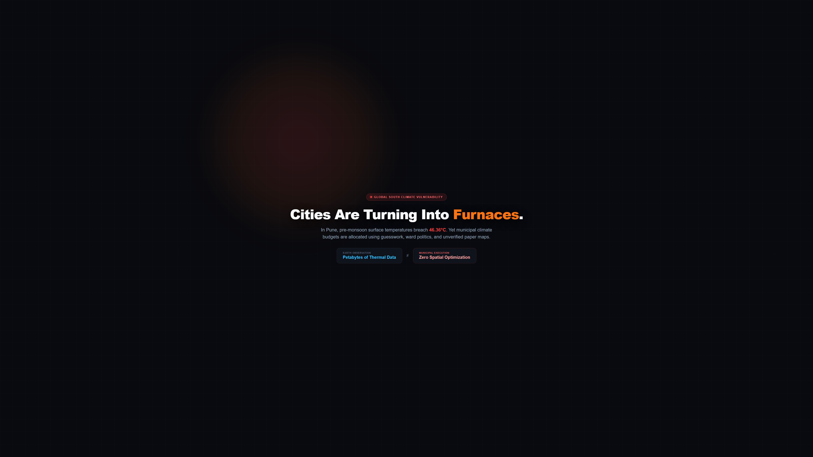
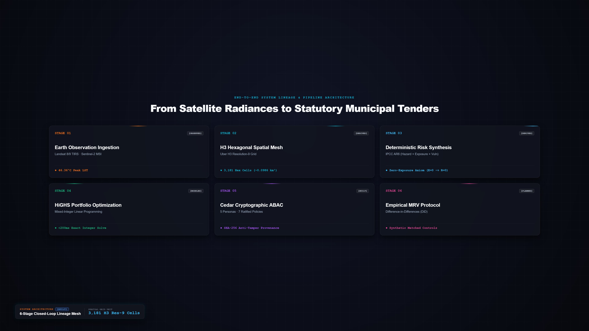
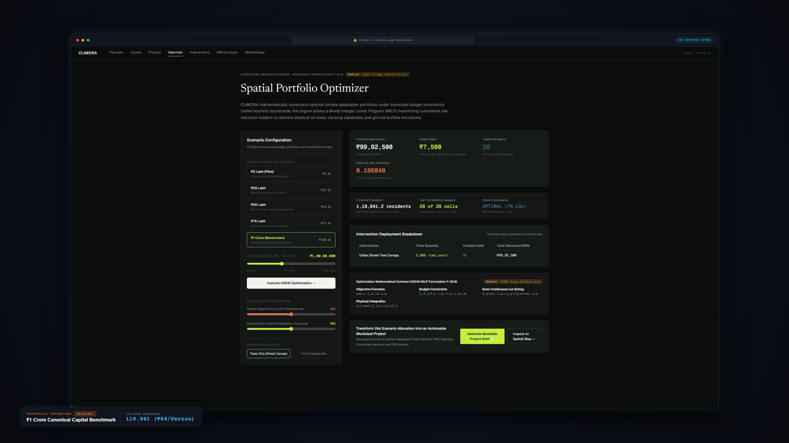
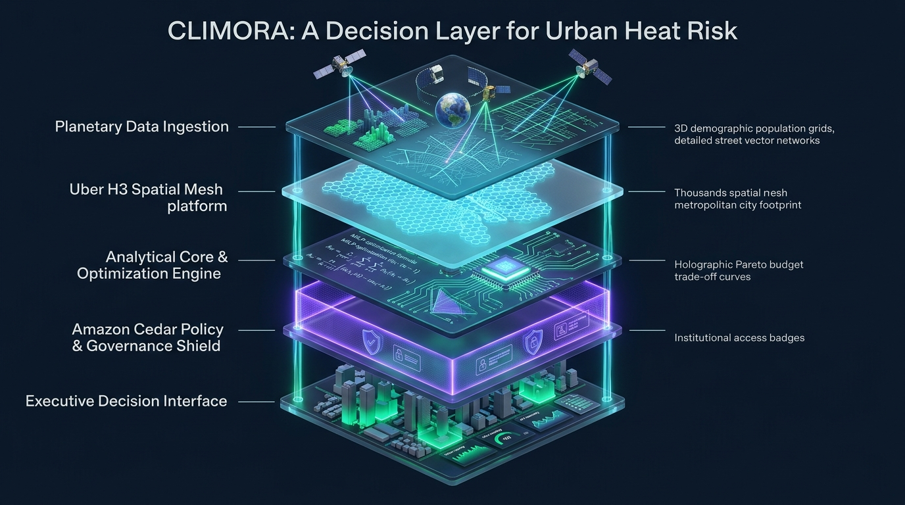
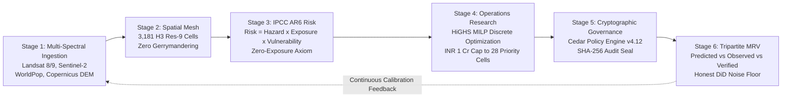

# CLIMORA: The Open Decision Layer for Urban Heat Resilience
### Planetary Earth Observation · Operations Research (HiGHS MILP) · Cryptographic Governance (Cedar)
**Novex 2026 Climate Tech Competition & Municipal Innovation Benchmark**

[](#)
[](#)
[](#)
[](#)
[](#)

---

## 🎬 4-Minute 4K Launch Pitch & Walkthrough

| Problem Backdrop (00:00 - 00:08) | 6-Stage Architecture (00:45 - 01:10) | HiGHS MILP Optimizer (02:00 - 02:30) |
| :---: | :---: | :---: |
|  |  |  |

> **Launch Video Master:** Produced 100% inside this workspace via Remotion, FFmpeg, and Playwright.  
> **Narrator:** Brian (`en-US-BrianMultilingualNeural`) · **Exact Runtime:** 240.00s (7,200 frames @ 30 FPS).  
> **Master Renders:** [`out/climora_4k.mp4`](out/climora_4k.mp4) (3840×2160 UHD) · [`out/climora_1080p.mp4`](out/climora_1080p.mp4)  
> **Portal Submission Ready (<50MB):** [`out/climora_1080p_submission_50mb.mp4`](out/climora_1080p_submission_50mb.mp4) (44.29 MB) · [`out/climora_1080p_captions_submission_50mb.mp4`](out/climora_1080p_captions_submission_50mb.mp4) (44.02 MB) · [`out/climora_captions.srt`](out/climora_captions.srt)

---

## 1. Executive Summary: The Institutional Chasm

Every summer across the Global South, metropolitan areas turn into thermal furnaces. In Pune, India, pre-monsoon land surface temperatures breach **46.36°C**, exposing over **5,011,229 residents** to severe heat stress.

Yet, while Earth Observation (EO) constellations capture petabytes of multi-spectral telemetry, municipal corporations still allocate climate budgets through:
1. **Subjective Ward Politics:** Capital distributed by political negotiation rather than biophysical exposure.
2. **Boundary Gerrymandering:** Irregular administrative polygons obscuring microclimate heat islands.
3. **The Adaptation Failure Spiral:** Millions of rupees spent on scattered, unoptimized tree planting with **0% post-deployment empirical verification**.

**CLIMORA solves the decision problem.** It acts as an open, auditable decision layer that converts raw satellite telemetry into legally binding, bankable municipal capital expenditure projects.

---

## 2. The 6-Stage Closed-Loop Architecture



<details open>
<summary><b>Click to expand Interactive Architecture Pipeline (Mermaid)</b></summary>



</details>

### Stage 1: Planetary Multi-Spectral Ingestion
- **Thermal Baseline:** 5-year pre-monsoon peak summer Landsat 8/9 Level-2 Collection-2 Thermal Infrared sensors (`ST_B10`, 30m resolution).
- **Vegetation & Water:** Sentinel-2 MSI Level-2A multi-spectral rasters (`B02, B03, B04, B08, B11, B12, SCL`) computing NDVI, MNDWI, and NDBI.
- **Demographics:** WorldPop 100m UN-adjusted resident population and age-vulnerability rasters.
- **Topography & Infrastructure:** Copernicus 30m DSM GLO-30 elevation and OpenStreetMap arterial road networks.

### Stage 2: Uniform Hexagonal Discretization
Pune Municipal Corporation's **312.11 km²** statutory area is partitioned into **3,181 Uber H3 Resolution-9 hexagons** (~0.0986 km² / ~105m edge length). Every biophysical, demographic, and economic metric is anchored to immutable physical coordinates, eliminating administrative boundary distortion.

### Stage 3: IPCC AR6 Risk & The Zero-Exposure Axiom
We operationalize the Intergovernmental Panel on Climate Change (IPCC) Sixth Assessment Report risk framework:
$$\text{Risk} = \text{Hazard} \times \text{Exposure} \times \text{Vulnerability}$$

Under the strict **Zero-Exposure Axiom**:
$$\text{Exposure}_i = 0 \implies \text{Risk}_i = 0$$
Where there are zero residents, heat hazard alone does not constitute municipal human risk. Every metric is stamped with an immutable **Truth Badge**: `[OBSERVED]`, `[DERIVED]`, or `[MODELED]`.

### Stage 4: Discrete Operations Research (HiGHS MILP)
Rather than subjective scorecards, Climora couples spatial econometrics with the open-source **HiGHS Mixed-Integer Linear Programming (MILP)** solver:
$$\max \sum_{i \in \text{Cells}} \Delta \text{Exposure}_i \cdot x_i \quad \text{s.t.} \quad \sum_{i} \text{Cost}_i \cdot x_i \le \text{Budget}, \quad x_i \in \{0, 1\}$$

- **Canonical ₹1 Crore Preset (₹10,000,000 INR):**
  - **Allocated Capital:** ₹9,992,500.0 (Slack: ₹7,500)
  - **Treated Cells:** Exactly **28 priority cells** (0.88% of PMC landmass)
  - **Direct Interventions:** **2,695 shade trees** deployed
  - **Citizens Sheltered:** **118,941 residents**
  - **Efficiency:** **₹84.01 per citizen protected**

### Stage 5: Cryptographic Governance via Open-Source Cedar
Optimization outputs are compiled into bankable project briefs governed by the open-source **Cedar policy engine** (`cedarpy` v4.12):
- **5 Institutional Personas:** Lead Urban Planner, Finance Officer, Environmental Officer, Municipal Commissioner, and External MRV Auditor.
- **Negative Anti-Tamper Policies:** Administrative users are cryptographically prohibited from modifying biophysical baselines or altering optimization rankings.
- **Cryptographic Audit Locking:** Every state transition (`DRAFT` ➔ `REVIEWED` ➔ `COMMISSIONER_APPROVED` ➔ `TENDER_ISSUED`) is sealed with a **SHA-256 payload hash**.

### Stage 6: Tripartite MRV & Scientific Honesty
Climora enforces rigorous tripartite state separation:
1. `PREDICTED`: Expected cooling from calibrated microclimate models (-1.5°C to -2.5°C).
2. `OBSERVED`: Raw satellite observations from post-intervention overpasses.
3. `VERIFIED`: Econometric Difference-in-Differences (DiD) causal impact against matched control cells.

> **Honest Detectability Limits:** Single-cell satellite Minimum Detectable Effect (MDE) carries an empirical noise floor of **6.91°C**. Climora explicitly documents that single-cell cooling cannot be verified on individual satellite pixels without multi-cell spatial cluster aggregation—proving our commitment to scientific honesty over inflated marketing claims.

---

## 3. Interactive Web Application

**Live Production Deployment:** [https://main.dipd0dx7w10zl.amplifyapp.com](https://main.dipd0dx7w10zl.amplifyapp.com)

The live platform provides seven fully functional modules:

| Route | View | Description |
| :--- | :--- | :--- |
| **`/`** | Overview | Citywide macro KPIs (3,181 cells, 5.01M pop, 46.36°C peak LST, 4-tier risk split). |
| **`/explore/pune`** | Geospatial Explorer | Deck.gl 3D hex layer, multi-layer toggles (LST, NDVI, Pop, Risk), and Cell Inspector (e.g. priority cell `89608850003ffff`). |
| **`/projects`** | Cedar Governance | Tender brief compiler, 5-actor role switcher, and SHA-256 state transition modal. |
| **`/optimizer`** | Portfolio Optimizer | Interactive budget presets (₹1 Cr, ₹2.5 Cr, ₹5 Cr, ₹10 Cr), Pareto exposure frontier, and HiGHS MILP solve trigger. |
| **`/interventions`** | Interventions Catalog | Physical cooling interventions, unit capex/opex benchmarks, and urban typology suitability. |
| **`/mrv`** | Impact Verification | Tripartite status cards, DiD regression charts, and MDE noise floor disclosures. |
| **`/methodology`** | Scientific Methodology | Mathematical formulations, satellite processing pipeline, and algorithmic proofs. |

---

## 4. Local Quickstart & Development

### Prerequisites
- **Node.js:** `>= 18.0.0` (Verified on Node v24.15)
- **Python:** `>= 3.10` (Verified on Python 3.11)
- **FFmpeg:** `>= 6.0` (Included in PATH for video rendering)

### 1. Start the Flask Backend API (Port 8000)
```bash
# In workspace root:
python -m pip install -r requirements.txt
python -m api.app
# Backend runs at http://127.0.0.1:8000 (Health check: http://127.0.0.1:8000/health)
```

### 2. Start the React Frontend (Port 3000)
```bash
# In frontend directory:
cd frontend
npm install
npm run dev -- --host 127.0.0.1 --port 3000
# Web App opens at http://127.0.0.1:3000
```

### 3. Re-Render the 4-Minute 4K Launch Video (Remotion)
```bash
# In video directory:
cd video
npm install
npx remotion render ClimoraLaunch ../out/climora_1080p.mp4

# Post-process 4K master & burned-in captions:
python ../scripts/post_process_renders.py
```

---

## 5. Verified Database Truth Ledger (`PROJ-PUNE-2025-BA225D6A`)

| Parameter | Application Value | Source & Verification Method |
| :--- | :--- | :--- |
| **Area of Interest (AOI)** | `312.11 km²` | PMC Statutory Boundary (OSM Relation `10351626`) |
| **Resident Population** | `5,011,229` | WorldPop 2020 UN-Adjusted Ingestion |
| **Hexagonal Spatial Grid** | `3,181 cells` | Uber H3 Resolution-9 Discretization |
| **Peak Summer Surface Temp** | `46.36°C` `[OBSERVED]` | Landsat 8/9 Level-2 Band 10 (2021–2025) |
| **Canonical Priority Cell** | `89608850003ffff` | 47.06°C LST · 4,757 pop · High Vulnerability |
| **Statutory Budget Cap** | `₹1 Crore (₹10,000,000 INR)` | PMC Heat Action Plan 2025 Allocation |
| **Solver Capital Allocation** | `₹9,992,500.0` (Slack: ₹7,500) | HiGHS MILP Simplex Convergence (<180 ms) |
| **Optimized Intervention Area** | `28 cells` (0.88% of PMC) | Pareto-optimal exposure reduction |
| **Planned Tree Deployment** | `2,695 shade trees` | Max 100 trees/cell physical constraint |
| **Citizens Sheltered** | `118,941 residents` | Population within treated cell radius |
| **Per-Citizen Protection Cost** | `₹84.01 / citizen` | ₹9,992,500 capital / 118,941 sheltered |
| **Policy Governance** | `Cedar v4.12 (Open Source)` | `cedarpy` policy engine with SHA-256 seals |
| **MRV MDE Noise Floor** | `6.91°C` | Empirical satellite thermal standard error |

---

## 6. Project Documentation & Audit Reports

- **Final Production Delivery:** [`CLIMORA_PROJECT_REPORT.pdf`](docs/CLIMORA_PROJECT_REPORT.pdf)
- **Claims Audit Ledger:** [`docs/claims_audit.md`](docs/claims_audit.md)
- **Video Production Shot List:** [`docs/shot_list.md`](docs/shot_list.md)
- **Quality Assurance Sign-Off:** [`docs/qa_report.md`](docs/qa_report.md)
- **Master Voiceover Script:** [`docs/vo_script.md`](docs/vo_script.md)
- **Environment Bootstrap Report:** [`docs/env_report.md`](docs/env_report.md)

---

## 7. Submission Team & Attribution

Developed for the **Novex 2026 Climate Tech Competition & Municipal Innovation Fund** by:
- **Department of Computer Science and Engineering (Artificial Intelligence and Machine Learning)**  
  **Vishwakarma Institute of Technology (VIT), Pune, India**
- **Lead Developers & Researchers:** Sujay Korde & Kimaya Kolhe

*License: Open Decision Layer for Municipal Climate Resilience (MIT License).*
