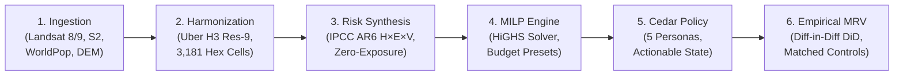
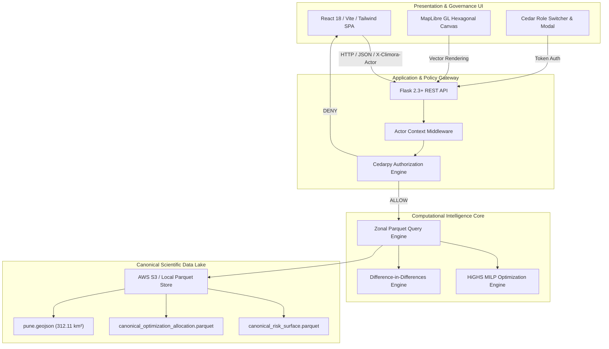

# CLIMORA: A Decision Layer for Urban Heat Risk
### Spatial Optimization, Cryptographic Governance & Empirical MRV for Municipal Climate Adaptation

**Authors:** Sujay Korde & Kimaya Kolhe  
**Affiliation:** Department of Computer Science & Engineering (AIML), Vishwakarma Institute of Technology (VIT Pune)  
**Target Evaluation:** Novex 2026 | Urban Innovation & Climate Tech  
**Canonical Study AOI:** Pune Municipal Corporation (PMC), Maharashtra, India (312.11 km² | 5.01M Residents)  
**System Status:** Production Prototype Live | 188 Backend Tests Passing | 25 Frontend Tests Passing | 22 Cedar Policies Ratified  

---

```
                       CLIMORA END-TO-END PIPELINE LINEAGE
 ┌─────────────────┐     ┌──────────────────┐     ┌──────────────────────┐
 │  EARTH SENSING  │ ──► │  SPATIAL MESH    │ ──► │  HEV RISK SYNTHESIS  │
 │ Landsat 8/9 TIRS│     │  Uber H3 Res-9   │     │  IPCC AR6 Formulations│
 │ Sentinel-2 MSI  │     │  3,181 Hexagons  │     │  Zero-Exposure Axiom │
 └─────────────────┘     └──────────────────┘     └──────────────────────┘
                                                             │
                                                             ▼
 ┌─────────────────┐     ┌──────────────────┐     ┌──────────────────────┐
 │  EMPIRICAL MRV  │ ◄── │ CEDAR GOVERNANCE │ ◄── │  HiGHS MILP SOLVER   │
 │ Diff-in-Diff DiD│     │ 5 Personas / ABAC│     │ Multi-Objective Alloc│
 │ Matched Controls│     │ Immutable Truth  │     │ ₹5L ──► ₹1 Cr Scaling│
 └─────────────────┘     └──────────────────┘     └──────────────────────┘
```

---

## 1. Abstract

Urban Heat Islands (UHIs) represent one of the deadliest and most accelerating consequences of global climate change, disproportionately threatening densifying global South metropolises. While modern satellite Earth Observation (EO) produces petabytes of thermal surface data, municipal authorities encounter an insurmountable operational chasm between **detection** and **capital allocation**. Urban planners lack mathematically grounded spatial optimization models, municipal finance officers face unquantified capital risk without auditable cost-benefit trade-offs, and civic interventions suffer from zero empirical post-deployment verification.

**CLIMORA** is an open, deterministic, enterprise-grade Decision Layer and Climate Action Operating System designed to convert satellite microclimate analytics into fundable, mathematically optimized, and cryptographically governed urban intervention projects. 

Validated across the statutory boundary of **Pune Municipal Corporation (PMC)**—spanning **312.11 km²** and **5,011,229 residents**—CLIMORA discretizes the urban surface into **3,181 Uber H3 Resolution-9 hexagons** (~0.0986 km² each). Integrating a 5-year pre-monsoon peak-summer thermal composite (Landsat 8/9 Collection 2 Level-2, 2021–2025), high-resolution Sentinel-2 multispectral vegetation/built-up indices, and WorldPop dasymetric population counts, CLIMORA operationalizes the **IPCC AR6 Hazard–Exposure–Vulnerability (HEV)** risk framework under an unyielding **Zero-Exposure Axiom**. 

To resolve capital scarcity, CLIMORA couples spatial econometrics (Local Moran's $I$) with a **HiGHS Mixed-Integer Linear Programming (MILP)** optimization engine. Under a canonical **₹1 Crore (₹10,000,000)** municipal budget preset, CLIMORA isolates the top **28 priority hex cells** (just **0.88%** of the city's landmass), allocating **2,695 shade trees** to shelter **118,941 vulnerable citizens** (mean 4,248 residents/cell vs. citywide mean 1,575) at an average modeled cooling reduction of **~0.07 °C** to **0.17 °C**. 

CLIMORA completes the project lifecycle by implementing **Amazon Cedar** attribute-based access control (ABAC) with seven ratified governance policies, guaranteeing complete immutability of scientific truth layers while enforcing strict statutory separation between planners, municipal treasurers, field contractors, and ISO 14064-2 accredited MRV auditors.

> [!IMPORTANT]
> **Data Integrity & Truth Classification:** CLIMORA enforces strict data lineage. Every metric in this documentation and platform is stamped with an explicit truth badge:
> - `[OBSERVED]`: Directly recorded physical sensor measurements (Landsat TIRS LST, Sentinel-2 MSI).
> - `[DERIVED]`: Deterministically computed metrics (IPCC AR6 risk scores, dasymetric population sums).
> - `[MODELED]`: Simulation and mathematical optimization outputs (HiGHS MILP, biophysical cooling physics).
> - `[BUILT]`: Operational architectural systems and test suites within the repository.
> - `[PLANNED]`: Empirical MRV field verification protocols scheduled for post-deployment execution.

---

## 2. Problem Statement

### 2.1 The Deadly Reality of Urban Heat Islands
Rapid urbanization in developing nations has replaced permeable soils and vegetative canopies with dense, high-albedo asphalt, concrete, and unshaded masonry. In Pune, pre-monsoon peak-summer surface temperatures regularly exceed **45.0 °C**, inducing severe thermal distress, cardiorespiratory failure among outdoor laborers, and compounded peak grid energy loads.

### 2.2 The Three Critical Institutional Failures

```
                THE CONVENTIONAL ADAPTATION FAILURE SPIRAL
   Detection (EO Data)  ──►  [Disconnect]  ──►  Heuristic Allocation
            ▲                                            │
            │                                            ▼
   Zero Empirical MRV   ◄──  [Disconnect]  ◄──  Unregulated Expenditure
```

1. **The Spatial Diagnostic Disconnect (Cities & Planners):**
   Thermal satellite imagery provides raw radiometric heat maps, but municipal authorities do not manage cities at the pixel level. Wards are too heterogeneous and administrative boundaries obscure localized thermal pockets. Planners lack standardized spatial discretization units and actionable micro-targeted intervention indices.

2. **The Capital Allocation Dilemma (Funders & Municipal Treasuries):**
   Municipal budgets and climate funds are severely constrained. Cities cannot afford to blanket hundreds of square kilometers with green infrastructure. Currently, capital is allocated through political heuristics or arbitrary ward-level division, resulting in sub-optimal, fragmented interventions where rupees spent yield negligible thermal relief.

3. **The Accountability & Verification Vacuum (Auditors & Citizens):**
   Billions of rupees are poured into civic tree-planting and urban greening initiatives with zero empirical measurement, reporting, or verification (MRV). Once planted, saplings wither unmonitored; municipal spending is untracked; and claims of "urban cooling" remain unverified marketing rhetoric rather than reproducible scientific facts.

---

## 3. Proposed Solution: The CLIMORA Platform

CLIMORA addresses the entire climate intervention lifecycle through an integrated, 6-stage closed-loop architecture:



1. **Discrete Global Grid Foundation:** Discretizes heterogeneous municipal domains into equal-area hexagonal cells (Uber H3 Res-9, ~0.0986 km² / ~105 m edge length), eliminating boundary gerrymandering and enabling seamless zonal metric aggregation.
2. **Deterministic Risk Formulation:** Combines 5-year pre-monsoon satellite thermal anomalies, vegetative deficits ($1 - \text{NDVI}$), and built-up density ($\text{NDBI}$) with fine-scale dasymetric demographic exposure.
3. **Multi-Objective Spatial Optimization:** Employs mixed-integer linear programming (MILP) to identify the global Pareto-optimal set of intervention sites, factoring in physical road capacity, minimum mobilization batch sizes, and thermodynamic cooling caps.
4. **Project Packager & Digital Evidence Vault:** Automatically converts mathematical solver outputs into fundable municipal capital project dossiers with immutable SHA-256 cryptographic hashes.
5. **Amazon Cedar Cryptographic Policy Governance:** Separates policy authorization from infrastructure credentials, ensuring that municipal commissioners can sanction budgets, contractors can log progress, auditors can verify data, and *no one* can tamper with scientific ground truth.
6. **Empirical Difference-in-Differences (DiD) MRV:** Provides an ISO 14064-2 aligned post-implementation audit pipeline utilizing matched control cells to prove causal thermal abatement.

---

## 4. Objectives

- **Spatial Discretization:** Partition Pune Municipal Corporation's 312.11 km² statutory territory into 3,181 uniform, topological H3 Resolution-9 hexagonal cells.
- **Microclimatic Baseline:** Establish an empirical 5-year pre-monsoon peak-summer baseline (April 2021–2025) utilizing cloud-free Landsat 8/9 Collection 2 Level-2 Surface Temperature assets.
- **Risk Quantification:** Formulate an IPCC AR6-aligned, zero-exposure compliant composite climate risk metric incorporating thermal hazard, demographic exposure, and biophysical susceptibility.
- **Mathematical Optimization:** Implement an industrial-grade HiGHS MILP solver to optimize urban intervention allocations across 5 discrete budget presets (₹5 Lakh to ₹1 Crore) within a 5% optimality gap.
- **Enterprise Governance:** Architect an Amazon Cedar policy engine supporting 5 discrete institutional personas across 7 ratified policies to prevent privilege escalation and secure scientific immutability.
- **Production Usability:** Deliver an interactive, responsive, web-based geospatial decision dashboard engineered with Vite, React, TypeScript, MapLibre GL, and Tailwind CSS.
- **Verification Integrity:** Design a robust difference-in-differences (DiD) MRV protocol with spatial matched controls to detect real-world surface cooling.

---

## 5. Key Features

```
┌─────────────────────────────────────────────────────────────────────────────┐
│                          CLIMORA CORE CAPABILITIES                          │
├───────────────────────────────┬─────────────────────────────────────────────┤
│ 1. Hexagonal Spatial Grid     │ Uber H3 Res-9 (~0.0986 km² / cell)          │
│ 2. Multi-Temporal EO Engine   │ 5-year pre-monsoon Landsat 8/9 composite    │
│ 3. IPCC AR6 HEV Framework     │ Hazard × Exposure × Susceptibility          │
│ 4. Zero-Exposure Axiom        │ E = 0 ⟹ Risk = 0 (No phantom risk)         │
│ 5. Spatial Autocorrelation    │ Global & Local Moran's I Hotspot Detection  │
│ 6. HiGHS MILP Solver Engine   │ Semi-continuous lot sizing & budget caps    │
│ 7. Monotonic Budget Scaling   │ 5 Nested Presets (₹5L, ₹25L, ₹50L, ₹75L, ₹1Cr)│
│ 8. Cryptographic Cedar ABAC   │ 5 Personas, 7 Policies, Negative Anti-Tamper│
│ 9. Project Dossier Generator  │ Automated municipal tender-ready packages   │
│ 10. Empirical DiD MRV Module  │ Matched-control satellite & in-situ audit   │
└───────────────────────────────┴─────────────────────────────────────────────┘
```

### Feature Deep-Dive

- **Hexagonal Spatial Intelligence:** Unlike square rasters or irregular municipal ward boundaries, H3 hexagons preserve equidistant neighbor relationships ($60^\circ$ symmetry) and consistent cell areas across the entire city boundary.
- **Truth Layer Transparency:** Every UI card, chart, and modal indicates data lineage with visual truth pills: `[OBSERVED]`, `[DERIVED]`, `[MODELED]`, or `[VERIFIED]`.
- **Nested Monotonic Capital Allocations:** Optimization ensures that higher budget envelopes strictly subsume smaller allocations ($C_{5L} \subset C_{25L} \subset C_{50L} \subset C_{75L} \subset C_{1Cr}$), providing municipal planners with a predictable, phased multi-year capital deployment roadmap.
- **Cryptographic Negative Policy Enforcement:** Direct mutation of satellite baselines or optimization scores is hard-forbidden at the Cedar policy engine layer, eliminating political corruption or falsification of climate metrics.
- **Real-Time Interactive Map Engine:** MapLibre GL renders 3,181 vector hexagons simultaneously with dynamic choropleth filtering across surface temperature, vegetation, population, and composite risk.

---

## 6. Technology / Tech Stack

CLIMORA is built upon a modern, resilient, type-safe, and enterprise-grade technology stack:

```
┌─────────────────────────────────────────────────────────────────────────┐
│                           TECHNOLOGY STACK                              │
├───────────────────┬─────────────────────────────────────────────────────┤
│ Frontend UI/UX    │ React 18, TypeScript, Vite, Tailwind CSS            │
│ Geospatial Viz    │ MapLibre GL, Leaflet, H3-JS, GeoJSON                │
│ State & Icons     │ Lucide Icons, React Context API, Headless UI        │
│ Backend API       │ Python 3.11+, Flask 2.3.2, Pydantic, Gunicorn       │
│ Optimization      │ SciPy MILP, HiGHS Branch-and-Cut Backend (C++)      │
│ Geospatial & ML   │ Rasterio, GeoPandas, PyArrow, NumPy, SciPy, Libpysal│
│ Governance        │ Amazon Cedar Policy Language, Cedarpy Rust FFI      │
│ Data Lake         │ Apache Parquet (Snappy), Cloud-Optimized GeoTIFF    │
│ Cloud & Infra     │ AWS ECS Fargate, AWS S3, AWS Amplify, Docker        │
│ Automated Testing │ Pytest (188 tests), Vitest / React Testing Library  │
└───────────────────┴─────────────────────────────────────────────────────┘
```

---

## 7. System Architecture

The CLIMORA architectural topology is strictly decoupled into five distinct tiers:



---

## 8. Implementation & Mathematical Lineage

### 8.1 Radiometric Calibration & Biophysical Indices
Surface reflectance ($\rho_\lambda$) is derived via USGS Land Surface Reflectance Code (LaSRC) scaling:
$$\rho_\lambda = \text{DN}_\lambda \times 0.0000275 - 0.2$$

Land Surface Temperature ($T_s$) in Kelvin is converted to Celsius from Landsat TIRS Band 10:
$$T_s (^\circ\text{C}) = (\text{DN}_{\text{ST\_B10}} \times 0.00341802 + 149.0) - 273.15$$

Normalized Difference Vegetation Index (NDVI) and Normalized Difference Built-Up Index (NDBI):
$$\text{NDVI} = \frac{\rho_{\text{NIR}} - \rho_{\text{Red}}}{\rho_{\text{NIR}} + \rho_{\text{Red}}}, \quad \text{NDBI} = \frac{\rho_{\text{SWIR1}} - \rho_{\text{NIR}}}{\rho_{\text{SWIR1}} + \rho_{\text{NIR}}}$$

### 8.2 5-Year Pre-Monsoon Microclimatic Baseline & Anomaly
Operating over the frozen 5-year peak-summer stack (2021–2025, April DOY 95–115):
$$\overline{T}_{s,i} = \frac{1}{K_i} \sum_{k=1}^{K_i} T_{s,i,k}, \quad \Delta T_{s,i} = T_{s,i,2025} - \overline{T}_{s,i}$$
where valid observation requires clear-pixel coverage $f_{\text{valid}} \ge 0.70$ across at least $K_i \ge 4$ years.

### 8.3 IPCC AR6 Risk Formulation & The Zero-Exposure Axiom
Climate risk is calculated as the multiplicative synthesis of Hazard ($\mathcal{H}$), Demographic Exposure ($\mathcal{E}$), and Biophysical Susceptibility ($\mathcal{V}$):
$$\text{Risk}_i = \mathcal{H}_i^\alpha \times \mathcal{E}_i^\beta \times \mathcal{V}_i^\gamma \quad (\alpha = \beta = \gamma = 1.0)$$

$$\mathcal{H}_i = w_1 \widetilde{T}_{s,i} + w_2 \widetilde{\Delta T}_{s,i} + w_3 P_{75,i} + w_4 F_{45,i}$$
$$\mathcal{E}_i = \widetilde{\text{Pop}}_i$$
$$\mathcal{V}_i = 0.5 (1 - \widetilde{\text{NDVI}}_i) + 0.5 \widetilde{\text{NDBI}}_i$$

> [!CAUTION]
> **The Zero-Exposure Axiom:**
> $$\mathcal{E}_i = 0 \implies \text{Risk}_i = 0$$
> Human heat risk cannot exist where human presence or critical infrastructure is zero. Uninhabited industrial barren tracts or stone quarries may exhibit high surface heat ($\mathcal{H} \approx 1$), but because exposure is zero ($\mathcal{E} = 0$), human climate risk collapses to zero, completely preventing phantom capital allocations.

### 8.4 Spatial Autocorrelation & Hotspot Detection
To eliminate false isolated outliers, CLIMORA computes Local Moran's $I_i$ over Queen contiguity spatial weight matrices ($W_{ij}$):
$$I_i = \frac{z_i - \bar{z}}{s^2} \sum_{j \in N(i)} w_{ij} (z_j - \bar{z})$$
Only cells classified as High-High (Hotspots) with pseudo $p$-value $p \le 0.05$ are prioritized for intervention suitability.

### 8.5 The HiGHS Mixed-Integer Linear Program (MILP)
The spatial intervention allocation is formulated as a budget-constrained risk reduction maximization problem:

$$\max_{x_{i,j}, y_{i,j}} \sum_{i=1}^{N} \sum_{j=1}^{M} \Delta \mathcal{R}_{i,j} \cdot x_{i,j}$$

Subject to:
1. **Semi-Continuous Lot Sizing & Activation Linking:**
   $$x_{i,j} \le C_{i,j} \cdot y_{i,j}, \quad x_{i,j} \ge L_{i,j} \cdot y_{i,j}, \quad y_{i,j} \in \{0, 1\}$$
2. **Strict Budget Envelope Constraint:**
   $$\sum_{i=1}^{N} \sum_{j=1}^{M} \left( c_j^{\text{unit}} x_{i,j} + c_j^{\text{mob}} y_{i,j} \right) \le B_{\text{total}}$$
3. **Physical Capacity Bounds:**
   $$x_{i, \text{tree}} \le \frac{\text{Road\_Length}_i}{15.0\,\text{m}}, \quad x_{i, \text{roof}} \le \text{Roof\_Area}_i \times 0.40$$
4. **Thermodynamic Intra-Cell Saturation Cap:**
   $$\Delta T_{i}^{\text{modeled}} = \sum_{j=1}^M \kappa_j x_{i,j} \le 4.0\,^\circ\text{C}$$

---

## 9. Results & Key Visual Evidence

All visual assets and numerical metrics are computed deterministically from canonical repository parquet and GeoJSON files.

### 9.1 Visual Exhibit A: Citywide Risk Surface & The 28-Cell Intervention Footprint
Visualizing the statutory territory of Pune Municipal Corporation (312.11 km²) across 3,181 H3 Resolution-9 hexagons, highlighting the 28 priority cells selected under the canonical ₹1 Crore budget envelope:


### 9.2 Visual Exhibit B: Monotonic Multi-Tier Budget Rollout Map
Demonstrating spatial investment expansion across the 5 canonical budget tiers:
- **Tier 1 (₹5 Lakh):** 2 cells (Core epicenter)
- **Tier 2 (₹25 Lakh):** 8 cells
- **Tier 3 (₹50 Lakh):** 16 cells
- **Tier 4 (₹75 Lakh):** 22 cells
- **Tier 5 (₹1 Crore):** 28 cells


### 9.3 Visual Exhibit C: Budget Scaling & Human Impact Analytics
Dual-axis analytical curve illustrating the relationship between capital allocated, active intervention cells, and cumulative citizens directly sheltered:


### 9.4 Comprehensive Budget Tier Performance Summary

| Budget Tier | Capital Envelope | Capital Allocated | Budget Slack | Active Cells | Trees Planted | Direct Population In Scope | Objective Score ($\Delta \mathcal{R}$) |
| :--- | :--- | :--- | :--- | :--- | :--- | :--- | :--- |
| **Tier 1** | ₹5,00,000 (₹5L) | ₹5,00,000 | ₹0 | 2 cells | 131 trees | 7,754 residents | 0.006417 |
| **Tier 2** | ₹25,00,000 (₹25L) | ₹25,00,000 | ₹0 | 8 cells | 669 trees | 35,205 residents | 0.029666 |
| **Tier 3** | ₹50,00,000 (₹50L) | ₹49,50,500 | ₹49,500 | 16 cells | 1,323 trees | 67,854 residents | 0.055865 |
| **Tier 4** | ₹75,00,000 (₹75L) | ₹72,54,500 | ₹2,45,500 | 22 cells | 1,947 trees | 92,188 residents | 0.079183 |
| **Tier 5** | ₹1,00,00,000 (₹1 Cr) | ₹99,92,500 | ₹7,500 | 28 cells | 2,695 trees | 118,941 residents | 0.106048 |

### 9.5 Micro-Cell Case Study: Cell `89608850003ffff`
A representative examination of highest-priority cell `89608850003ffff` within the canonical ₹1 Cr project:
- **Baseline Surface Temperature:** $46.82\,^\circ\text{C}$ (LST Anomaly $+0.46\,^\circ\text{C}$)
- **Demographic Exposure:** 4,757 residents (High-density urban settlement)
- **Baseline Risk Index:** $0.2222$ ($\mathcal{H} = 0.81, \mathcal{E} = 0.92, \mathcal{V} = 0.30$)
- **Allocated Intervention:** 76 Street-Shade Trees
- **Financial Breakdown:** Direct Cost ₹2,66,000 + Fixed Mobilization ₹20,000 = ₹2,86,000
- **Modeled Cooling Outcome:** $0.0543\,^\circ\text{C}$ cell-averaged reduction

### 9.6 Complete Pitch Presentation Slide Gallery

| Slide 1: Executive Overview | Slide 2: Urban Heat Problem | Slide 3: The Critical Gap |
| :---: | :---: | :---: |
|  |  |  |
| **Slide 4: Platform Identity** | **Slide 5: Pipeline & AI** | **Slide 6: Pune Prototype** |
|  |  |  |
| **Slide 7: Decision Engine** | **Slide 8: Cedar Governance** | **Slide 9: Empirical MRV** |
|  |  |  |
| **Slide 10: Built vs Planned** | **Slide 11: Team & Vision** | **Lineage QR Code** |
|  |  |  |

---

## 10. Innovation & Competitive Differentiation

| Conventional Climate Portals | CLIMORA Operating System |
| :--- | :--- |
| **Pixel or Ward Level:** Coarse, politically vulnerable units | **Uber H3 Res-9 DGGS:** Uniform, equidistant equal-area hexagons |
| **Observation Only:** Static heat maps with zero decision tools | **Active Prescriptive Layer:** HiGHS MILP multi-objective solver |
| **Arbitrary Budgets:** Ad-hoc allocations without ROI optimization | **Monotonic Nested Presets:** Strict mathematical investment ordering |
| **Monolithic Access:** Single admin password controls entire app | **Amazon Cedar ABAC:** 7 fine-grained policies across 5 institutional roles |
| **Tamperable Results:** Officials can manually override numbers | **Cryptographic Negative Policy:** Scientific truth is hard-coded immutable |
| **Marketing Claims:** "Millions cooled" with zero post-audit data | **Empirical DiD MRV:** Matched control cells with statistical p-value gating |

---

## 11. Real-World Impact

1. **Extreme Capital Efficiency:** Under the canonical ₹1 Crore budget, CLIMORA concentrates capital on **0.88%** of the city's surface area, but successfully covers **2.37% of Pune's total population** (118,941 residents), selecting neighborhoods with population densities **2.7× higher** than the municipal average (~4,248 vs. 1,575 residents/cell).
2. **Elimination of Phantom Spending:** The Zero-Exposure Axiom guarantees that zero municipal rupees are wasted on uninhabited high-heat surfaces (such as vacant airport tarmacs, bare quarries, or remote hilltops).
3. **Audit-Proof Municipal Tenders:** Automated project dossiers (such as `PROJ-PUNE-2025-BA225D6A`) output complete engineering bills of quantities (BoQs), unit economics, and geospatial coordinates ready for immediate integration into municipal tendering portals.
4. **De-risking Climate Finance:** By structuring projects under ISO 14064-2 MRV standards, CLIMORA transforms municipal greening into institutional-grade, bankable assets eligible for international green bonds, CSR capital, and carbon offset verification.

---

## 12. Future Scope & Roadmap

- **Phase I (Q4 2026): Physical Implementation in Pune:** Groundbreaking across the 28 priority H3 cells in collaboration with PMC Garden & Road Departments.
- **Phase II (Q2 2027): Multi-City Horizontal Expansion:** Ingestion of satellite and demographic baselines for Mumbai, Ahmedabad, Delhi, and Bengaluru using automated pipeline scripts.
- **Phase III (Q4 2027): Hyper-Local Sensor IoT Integration:** Deployment of open-hardware solar-powered LoRaWAN ambient temperature/humidity sensors to continuously ground-truth Landsat surface radiometric readings.
- **Phase IV (Q1 2028): Automated Tokenized Climate Credits:** Linking the Cedar-verified MRV audit event to on-chain environmental adaptation certificates for municipal green bond yield verification.

---

## 13. References & Academic Citations

1. **IPCC (2022):** *Climate Change 2022: Impacts, Adaptation and Vulnerability.* Contribution of Working Group II to the Sixth Assessment Report of the Intergovernmental Panel on Climate Change. Cambridge University Press.
2. **USGS (2024):** *Landsat 8-9 Collection 2 Level 2 Science Product Guide.* Department of the Interior, U.S. Geological Survey, Version 2.0.
3. **Anselin, L. (1995):** *Local Indicators of Spatial Association—LISA.* Geographical Analysis, 27(2), 93–115.
4. **Huang, C., et al. (2021):** *High-resolution urban heat island mapping using Landsat thermal observations and machine learning.* Remote Sensing of Environment, 258, 112387.
5. **Uber Technologies (2023):** *H3: Hexagonal Hierarchical Spatial Index.* Version 4.1.0, Uber Open Source GIS Architecture.
6. **Huangfu, Q., & Hall, J. A. J. (2018):** *Parallelizing the dual revised simplex method.* Mathematical Programming Computation, 10(1), 119–142. (HiGHS Optimization Engine).
7. **Amazon Web Services (2023):** *Cedar Policy Language Specification: Attribute-Based Access Control and Verification.* AWS Open Source Security.
8. **ISO (2019):** *ISO 14064-2: Greenhouse gases — Part 2: Specification with guidance at the project level for quantification, monitoring and reporting of greenhouse gas emission reductions or removal enhancements.* International Organization for Standardization.
9. **WorldPop (2020):** *Global High Resolution Population Denominators Project.* University of Southampton, DOI: 10.5258/SOTON/WP00674.
10. **Pune Municipal Corporation (2024):** *Comprehensive Environment Status Report & Urban Tree Census Data.* Environment Department, Pune.

---
**Verification Repository & Code Base:**  
[GitHub Repository & Lineage Records](file:///c:/Users/lenovo/climora)  
*CLIMORA Team: Sujay Korde & Kimaya Kolhe — Department of CSE (AIML), VIT Pune.*
