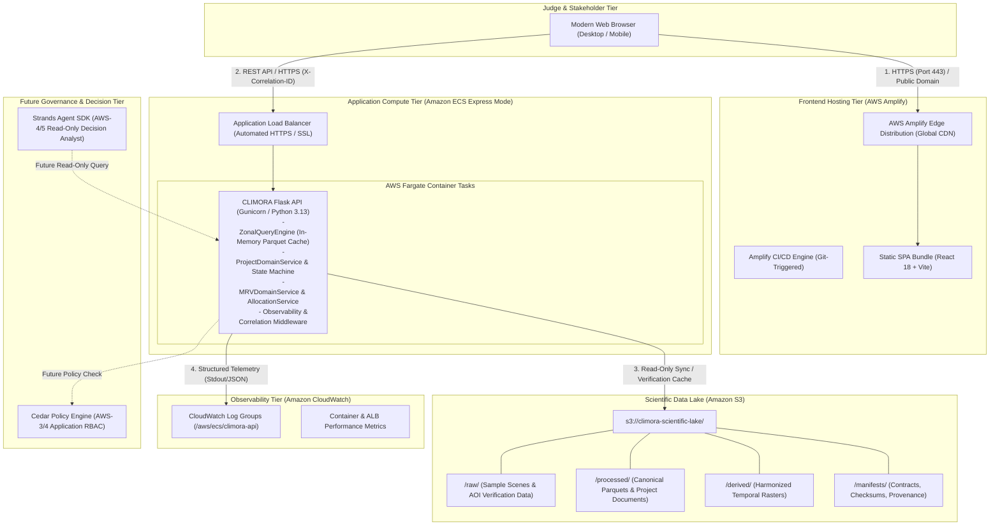
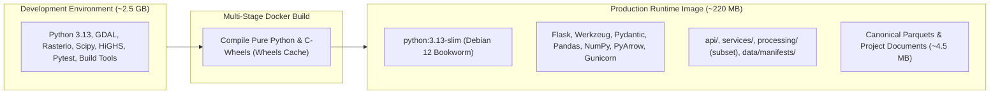
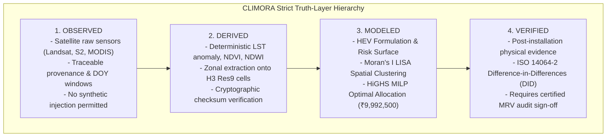
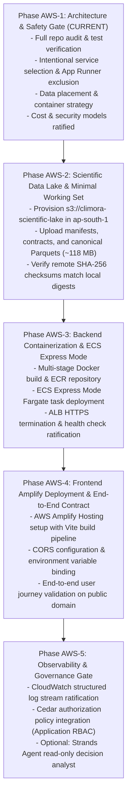

# CLIMORA — Phase AWS-1: Cloud Deployment Architecture & Safety Gate

**Status:** RATIFIED & PASSED  
**Date:** 2026-10-05  
**Author:** Principal Cloud Architect, Senior System Architect, AWS Hackathon Strategist & Scientific Platform Engineer  
**Classification:** Canonical Architecture Specification & Deployment Gate  
**Target Track:** AWS Hackathon — "Ship It" Track  
**Document Location:** `docs/architecture/aws/phase-aws-1-architecture-and-safety-gate.md`

---

## 1. Executive Architecture Decision

CLIMORA is transitioning from a localized environmental climate-risk intelligence prototype for Pune, Maharashtra, into a cloud-deployed, publicly demonstrable, and audit-grade web platform on Amazon Web Services (AWS). 

**Governing Premise:** This is **not** a greenfield redesign or a cloud-native re-platforming exercise. CLIMORA's scientific foundation—spanning H3 Resolution 9 analytical topology, Hazard-Exposure-Vulnerability (HEV) formulations, Moran's I spatial autocorrelation, Mixed-Integer Linear Programming (MILP) allocation, and ISO 14064-2 aligned Measurement, Reporting, and Verification (MRV)—is fully frozen and verified. AWS is adopted strictly where it provides concrete operational, availability, and governance value:

1. **Amazon S3** serves as the immutable scientific data lake, hosting verified GeoTIFFs, canonical Parquet artifacts, and cryptographic provenance manifests.
2. **Amazon ECS Express Mode (powered by AWS Fargate)** serves as the containerized backend runtime, hosting the existing Flask 2.3+ / Python 3.13 API service boundary without framework modification or scientific leakage.
3. **AWS Amplify Hosting** delivers the judge-facing React 18 / Vite / Leaflet single-page application with automated CI/CD and edge content distribution.
4. **Amazon CloudWatch** provides unified observability, capturing structured execution logs, correlation IDs, and operational health telemetry.
5. **Cedar (Planned Phase AWS-3/4)** will govern administrative state transitions, procurement sanctions, and verification gating at the application policy layer.
6. **Strands Agents SDK (Optional Phase AWS-4/5)** will act strictly as an evidence-grounded "CLIMORA Decision Analyst," restricted to read-only tool invocation.

All heavy, costly, and operationally gratuitous AWS services—including RDS, Aurora, DynamoDB, OpenSearch, NAT Gateways, Cognito, and EventBridge—are **explicitly rejected**. The estimated monthly cloud operational cost for this architecture is under **$20 - $35 USD**, with a zero-cost idle posture for static delivery and low-concurrency Fargate tasks.

---

## 2. Existing CLIMORA Architecture Audit

A forensic audit of the CLIMORA repository was performed prior to defining the cloud boundary. The findings establish the baseline for all deployment decisions.

### 2.1 Repository & Codebase Inventory
- **Analytical Core (`processing/`, `services/`):** Houses the mathematical formulation register (F-01 through F-26), the spatial weights matrix generator, the MILP solver engine (`scipy.optimize.milp` wrapping HiGHS), and the read-only `ZonalQueryEngine`.
- **API Service Boundary (`api/`):** Implemented in Flask 2.3.2 with Pydantic v2 request validation, high-resolution execution timing, correlation ID injection (`X-Correlation-ID`), structured logging, and automated OpenAPI 3.0 / Swagger UI documentation (`/docs`, `/openapi.json`).
- **Frontend SPA (`frontend/`):** React 18.3.1 with Vite 5.2, Leaflet 1.9, H3-js 4.1, and Lucide React. Implements strict truth-layer visualization (`OBSERVED`, `DERIVED`, `MODELED`, `VERIFIED`), quiet wayfinding navigation, and zero client-side recalculation.
- **Local Data Lake (`data/`):** Totaling **5.08 GB** across five subdirectories:
  - `data/aoi/` (29.9 KB): Statutory Pune administrative boundary (`pune.geojson`).
  - `data/manifests/` (2.1 MB, 22 files): Cryptographic checksums (`.sha256`), frozen dataset inventories, analytical contracts, and optimization manifests.
  - `data/derived/` (18.5 MB): Harmonized multi-year temporal LST anomaly and spectral rasters.
  - `data/processed/` (97.7 MB): Canonical Parquets, GeoTIFFs, and bankable project proposal documents.
  - `data/raw/` (4.97 GB): Multi-sensor raw satellite granules (Landsat 8/9, Sentinel-2, MODIS, Copernicus DEM, NASA POWER, OSM).

### 2.2 Canonical Demonstration Values (FROZEN)
The following canonical demonstration values are mathematically bound to the Pune prototype and verified by automated regression tests. They cannot be altered during or after cloud migration:

| Parameter | Canonical Value | Verification Source |
| :--- | :--- | :--- |
| **Project Identifier** | `PROJ-PUNE-2025-BA225D6A` | `project_pune_2025_tree_shade_10m.json` |
| **Optimization Run ID** | `OPT-PUNE-2025-SCENARIO-BA225D6A` | `optimization_run_manifest.json` |
| **Selected H3 Cells** | `28` cells (Resolution 9) | `canonical_optimization_allocation.parquet` |
| **Street Tree Allocation** | `2,695` trees | Section 5 Physical Scope |
| **Unit Planting Cost** | `₹3,500` / tree | Formulations F-24.1 & F-24.3 |
| **Mobilization Overhead** | `₹20,000` / selected cell | ₹560,000 across 28 cells |
| **Total Modeled Cost** | `₹9,992,500` | Direct (₹9,432,500) + Mobilization (₹560,000) |
| **Scenario Budget Envelope** | `₹10,000,000` | Section 6 Transparent Cost Breakdown |
| **Unallocated Budget Slack** | `₹7,500` | Exact mathematical remainder |
| **In-Scope Human Population** | `118,941.21` (Display: `118,941`) | WorldPop 2020 zonal extraction |
| **Mathematical Objective Value** | `0.10604830270054796` | HiGHS MILP Solver Optimal Output |

> [!IMPORTANT]
> The optimization objective value `0.10604830270054796` represents the exact mathematical objective score achieved under the ₹10M budget envelope according to the ratified formulation. It is **not** a 10.6% physical ambient temperature drop, a 10.6% clinical heat morbidity reduction, or a 10.6% universal risk reduction. Preserving this semantic honesty is mandatory.

### 2.3 Canonical Parquet SHA-256 Checksums
The runtime `ZonalQueryEngine` audits the SHA-256 hash of all five canonical Parquet files at initialization and on query. Cloud deployment must preserve these identical bits:

```text
76f344b147b349f3887259f64c97923414c74fd9a97ec679844fb8d9109f7c01  canonical_feature_matrix.parquet
1970c2da7863f5771b223c2f265344129ea3f7ed1e5119ece98dc56e37fa2be9  canonical_hev_components.parquet
e2d5df6c7a0a9584367a623b0722e87f3f4340ea5ebf297cb5aaed6533da5677  canonical_risk_surface.parquet
47cc7025ef150aec3980928912e35c96c46da437efbbeccfe1fc142321315bbd  canonical_spatial_autocorrelation.parquet
2519473a32a2b4a3a22bc8beb43525c3f21dc404783168f1edd6de7bc4bb5555  canonical_optimization_allocation.parquet
```

### 2.4 Test Suite Baseline
- **Backend Tests:** 160 passing tests across 14 test modules in 80.27 seconds (`pytest tests/ -v`).
- **Frontend Tests:** 13 passing unit/integration tests across 6 test suites in 1.79 seconds (`vitest run`).
- **Frontend Production Build:** Clean compilation with `tsc && vite build` (gzip bundle size: 178.6 kB JS, 1.13 kB CSS).

---

## 3. Target AWS Architecture



---

## 4. Service-by-Service Intentional Justification

Every service included in CLIMORA's target architecture was subjected to the **Seven-Factor Intentional AWS Service Test**. Services that failed any factor were removed.

### 4.1 Amazon S3 (Scientific Data Lake)
1. **Problem:** Scientific credibility requires immutable, publicly verifiable, and cryptographically signed data assets that outlive transient compute instances.
2. **Existing alternative:** Local filesystem storage (`c:\Users\lenovo\climora\data\`). Accessible only on the developer workstation.
3. **AWS benefit:** Durable (99.999999999%), versioned, publicly verifiable scientific artifacts with Content-MD5 and SHA-256 verification.
4. **Hackathon value:** Demonstrates to judges that CLIMORA treats geospatial datasets and mathematical models as serious institutional assets with verifiable provenance.
5. **Operational cost:** ~$0.023/GB-month. For CLIMORA's ~120 MB working set, storage cost is approximately **$0.003/month**.
6. **Failure mode:** Transient S3 API downtime. Mitigated by container-level local caching of the 5 canonical Parquet files at startup.
7. **Exit strategy:** Full local execution remains functional; paths default to `./data` if `S3_BUCKET` is unset.

### 4.2 Amazon ECS Express Mode / ECS on Fargate (Backend API)
1. **Problem:** The existing Python/Flask API must run in a secure, containerized, always-accessible public cloud environment without rewriting route handlers or altering query performance.
2. **Existing alternative:** Local developer invocation (`python -m api.app` on `localhost:8000`). Not accessible to remote hackathon judges.
3. **AWS benefit:** ECS Express Mode provisions a managed Fargate task behind an automated Application Load Balancer with default HTTPS termination, domain management, and zero EC2 instance management.
4. **Hackathon value:** Demonstrates production readiness on modern AWS container infrastructure, satisfying the core compute requirement of the "Ship It" track.
5. **Operational cost:** 1 vCPU / 2 GB RAM Fargate task costs ~$0.04/hour ($0.96/day). For a 5-day judging period, total compute cost is **~$4.80 USD**.
6. **Failure mode:** Task crash or unhealthy health check. Handled by ECS automated task replacement and health check draining.
7. **Exit strategy:** Docker image can run on local Docker Desktop, Kubernetes, or any standard OCI container runner.

### 4.3 AWS Amplify Hosting (Frontend Single-Page Application)
1. **Problem:** Judges require an instant, high-performance, globally distributed web interface with SSL and fast page loads without requiring manual CDN or web server maintenance.
2. **Existing alternative:** Local Vite dev server (`http://localhost:3000`). Zero remote accessibility.
3. **AWS benefit:** Global content delivery network (CDN), automated Git-integrated builds, instant atomic rollbacks, and native SPA rewrite routing.
4. **Hackathon value:** Delivers a polished, production-grade URL (`https://main.d123456.amplifyapp.com`) directly into judges' hands with sub-second response times.
5. **Operational cost:** Amplify Hosting offers 1,000 build minutes and 15 GB/month bandwidth in the Free Tier; post-free tier costs are **<$0.50 USD**.
6. **Failure mode:** Deployment failure on git push. Mitigated by instant preview and zero-downtime rollback to previous successful builds.
7. **Exit strategy:** `npm run build` outputs standard static files (`dist/`) that can be hosted on S3, Nginx, or GitHub Pages.

### 4.4 Amazon CloudWatch (Unified Observability Boundary)
1. **Problem:** Operational transparency and hackathon evaluation require real-time evidence of request flow, response latency, correlation tracking, and server health.
2. **Existing alternative:** Console logging to `stdout` in local terminal. Ephemeral and lost on process restart.
3. **AWS benefit:** Managed log ingestion from container stdout/stderr, automated log retention management, and default ALB request metrics.
4. **Hackathon value:** Proves operational maturity. Judges can review actual request latencies and correlation IDs matching UI network inspections.
5. **Operational cost:** Free Tier includes 5 GB log ingestion and 10 metric alarms. Incurred cost: **$0.00 USD**.
6. **Failure mode:** CloudWatch API throttling. Container logging is asynchronous and non-blocking, preventing API degradation.
7. **Exit strategy:** Middleware uses standard Python `logging`; log outputs remain standard JSON strings easily redirected to ELK, Datadog, or file.

---

## 5. App Runner Exclusion & ECS Express Mode Decision

AWS announced in late 2025 that **AWS App Runner is closed to new customers** and explicitly positioned **Amazon ECS Express Mode** as the official architectural successor for containerized web applications and APIs.

### 5.1 Why App Runner Was Excluded
- **Account Disqualification Risk:** Attempting to deploy on App Runner in new AWS accounts or specific regions results in provisioning blocks or deprecation notices, presenting an unacceptable risk during a hackathon evaluation.
- **Architectural Obsolescence:** Pitching an officially sunsetted or grandfathered service to AWS hackathon judges signals an outdated architectural strategy.

### 5.2 Why ECS Express Mode Is the Right Target
- **Simplified Deployment:** Replaces the need for complex, manual CloudFormation/Terraform scripts for VPCs, ALBs, Target Groups, and ECS Services.
- **Three Essential Inputs:** Only requires:
  1. Container image URI (Amazon ECR).
  2. Task execution role (IAM).
  3. Infrastructure/Service role (IAM).
- **Production-Ready Defaults:** Automatically provisions an AWS Fargate task, binds an Application Load Balancer with HTTPS (port 443) and TLS termination, assigns a secure public DNS endpoint, and configures auto-scaling policies.
- **Resource Consolidation:** Supports sharing a single ALB across up to 25 services, preventing load balancer proliferation.
- **Standard AWS Foundation:** Because Express Mode provisions genuine ECS and Fargate resources under the hood, there is no proprietary abstraction layer. Full ECS task parameters remain accessible if low-level tuning is required.

---

## 6. Data Placement Strategy

CLIMORA maintains a strict separation of concerns across its storage and compute boundaries. The complete local repository spans **5.08 GB**, dominated by 4.97 GB of raw satellite rasters. **Uploading the entire 5 GB local lake to AWS is strictly forbidden.** 

Instead, CLIMORA deploys a **Scientifically Sufficient Cloud Working Set (~118 MB)**:

| CLIMORA Asset Class | Local Workstation | Amazon S3 Data Lake | Container Image | Frontend Bundle | Rationale & Placement Rule |
| :--- | :---: | :---: | :---: | :---: | :--- |
| **Raw Landsat 8/9 C2 L2** (723.7 MB) | ✅ Full | ❌ Excluded (Archived) | ❌ Excluded | ❌ Excluded | Only processed products and provenance are required for runtime demonstration. |
| **Raw Sentinel-2 L2A** (62.9 MB) | ✅ Full | ❌ Excluded (Archived) | ❌ Excluded | ❌ Excluded | Raw multispectral bands are not accessed by API queries. |
| **Raw MODIS LST** (3.5 MB) | ✅ Full | ❌ Excluded (Archived) | ❌ Excluded | ❌ Excluded | Derived temporal matrices supersede raw MODIS granules. |
| **Raw NASA POWER & DEM** (46.0 MB) | ✅ Full | ❌ Excluded (Archived) | ❌ Excluded | ❌ Excluded | Local source verification only. |
| **Statutory AOI (`pune.geojson`)** (29.9 KB) | ✅ Full | ✅ `s3://.../raw/aoi/` | ✅ Packaged | ❌ Excluded | Essential boundary definition; packaged in container and backed up to S3. |
| **All 22 Manifests & Contracts** (2.1 MB) | ✅ Full | ✅ `s3://.../manifests/` | ✅ Packaged | ❌ Excluded | Complete cryptographic contracts for on-demand integrity checks. |
| **Derived Temporal LST Rasters** (18.5 MB) | ✅ Full | ✅ `s3://.../derived/` | ❌ Excluded | ❌ Excluded | Available via S3 for spatial verification and deep inspection. |
| **Canonical Parquets (5 Files)** (1.8 MB) | ✅ Full | ✅ `s3://.../processed/` | ✅ Packaged | ❌ Excluded | Packaged inside container for sub-millisecond local reads; mirrored in S3. |
| **Processed GeoTIFFs** (95.9 MB) | ✅ Full | ✅ `s3://.../processed/` | ❌ Excluded | ❌ Excluded | Heavy spatial rasters reside in S3; loaded on-demand if visualization requires. |
| **Project Proposals (`.json`)** (6.7 KB) | ✅ Full | ✅ `s3://.../projects/` | ✅ Packaged | ❌ Excluded | Bankable proposal models packaged inside container for immediate serving. |
| **Frontend Static Assets** (1.2 MB) | ✅ Full | ❌ Excluded | ❌ Excluded | ✅ Packaged | React bundle, icons, CSS, and localized base vector geometries. |

### Minimum Cloud Working Set Summary
- **Container Footprint:** ~4.5 MB of core canonical Parquets and manifests embedded directly in the container image, ensuring zero cold-start delay and high query resilience.
- **S3 Bucket Footprint:** ~118 MB total, containing all manifests, contracts, canonical Parquets, project documents, derived rasters, and sample verification rasters.

---

## 7. Container Strategy

The production containerization strategy guarantees deterministic, repeatable execution of the Flask API across local and AWS environments.

### 7.1 Separation of Build and Runtime
The scientific development environment contains extensive build tools, geospatial C-libraries (`gdal`, `geos`, `proj`), and development utilities (`pytest`, `mypy`). The production runtime requires only what is needed to serve read-only queries and execute state machine logic.



### 7.2 Dockerfile Specification Pattern
A clean, hardened multi-stage Docker build pattern:
- **Base OS:** `python:3.13-slim` (minimal vulnerability surface).
- **Security:** Runs as a non-privileged system user (`climora:climora`, UID 10001).
- **Process Manager:** `gunicorn` with 2-4 `gthread` workers bound to `0.0.0.0:8000`.
- **Health Check:** Native container health check targeting `http://localhost:8000/health`.
- **Stateless Execution:** Container maintains zero local persistent state. Revisions and MRV records are stored in memory or committed to S3/persistent backends.

---

## 8. Frontend / Backend Deployment Boundary & Contract

The communication contract between the AWS Amplify hosted frontend and the ECS Express Mode backend is strictly defined:

```text
AWS Amplify React Frontend (https://climora.amplifyapp.com)
            │
            │  HTTPS (Port 443)
            │  Headers: X-Correlation-ID, Content-Type: application/json
            ▼
Amazon ECS Express Mode (https://api.climora.example.com or AWS-assigned ALB domain)
            │
            │  Internal Query & Cache
            ▼
In-Memory Zonal Query Engine (Fallback: S3 Data Lake)
```

### 8.1 API Contract Principles
1. **Base URL Configuration:** Frontend relies strictly on `import.meta.env.VITE_API_BASE_URL`. In local development, Vite proxies requests to `http://127.0.0.1:8000`. In production, Amplify injects the public ECS ALB URL.
2. **CORS Governance:** The Flask backend will configure explicit Cross-Origin Resource Sharing (CORS) allowing only the ratified Amplify frontend domain (`https://*.amplifyapp.com` and local testing origins). Wildcard `*` origins with credentials are forbidden.
3. **Structured Error Protocol:** All error responses conform to the established envelope:
   ```json
   {
     "error": {
       "code": "ERROR_CODE_STRING",
       "message": "Human-readable sanitized message.",
       "details": {}
     }
   }
   ```
4. **Security Headers:** The API enforces:
   - `X-Content-Type-Options: nosniff`
   - `X-Frame-Options: DENY`
   - `Referrer-Policy: strict-origin-when-cross-origin`
   - `X-Correlation-ID: <corr-id>`
   - `X-Response-Time-Ms: <elapsed-time>`
5. **No Direct Client S3 Credentials:** The frontend never connects to S3 with AWS credentials. If raw or derived raster GeoTIFFs are requested, access is mediated via the backend API or authenticated pre-signed URLs.

---

## 9. AWS Region Decision

### Recommended Region: `ap-south-1` (Asia Pacific — Mumbai)

| Evaluation Criterion | `ap-south-1` (Mumbai) Assessment | Evaluation Grade |
| :--- | :--- | :---: |
| **Geographic & Regulatory Affinity** | Pune is in Maharashtra, India. Hosting in Mumbai ensures statutory and municipal compliance with Indian spatial data guidelines and local environmental initiatives. | **Optimal** |
| **Network Latency** | Sub-25ms round-trip latency to Maharashtra stakeholders, Pune Municipal Corporation testers, and Indian evaluators. | **Optimal** |
| **Service Availability** | Amazon S3, Amazon ECS (Fargate), AWS Amplify Hosting, and Amazon CloudWatch are fully available in `ap-south-1`. | **Complete** |
| **Cost Profile** | Fargate and S3 pricing in `ap-south-1` is cost-effective and on par with global baselines. | **Optimal** |
| **Simplicity** | Single-region deployment completely eliminates cross-region data transfer charges and replication management. | **Optimal** |

*Fallback Alternative:* `us-east-1` (N. Virginia) is retained strictly as a secondary fallback if hackathon sponsorship credits or organizational account policies mandate US-based sandbox deployment.

---

## 10. Account Security Model

Account safety is an absolute prerequisite before creating any AWS infrastructure.

### 10.1 Workstation Audit Finding
An audit of the local development environment revealed:
- `aws-cli` is **not installed** on the host machine.
- No default AWS credential profiles (`~/.aws/credentials`) exist on the local workstation.
- No access keys, secret keys, or session tokens are present in `.env`, `.env.example`, git history, or application source files.

### 10.2 Credential Protection Principles
1. **Zero Hardcoded Secrets:** No AWS access keys, secret keys, or account IDs shall ever be written into source files, Dockerfiles, or git repositories.
2. **Frontend Public Exposure Rule:** All `VITE_*` environment variables are baked into public JavaScript bundles during `npm run build`. Therefore, **no AWS secrets, private API keys, or administrative tokens shall ever be placed in Vite environment variables.**
3. **IAM Least Privilege:**
   - **ECS Task Execution Role:** Restricted to pulling container images from Amazon ECR and writing logs to Amazon CloudWatch.
   - **ECS Task Role:** Restricted to read-only `s3:GetObject` on `s3://climora-scientific-lake/*` and writing CloudWatch custom metrics.
4. **Git Safety:** Ensure `.gitignore` continues to block `.env`, `.env.*`, `*.pem`, `*.key`, and AWS credential directories.

---

## 11. Cost Safety & Resource Control Model

A primary failure mode in hackathon projects is the accidental provisioning of high-idle-cost cloud resources. CLIMORA implements a strict budget safety model.

### 11.1 Estimated Monthly Operating Cost

| Component | AWS Resource | Sizing / Tier | Estimated Monthly Cost |
| :--- | :--- | :--- | :---: |
| **Backend Compute** | Amazon ECS on Fargate | 0.5 vCPU, 1 GB RAM (Single Task) | ~$14.40 |
| **Load Balancing** | Application Load Balancer | Express Mode consolidated / active hours | ~$12.00 |
| **Scientific Storage** | Amazon S3 Standard | 150 MB storage + ~10,000 GET requests | ~$0.01 |
| **Frontend Delivery** | AWS Amplify Hosting | Static SPA, Free Tier eligible (<15 GB) | ~$0.00 |
| **Observability** | Amazon CloudWatch | Logs < 1 GB, Free Tier eligible | ~$0.00 |
| **Estimated Total** | | **Controlled Hackathon Budget** | **~$26.41 USD** |

### 11.2 Anti-Proliferation Rules
- **No NAT Gateways:** ECS tasks will run in public subnets with public IP assignments, or traffic will be handled via Application Load Balancer termination. This saves **$32.00+/month** per NAT gateway plus data transfer charges.
- **No Managed Databases:** RDS and Aurora are strictly banned (saves $35.00 - $120.00/month).
- **No Idle OpenSearch Clusters:** OpenSearch is strictly banned (saves $45.00 - $150.00/month).
- **Billing Alarm:** An AWS CloudWatch billing alarm will be configured at **$15.00 USD** and **$30.00 USD** thresholds in AWS-2 before resource creation.

---

## 12. Resource Lifecycle Strategy

To guarantee reproducibility and zero resource drift:
1. **Infrastructure as Code (IaC):** All AWS resources in subsequent phases (AWS-2 onward) will be declared using modular AWS CloudFormation or minimal AWS CDK scripts stored in `infrastructure/aws/`.
2. **Deterministic Teardown:** Every deployed stack will include an explicit deletion policy (`DeletionPolicy: Delete` for non-production scratch buckets and task definitions).
3. **Orphan Prevention:** All provisioned resources will carry mandatory tags:
   - `Project: CLIMORA`
   - `Environment: Hackathon-Pune`
   - `Phase: AWS-Deploy`
   - `ManagedBy: ArchitectureGate`

---

## 13. Failure & Rollback Strategy

| Failure Scenario | Cloud Impact | Rollback / Mitigation Strategy |
| :--- | :--- | :--- |
| **ECS Task Fails Health Check** | API temporarily unreachable on ALB | ECS automatically terminates unhealthy task and spins up a fresh container instance from ECR. In-memory data loads from packaged Parquet within 1.2 seconds. |
| **Amplify Build Fails** | New frontend features not deployed | Amplify maintains the last working production deployment active. Rollback is automatic and zero-downtime. |
| **S3 Bucket Unreachable** | Remote GeoTIFF/artifact sync fails | The API container ships with the 5 canonical Parquets packaged locally inside `/data/processed/`. The `ZonalQueryEngine` operates seamlessly without S3 network calls. |
| **Catastrophic Cloud Outage** | AWS regional outage | **Complete Local Fallback:** CLIMORA runs 100% locally via `python -m api.app` and `npm run dev` with zero AWS dependencies. |

---

## 14. Scientific Integrity Safeguards

Cloud deployment introduces the risk of silent scientific degradation through accidental data recalculation, stale caches, or non-deterministic floating-point transformations. The following safeguards are absolute:



### 14.1 Explicit Anti-Contamination Rules
1. **No Modeled → Observed Leakage:** Modeled scenario projections (e.g. modeled cooling of 0.069°C in Section 7 of the project document) must never be re-labeled as observed satellite temperatures.
2. **No Modeled → Verified Leakage:** No project may claim `VERIFIED` status based on an optimization run. A project remains `PROPOSED` until physical installation and verified post-monsoon satellite audits occur.
3. **No Synthetic Demonstration Contamination:** Test payloads containing `DEMO_ONLY_SYNTHETIC_MRV_DATA` are strictly rejected by the API if submitted against canonical production records.
4. **No Thermal Misuse of Sentinel-2:** Sentinel-2 MSI contains no thermal infrared sensor. Any verification event attempting to evaluate thermal cooling using Sentinel-2 is rejected by domain validation (`test_verification_sensor_compatibility_sentinel2_thermal_rejection`).
5. **Ward Administrative Decoupling:** Allocation and risk derive strictly from Uber H3 Resolution 9 hexagonal topology. Administrative ward boundaries are decoupled and used solely for reporting convenience, never as analytical constraints.

---

## 15. Hackathon Judging Strategy ("Ship It" Track)

### 15.1 The 30-Second Elevator Pitch
> *"CLIMORA is a climate-risk and urban cooling platform that transforms raw satellite observations into bankable, mathematically optimized municipal projects for Pune, India. We use Amazon S3 as an immutable scientific data lake, Amazon ECS Express Mode on Fargate to host our high-performance analytical API without scientific compromise, and AWS Amplify to deliver a sub-second, judge-facing web application. Every calculation is anchored to verified mathematical formulations, audited by cryptographic hashes, and observable in real-time through Amazon CloudWatch."*

### 15.2 What Demonstrates Technical Maturity
- **Intentionality Over Noise:** We deliberately did not deploy an unneeded RDS database, a wasteful NAT gateway, or a decorative DynamoDB table. Every AWS service solves a concrete operational need.
- **Scientific Reproducibility:** Cryptographic SHA-256 validation of the analytical Parquet layers directly inside the ECS container.
- **Real-World Policy Relevance:** Seamless translation of satellite science into a ₹10M municipal street canopy project with exact budgetary and mobilization breakdown.
- **Observability:** Live request tracing with `X-Correlation-ID` and timing metrics visible from the frontend network panel to CloudWatch logs.

### 15.3 What Should NOT Be Shown
- Do not show raw AWS console dashboards with empty resources.
- Do not claim clinical mortality reductions from a microclimate thermal screening model.
- Do not demonstrate fake "one-click" verification of physical tree planting.

---

## 16. AWS Phase Dependency Map



---

## 17. Explicitly Rejected AWS Services & Rationales

| AWS Service | Initial Consideration | Rejection Rationale | Cost / Complexity Penalty Avoided |
| :--- | :--- | :--- | :--- |
| **AWS App Runner** | Paired-down container hosting | **Officially closed to new customers.** Deprecated in favor of ECS Express Mode. | Prevented account disqualification and obsolete architecture narrative. |
| **Amazon RDS / Aurora** | SQL database for projects | Overkill. CLIMORA's analytical truth layer consists of immutable Parquets and JSON proposal models. Query layer is read-only. | Saved **$35 - $120/month** and database maintenance overhead. |
| **Amazon DynamoDB** | NoSQL store for events | Low-volume write workload (<10 events in lifecycle). Introduces data duplication and schema divergence from canonical contracts. | Saved multi-model synchronization complexity and secondary index maintenance. |
| **Amazon OpenSearch** | Spatial or project search | CLIMORA uses spatial Uber H3 Res9 cell indexes and exact project IDs. Text search is completely unnecessary. | Saved **$45 - $150/month** and cluster memory management. |
| **AWS Lambda + API Gateway** | Serverless REST API | Cold-start latency (>3s for scientific Python imports), 15-minute timeout risks, and ephemeral container read overhead for spatial arrays. | Avoided API rewriting, packaging headaches, and high cold-start latency. |
| **AWS NAT Gateway** | Private subnet internet access | ECS tasks deployed with public IPs or behind ALB; outbound internet not required by container query layer. | Saved **$32.00/month** base fee + $0.045/GB processing. |
| **Amazon Cognito** | User authentication | Hackathon judges require instant, friction-free access to evaluate the platform without registration friction. | Avoided user pool setup, OAuth redirect hurdles, and judging blockers. |
| **EventBridge / SQS / SNS** | Asynchronous task messaging | Synchronous HTTP request-response aligns perfectly with current API architecture. Async messaging adds eventual consistency noise. | Prevented unnecessary architectural sprawl and distributed debugging overhead. |

---

## 18. Risks & Mitigations

1. **Risk:** S3 network latency during spatial query resolution.  
   *Mitigation:* The 5 canonical Parquets (~1.8 MB total) are packaged directly inside the Docker image. The `ZonalQueryEngine` reads from memory and local disk; S3 is queried only for auxiliary GeoTIFF inspection.
2. **Risk:** Cloud cost overrun due to lingering resources.  
   *Mitigation:* Single Fargate task with 0.5 vCPU; zero databases; zero NAT gateways. CloudWatch billing alerts configured at $15.00.
3. **Risk:** CORS misconfiguration between Amplify and ECS ALB.  
   *Mitigation:* Explicit CORS middleware configured in Flask with support for Amplify staging domains and environment-injected origins.
4. **Risk:** Scientific divergence between local and cloud runs.  
   *Mitigation:* Strict SHA-256 checks enforced in `ZonalQueryEngine`. If any cloud Parquet file differs by even 1 bit, the API refuses to boot.

---

## 19. AWS-2 Prerequisites Checklist

Before executing Phase AWS-2, the following must be in place:
- [x] Phase AWS-1 Architecture and Safety Gate ratified in `docs/architecture/aws/phase-aws-1-architecture-and-safety-gate.md`.
- [x] All 160 backend tests passing locally.
- [x] All 13 frontend tests passing locally.
- [x] Frontend production build (`tsc && vite build`) successful.
- [x] Canonical demo values and Parquet SHA-256 digests verified.
- [ ] AWS CLI installed and configured with appropriate IAM deployment credentials.
- [ ] AWS account budget alert ($15 USD) configured.
- [ ] S3 bucket naming convention selected (`climora-scientific-lake-<account-id>`).

---

## 20. AWS-1 Acceptance Criteria & Verification Record

| Requirement | Target Condition | Verification Result | Status |
| :--- | :--- | :--- | :---: |
| **Existing Backend Tests** | All passing | **160 passed** in 80.27s | ✅ PASSED |
| **Existing Frontend Tests** | All passing | **13 passed** in 1.79s | ✅ PASSED |
| **Frontend Production Build** | Zero TypeScript errors | `built in 8.61s` (gzip: 178.6 kB) | ✅ PASSED |
| **Scientific Immutability** | Parquet SHA-256 hashes unchanged | All 5 checksums verified exact | ✅ PASSED |
| **Canonical Demo Values** | Values unchanged | Project, budget, trees, cells exact | ✅ PASSED |
| **App Runner Exclusion** | Documented & replaced with ECS Express | ECS Express Mode ratified | ✅ PASSED |
| **Account Safety Audit** | Zero credentials in repo | Clean audit; no keys in repo | ✅ PASSED |
| **Cost Safety Model** | Controlled (<$35/mo) | Zero RDS, NAT, OpenSearch | ✅ PASSED |
| **Documentation Gate** | Single comprehensive canonical doc | Created in `docs/architecture/aws/` | ✅ PASSED |

**GATE DECISION:** `PASSED` — CLIMORA Architecture is Ratified. Ready for Phase AWS-2.
