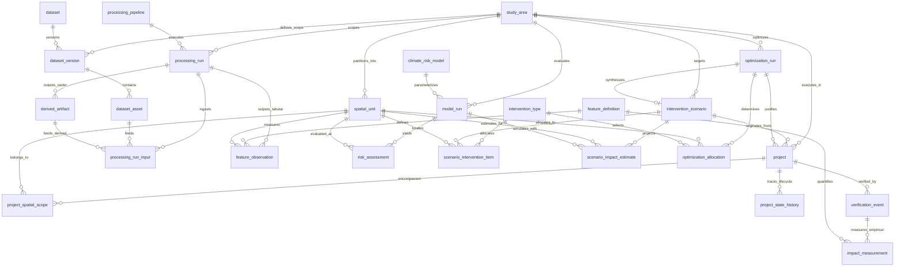

# CLIMORA — Canonical Data Model & Database Architecture Specification

**Document Version:** 1.0.0  
**Phase:** Phase 1A (Design Only)  
**Status:** Approved Architectural Contract  
**Applies To:** Ingestion, Storage, Processing, Features, Risk Modeling, Interventions, Optimization, Projects, Verification, API, Frontend, Cloud Deployment  

---

## 1. Purpose

This document establishes the **canonical data model and database architecture** for CLIMORA—an environmental climate-risk intelligence and intervention-planning platform. 

CLIMORA operates across the entire climate adaptation lifecycle:
```
DATA SOURCES
    ↓
DATA INGESTION & VALIDATION
    ↓
RAW DATA LAKE & PROVENANCE
    ↓
STANDARDIZATION & HARMONIZATION
    ↓
DERIVED FEATURE ENGINEERING
    ↓
SPATIAL CLIMATE-RISK MODELING (Hazard, Exposure, Vulnerability)
    ↓
INTERVENTION SCENARIO GENERATION
    ↓
PHYSICAL & ECONOMIC IMPACT ESTIMATION
    ↓
MATHEMATICAL SPATIAL OPTIMIZATION
    ↓
BANKABLE / FUNDABLE PROJECT PROPOSAL
    ↓
IMPLEMENTATION & CAPITAL DEPLOYMENT
    ↓
MRV (MEASUREMENT, REPORTING, VERIFICATION) & CONTINUOUS MONITORING
```

The primary objective of Phase 1A is to specify the entities, relationships, attributes, storage boundaries, integrity rules, and state transitions that govern CLIMORA without tying the system to raw file layouts, single algorithms, or a single prototype city. This document serves as the unyielding architectural contract for all subsequent implementation phases (schema creation, ORM models, processing pipelines, APIs, and UIs).

---

## 2. Architecture Principles

1. **Strict Storage Tier Separation**:
   - **PostgreSQL**: Relational metadata, provenance DAGs, feature values, risk scores, scenario configurations, solver parameters, fundable project specifications, and verification records.
   - **PostGIS**: Spatial geometries (study areas, analytical units, intervention sites, project boundaries), spatial indexing (GiST), and spatial joins.
   - **Object Storage (S3 / Local Data Lake)**: Raw satellite tiles (GeoTIFF), digital elevation models (DEM), heavy derived rasters (continuous LST, NDVI surfaces), serialized ML model weights (pickle, ONNX), and third-party verification report files.
   - **Database Never Stores Heavy Rasters**: PostgreSQL must never become a dumping ground for multi-megabyte/gigabyte GeoTIFF arrays. Database records store URIs, checksums, footprints, and aggregated analytical metrics.

2. **No Overengineering — Justified Entity Existence**:
   - Every entity in this design answers the question: *"Why does this need to exist as a distinct entity?"*
   - Polymorphic bloat and speculative enterprise patterns (e.g., universal temporal calendars, generic entity-attribute-value for fixed domains) are explicitly rejected.
   - Core concepts remain normalized; JSONB is restricted strictly to domains where schema flexibility is structurally unavoidable.

3. **Geographic & Algorithm Agnosticism**:
   - Pune is data, not a schema. No column, table, or constraint contains hardcoded references to Pune, Maharashtra, or India.
   - Climate-risk calculations are decoupled from specific machine learning algorithms. The model represents risk components (Hazard, Exposure, Vulnerability) and tracks model runs whether computed via deterministic spatial heuristics, Random Forest, XGBoost, or spatial Bayesian models.

4. **Reproducibility & Immutable Lineage**:
   - All analytical and model outputs must be fully traceable to the exact code commit, execution parameters, input assets, and raw source acquisitions that generated them.
   - Raw data assets are immutable. Processing outputs reference input assets via directed acyclic graph (DAG) edges.

5. **Extensibility via Catalogs (Plugin-like Interventions & Features)**:
   - Introducing a new satellite sensor, a new climate indicator, or a new urban intervention type (e.g., cool pavements, bioswales, green roofs) requires inserting a row into a catalog table—never executing a DDL schema migration.

---

## 3. Entity Inventory

The canonical data model consists of **23 Core Entities**, **2 Supporting Lineage/Scope Join Entities**, and **23 Enums/Value Types**, organized across 7 functional layers:

| Layer | Core Entities | Supporting Join Entities | Purpose |
| :--- | :--- | :--- | :--- |
| **1. Spatial Foundation** | `study_area`, `spatial_unit` | — | Defines geographical boundaries and canonical analytical units (grids, wards). |
| **2. Catalog & Ingestion** | `dataset`, `dataset_version`, `dataset_asset` | — | Catalogs external datasets, versions, and individual raw assets with checksums. |
| **3. Processing & Features** | `processing_pipeline`, `processing_run`, `derived_artifact`, `feature_definition`, `feature_observation` | `processing_run_input` | Governs execution provenance, derived raster outputs, feature catalogs, and spatial feature values. |
| **4. Risk Modeling** | `climate_risk_model`, `model_run`, `risk_assessment` | — | Encapsulates model definitions, run parameters/artifacts, and spatial risk scores (H+E+V). |
| **5. Interventions & Scenarios**| `intervention_type`, `intervention_scenario`, `scenario_intervention_item`, `scenario_impact_estimate` | — | Models intervention catalog, multi-intervention scenario composition, and projected impacts. |
| **6. Optimization** | `optimization_run`, `optimization_allocation` | — | Encapsulates spatial optimization runs, solver configurations, and unit-level allocations. |
| **7. Projects & Verification** | `project`, `project_state_history`, `verification_event`, `impact_measurement` | `project_spatial_scope` | Manages bankable project proposals, state transitions, MRV verification events, and empirical metrics. |

---

## 4. Entity Definitions

### Layer 1: Spatial & Administrative Foundation

#### 4.1. `study_area`
- **Why it exists**: Establishes the top-level geographic container for climate analysis. Decouples the platform from Pune, allowing multi-city and regional expansion.
- **Attributes**:
  - `id` (UUID, PK): Unique identifier.
  - `slug` (VARCHAR(64), UNIQUE): URL-safe identifier (e.g., `'pune'`, `'thane'`, `'bengaluru'`).
  - `name` (VARCHAR(255)): Official display name (e.g., `'Pune Municipal Corporation'`).
  - `admin_level` (ENUM `admin_level_type`): Level (`city`, `district`, `metropolitan_region`, `custom_aoi`).
  - `admin_code` (VARCHAR(64), NULLABLE): Official administrative code (e.g., LGD Sub-District Code `'4194'`, OSM Relation `'10351626'`).
  - `boundary` (GEOMETRY(Polygon/MultiPolygon, 4326)): Canonical statutory boundary polygon.
  - `srid_local` (INTEGER): Local projected CRS EPSG code for accurate metric area/distance calculations (e.g., `32643` for UTM Zone 43N).
  - `parent_id` (UUID, FK -> `study_area.id`, NULLABLE): Self-referential hierarchy (e.g., ward -> city -> district).
  - `metadata` (JSONB): Non-relational context (census identifiers, regional climate zone, demographic baselines).
  - `created_at` (TIMESTAMPTZ): Ingestion timestamp.

#### 4.2. `spatial_unit`
- **Why it exists**: Provides the atomic, discretized spatial geometry upon which features are aggregated, risk is computed, and interventions are allocated. Supports both uniform analytical grids (e.g., H3 hexagons, 250m vector grids) and administrative zones (e.g., municipal wards, census tracts).
- **Attributes**:
  - `id` (UUID, PK): Unique identifier.
  - `study_area_id` (UUID, FK -> `study_area.id`): Parent study area.
  - `unit_type` (ENUM `spatial_unit_type`): Spatial type (`grid_hex_h8`, `grid_hex_h9`, `grid_square_250m`, `ward`, `neighborhood`, `custom_parcel`).
  - `unit_code` (VARCHAR(128)): Human-readable or standardized code (e.g., H3 index `'8860145b23fffff'` or ward code `'WARD_01'`).
  - `geom` (GEOMETRY(Polygon/MultiPolygon, 4326)): Bounding geometry.
  - `centroid` (GEOMETRY(Point, 4326)): Precomputed centroid for point-based spatial joins and map marker rendering.
  - `area_m2` (DOUBLE PRECISION): Calculated surface area in square meters using `study_area.srid_local`.
  - `properties` (JSONB): Dynamic attributes (e.g., ward name, ward councillor, baseline census population estimate).
  - `is_active` (BOOLEAN): Status flag for active analysis.

---

### Layer 2: Catalog & Ingestion Layer

#### 4.3. `dataset`
- **Why it exists**: Canonical registry of an external or primary data product provider. Separates permanent data product definitions from temporal acquisition versions.
- **Attributes**:
  - `id` (UUID, PK): Unique identifier.
  - `slug` (VARCHAR(64), UNIQUE): Unique slug (e.g., `'landsat-c2-l2'`, `'sentinel-2-c1-l2a'`, `'modis-11a2-061'`, `'nasa-power-daily'`, `'copernicus-dem-glo-30'`, `'osm-vectors'`).
  - `name` (VARCHAR(255)): Formal name (e.g., `'Landsat 8-9 Collection 2 Level-2 Surface Reflectance'`).
  - `provider` (VARCHAR(255)): Data source organization/platform (e.g., `'USGS / Microsoft Planetary Computer'`, `'ESA / AWS Element84'`, `'NASA LP DAAC'`, `'NASA Langley Research Center'`, `'OpenStreetMap Community'`).
  - `category` (ENUM `dataset_category`): Category (`satellite_optical`, `satellite_thermal`, `meteorology`, `elevation`, `vector_osm`, `census`).
  - `license` (VARCHAR(128)): License identifier (e.g., `'PDDL'`, `'CC-BY-4.0'`, `'ODbL'`).
  - `description` (TEXT): Comprehensive summary.

#### 4.4. `dataset_version`
- **Why it exists**: Groups a frozen, immutable set of acquisitions for a study area and temporal window, guaranteeing baseline reproducibility.
- **Attributes**:
  - `id` (UUID, PK): Unique identifier.
  - `dataset_id` (UUID, FK -> `dataset.id`): Parent dataset.
  - `study_area_id` (UUID, FK -> `study_area.id`): Target study area.
  - `version_tag` (VARCHAR(64)): Identifier tag (e.g., `'pune-2025-v1'`).
  - `temporal_start` (TIMESTAMPTZ): Start of acquisition window.
  - `temporal_end` (TIMESTAMPTZ): End of acquisition window.
  - `status` (ENUM `dataset_version_status`): Status (`planned`, `ingesting`, `frozen`, `deprecated`).
  - `manifest_uri` (VARCHAR(512)): External URI to frozen JSON manifest (e.g., `s3://climora-lake/manifests/pune_2025_v1_frozen.json` or local path).
  - `total_files` (INTEGER): Number of physical files included.
  - `total_size_bytes` (BIGINT): Aggregate storage footprint.
  - `frozen_at` (TIMESTAMPTZ, NULLABLE): Timestamp when the dataset version was locked against modifications.
  - `metadata` (JSONB): Ingestion settings, cloud coverage limits, STAC query parameters.

#### 4.5. `dataset_asset`
- **Why it exists**: Represents an individual physical file acquired from an external source (e.g., a specific spectral band GeoTIFF, an OSM GeoJSON, or a NASA POWER JSON). Stores exact file locations, cryptographic checksums, and validation status.
- **Attributes**:
  - `id` (UUID, PK): Unique identifier.
  - `dataset_version_id` (UUID, FK -> `dataset_version.id`): Parent dataset version.
  - `asset_key` (VARCHAR(128)): Canonical product key (e.g., `'SR_B4'`, `'ST_B10'`, `'QA_PIXEL'`, `'B05'`, `'LST_Day_1km'`, `'green_spaces'`, `'power_2025_daily'`).
  - `storage_tier` (ENUM `storage_tier_type`): Location tier (`local`, `s3_standard`, `s3_glacier`).
  - `file_path` (VARCHAR(512)): Relative path or S3 URI (e.g., `'raw/landsat/2025/LC08_.../SR_B4.tif'`).
  - `file_format` (ENUM `file_format_type`): File format (`geotiff`, `geojson`, `json`, `netcdf`, `parquet`).
  - `file_size_bytes` (BIGINT): Byte size on disk/object storage.
  - `checksum_sha256` (CHAR(64)): Cryptographic SHA-256 hash.
  - `crs` (VARCHAR(64), NULLABLE): Coordinate reference system string (e.g., `'EPSG:32643'`, `'EPSG:4326'`).
  - `spatial_bounds` (GEOMETRY(Polygon, 4326), NULLABLE): Bounding box/convex hull of the asset.
  - `resolution_m` (DOUBLE PRECISION, NULLABLE): Spatial pixel resolution in meters (e.g., `10.0`, `30.0`, `1000.0`).
  - `temporal_timestamp` (TIMESTAMPTZ, NULLABLE): Instantaneous satellite overpass timestamp.
  - `temporal_extent_start` (TIMESTAMPTZ, NULLABLE): Start of temporal validity (for composites or weather series).
  - `temporal_extent_end` (TIMESTAMPTZ, NULLABLE): End of temporal validity.
  - `source_product_id` (VARCHAR(255)): Upstream catalog granule/scene identifier (e.g., `'LC08_L2SP_147047_20250214_02_T1'`).
  - `source_url` (TEXT, NULLABLE): Upstream STAC or API download URI.
  - `validation_status` (ENUM `validation_status_type`): Quality status (`pending`, `valid`, `invalid`, `corrupt`).
  - `validation_details` (JSONB): Validation check output (dimensions, band counts, nodata values).
  - `created_at` (TIMESTAMPTZ): Insertion timestamp.

---

### Layer 3: Processing & Derived Features Layer

#### 4.6. `processing_pipeline`
- **Why it exists**: Catalogs the analytical code pipelines and transformation workflows, guaranteeing reproducibility across code versions.
- **Attributes**:
  - `id` (UUID, PK): Unique identifier.
  - `name` (VARCHAR(128)): Pipeline name (e.g., `'landsat_lst_harmonization'`, `'sentinel2_ndvi_extraction'`, `'osm_infrastructure_density'`).
  - `pipeline_type` (ENUM `pipeline_type`): Type (`feature_extraction`, `spatial_aggregation`, `harmonization`, `raster_derivation`).
  - `code_repository` (VARCHAR(255)): Git repo URL.
  - `code_version` (VARCHAR(64)): Git commit SHA or semantic version string.
  - `environment_hash` (VARCHAR(64), NULLABLE): Docker image digest or conda/poetry lockfile hash.
  - `description` (TEXT): Functional documentation.

#### 4.7. `processing_run`
- **Why it exists**: An execution instance of a processing pipeline. Records exact runtime parameters, inputs, outputs, and execution metrics.
- **Attributes**:
  - `id` (UUID, PK): Unique identifier.
  - `pipeline_id` (UUID, FK -> `processing_pipeline.id`): Pipeline executed.
  - `study_area_id` (UUID, FK -> `study_area.id`): Study area processed.
  - `execution_timestamp` (TIMESTAMPTZ): Start timestamp.
  - `duration_seconds` (DOUBLE PRECISION): Runtime duration.
  - `status` (ENUM `run_status_type`): Execution outcome (`running`, `succeeded`, `failed`).
  - `parameters` (JSONB): Complete runtime parameter dictionary (e.g., window size, cloud masking threshold, weights).
  - `executed_by` (VARCHAR(128)): System actor or user ID.
  - `error_log` (TEXT, NULLABLE): Error stack trace if failed.

#### 4.8. `processing_run_input`
- **Why it exists**: Associative entity establishing the input lineage edges of the provenance Directed Acyclic Graph (DAG). Answers: *"What exact raw assets or derived artifacts were fed into this run?"*
- **Attributes**:
  - `processing_run_id` (UUID, FK -> `processing_run.id`): Execution run.
  - `input_asset_id` (UUID, FK -> `dataset_asset.id`, NULLABLE): Upstream raw asset input (mutually exclusive or combined with `input_artifact_id`).
  - `input_artifact_id` (UUID, FK -> `derived_artifact.id`, NULLABLE): Upstream derived artifact input.
  - `input_role` (VARCHAR(64)): Semantic role in pipeline (e.g., `'red_band'`, `'nir_band'`, `'thermal_band'`, `'dem'`, `'cloud_mask'`).
  - **Constraint**: At least one of `input_asset_id` or `input_artifact_id` must be non-null.

#### 4.9. `derived_artifact`
- **Why it exists**: Catalogs heavy intermediate or final spatial raster/vector artifacts generated by processing runs (e.g., harmonized 10m LST raster, calculated NDVI GeoTIFF, aligned DEM slope layer). Keeps heavy binary files in object storage while recording spatial metadata in PostgreSQL.
- **Attributes**:
  - `id` (UUID, PK): Unique identifier.
  - `processing_run_id` (UUID, FK -> `processing_run.id`): Originating run.
  - `artifact_type` (ENUM `artifact_type`): Type (`derived_raster`, `composite_raster`, `vector_mask`, `tabular_matrix`).
  - `storage_tier` (ENUM `storage_tier_type`): Storage location tier (`local`, `s3_standard`).
  - `file_path` (VARCHAR(512)): Relative path or S3 URI (e.g., `'derived/rasters/pune_2025_lst_10m.tif'`).
  - `file_format` (ENUM `file_format_type`): File format (`geotiff`, `parquet`, `zarr`, `geojson`).
  - `file_size_bytes` (BIGINT): Disk size.
  - `checksum_sha256` (CHAR(64)): Cryptographic hash.
  - `crs` (VARCHAR(64)): Projected CRS (e.g., `'EPSG:32643'`).
  - `resolution_m` (DOUBLE PRECISION): Pixel resolution.
  - `spatial_bounds` (GEOMETRY(Polygon, 4326)): Spatial footprint.
  - `temporal_start` (TIMESTAMPTZ): Start of observation window.
  - `temporal_end` (TIMESTAMPTZ): End of observation window.
  - `created_at` (TIMESTAMPTZ): Generation timestamp.

#### 4.10. `feature_definition`
- **Why it exists**: Canonical catalog of derived environmental, infrastructural, and demographic indicators. Allows adding new features dynamically without DDL table alterations.
- **Attributes**:
  - `id` (UUID, PK): Unique identifier.
  - `name` (VARCHAR(64), UNIQUE): Canonical programmatic identifier (e.g., `'ndvi'`, `'ndbi'`, `'ndwi'`, `'lst_celsius'`, `'canopy_cover_pct'`, `'impervious_surface_pct'`, `'elevation_meters'`, `'slope_degrees'`, `'road_density_km_km2'`, `'t2m_max_summer'`).
  - `display_name` (VARCHAR(128)): Human-readable label (e.g., `'Normalized Difference Vegetation Index'`).
  - `category` (ENUM `feature_category`): Category (`vegetation`, `thermal`, `built_environment`, `hydrology`, `topography`, `meteorology`, `demographic`).
  - `unit` (ENUM `feature_unit`): Unit of measurement (`unitless_index`, `celsius`, `percentage`, `meters`, `degrees`, `density_per_km2`, `m_per_s`).
  - `range_min` (DOUBLE PRECISION, NULLABLE): Valid theoretical minimum.
  - `range_max` (DOUBLE PRECISION, NULLABLE): Valid theoretical maximum.
  - `description` (TEXT): Scientific definition and formula.

#### 4.11. `feature_observation`
- **Why it exists**: Stores the aggregated, tabular feature values mapped to a specific `spatial_unit`, `temporal_window`, and `processing_run`. Serves as the primary tabular feature store for risk modeling.
- **Attributes**:
  - `id` (UUID, PK): Unique identifier.
  - `spatial_unit_id` (UUID, FK -> `spatial_unit.id`): Analytical unit.
  - `feature_definition_id` (UUID, FK -> `feature_definition.id`): Feature observed.
  - `processing_run_id` (UUID, FK -> `processing_run.id`): Generating run.
  - `observation_date` (DATE): Reference observation date or season midpoint.
  - `temporal_window_start` (TIMESTAMPTZ): Observation window start.
  - `temporal_window_end` (TIMESTAMPTZ): Observation window end.
  - `val_numeric` (DOUBLE PRECISION): Primary summary metric (e.g., spatial mean).
  - `val_min` (DOUBLE PRECISION, NULLABLE): Minimum value within unit.
  - `val_max` (DOUBLE PRECISION, NULLABLE): Maximum value within unit.
  - `val_stddev` (DOUBLE PRECISION, NULLABLE): Standard deviation.
  - `val_p90` (DOUBLE PRECISION, NULLABLE): 90th percentile value.
  - `confidence_score` (DOUBLE PRECISION): Quality score (0.0 to 1.0) based on cloud mask and valid pixel ratio.
  - **Natural Key / Unique Constraint**: `(spatial_unit_id, feature_definition_id, observation_date, processing_run_id)`.

---

### Layer 4: Climate-Risk Assessment Layer

#### 4.12. `climate_risk_model`
- **Why it exists**: Catalogs the risk assessment model architecture. Ensures independence from any single ML framework (e.g., IPCC AR6 additive framework vs. Random Forest vs. XGBoost vs. spatial Bayesian models).
- **Attributes**:
  - `id` (UUID, PK): Unique identifier.
  - `name` (VARCHAR(128)): Model name (e.g., `'ipcc_ar6_urban_heat_risk'`, `'xgboost_vulnerability_ensemble'`).
  - `model_family` (ENUM `model_family_type`): Architecture family (`heuristic_ipcc`, `random_forest`, `xgboost`, `spatial_bayesian`, `linear_additive`).
  - `version_tag` (VARCHAR(32)): Semantic version (e.g., `'v1.0.0'`).
  - `framework_details` (JSONB): Software dependencies (`scikit-learn==1.4.0`, Python 3.11).
  - `description` (TEXT): Scientific methodology documentation.

#### 4.13. `model_run`
- **Why it exists**: An execution instance of a risk model. Stores hyperparameters, trained model weights artifact URI, training metrics, and temporal baseline scope.
- **Attributes**:
  - `id` (UUID, PK): Unique identifier.
  - `model_id` (UUID, FK -> `climate_risk_model.id`): Model executed.
  - `study_area_id` (UUID, FK -> `study_area.id`): Study area evaluated.
  - `baseline_start` (DATE): Baseline climate window start.
  - `baseline_end` (DATE): Baseline climate window end.
  - `execution_timestamp` (TIMESTAMPTZ): Execution timestamp.
  - `code_version` (VARCHAR(64)): Git commit SHA.
  - `hyperparameters` (JSONB): Model weights, tuning parameters, feature coefficients.
  - `evaluation_metrics` (JSONB, NULLABLE): Performance metrics (R2, MAE, AUC, SHAP feature importance rankings).
  - `model_artifact_uri` (VARCHAR(512), NULLABLE): S3 URI to serialized model file (e.g., `s3://climora-lake/models/heat_risk_v1.onnx`).
  - `status` (ENUM `run_status_type`): Execution outcome (`succeeded`, `failed`).

#### 4.14. `risk_assessment`
- **Why it exists**: The definitive spatial output of a risk evaluation. Stores normalized Hazard, Exposure, Vulnerability, and Composite Risk scores per spatial unit for interactive mapping, priority querying, and downstream project generation.
- **Attributes**:
  - `id` (UUID, PK): Unique identifier.
  - `model_run_id` (UUID, FK -> `model_run.id`): Generating model run.
  - `spatial_unit_id` (UUID, FK -> `spatial_unit.id`): Evaluated unit.
  - `evaluation_period` (VARCHAR(64)): Evaluation label (e.g., `'2025_summer'`, `'2025_annual'`).
  - `hazard_score` (DOUBLE PRECISION): Normalized Hazard index (0.0 to 1.0, e.g. severe surface temperature, heatwave exposure).
  - `exposure_score` (DOUBLE PRECISION): Normalized Exposure index (0.0 to 1.0, e.g. population density, hospital/school proximity).
  - `vulnerability_score` (DOUBLE PRECISION): Normalized Vulnerability index (0.0 to 1.0, e.g. lack of canopy, low albedo, high imperviousness).
  - `composite_risk_score` (DOUBLE PRECISION): Integrated Risk score (0.0 to 1.0).
  - `risk_category` (ENUM `risk_category_type`): Risk tier (`very_low`, `low`, `moderate`, `high`, `extreme`).
  - `confidence_score` (DOUBLE PRECISION): Statistical confidence level (0.0 to 1.0).
  - `component_breakdown` (JSONB): Granular explainability data (e.g., `{"lst_hazard": 0.85, "elderly_pop_exposure": 0.72, "canopy_deficit_vulnerability": 0.91}`).
  - `raster_map_uri` (VARCHAR(512), NULLABLE): S3 URI to continuous spatial raster risk surface if generated.
  - **Unique Constraint**: `(model_run_id, spatial_unit_id, evaluation_period)`.

---

### Layer 5: Intervention & Scenario Modeling Layer

#### 4.15. `intervention_type`
- **Why it exists**: Plugin-like catalog of urban cooling and climate adaptation physical interventions. Adding a new intervention requires zero schema modifications.
- **Attributes**:
  - `id` (UUID, PK): Unique identifier.
  - `code` (VARCHAR(64), UNIQUE): Unique slug (e.g., `'urban_canopy_trees'`, `'cool_roofs_reflective'`, `'green_corridor'`, `'permeable_pavements'`, `'water_retention_bioswale'`, `'photovoltaic_shade_canopy'`).
  - `name` (VARCHAR(128)): Human-readable label (e.g., `'High-Albedo Cool Roof Coating'`).
  - `category` (ENUM `intervention_category`): Category (`nature_based`, `albedo_modification`, `water_infrastructure`, `structural_shade`).
  - `unit_of_measure` (ENUM `unit_of_measure_type`): Allocation metric (`count_units`, `m2_surface_area`, `m2_roof_area`, `linear_meters`, `m3_capacity`).
  - `default_unit_cost_inr` (NUMERIC(14, 2)): Baseline capital expenditure per unit in INR.
  - `default_annual_opex_pct` (DOUBLE PRECISION): Annual maintenance cost as percentage of CapEx (e.g., `0.05` for 5%).
  - `default_lifespan_years` (INTEGER): Expected operational lifespan.
  - `physical_constraints` (JSONB): Feasibility bounds (e.g., `{"requires_roof": true, "min_slope_deg": 0, "max_slope_deg": 15, "min_road_width_m": null}`).
  - `cooling_efficiency_model` (JSONB): Physical cooling transfer coefficients (e.g., `{"lst_delta_per_1000m2": -0.45, "albedo_increase": 0.55}`).
  - `description` (TEXT): Engineering specifications.

#### 4.16. `intervention_scenario`
- **Why it exists**: Encapsulates a simulated policy, budget, or engineering scenario containing multiple intervention allocations across a study area, evaluated against a baseline risk model run.
- **Attributes**:
  - `id` (UUID, PK): Unique identifier.
  - `study_area_id` (UUID, FK -> `study_area.id`): Target geography.
  - `name` (VARCHAR(255)): Scenario title (e.g., `'Pune 2026 High-Heat Ward Cool Roof Initiative'`).
  - `scenario_type` (ENUM `scenario_type`): Type (`baseline`, `single_intervention`, `multi_intervention`, `budget_constrained_optimal`).
  - `baseline_model_run_id` (UUID, FK -> `model_run.id`): Reference baseline risk run for counterfactual comparison.
  - `target_horizon_year` (INTEGER): Target completion year (e.g., `2026`, `2030`).
  - `assumptions` (JSONB): Explicit modeling assumptions (e.g., `{"tree_sapling_survival_rate": 0.85, "roof_coating_albedo_degradation_annual": 0.02}`).
  - `created_by` (VARCHAR(128)): Creator identity.
  - `created_at` (TIMESTAMPTZ): Creation timestamp.

#### 4.17. `scenario_intervention_item`
- **Why it exists**: Granular allocation of a specific intervention type to a specific spatial unit within a scenario.
- **Attributes**:
  - `id` (UUID, PK): Unique identifier.
  - `scenario_id` (UUID, FK -> `intervention_scenario.id`): Parent scenario.
  - `spatial_unit_id` (UUID, FK -> `spatial_unit.id`): Target analytical unit.
  - `intervention_type_id` (UUID, FK -> `intervention_type.id`): Allocated intervention.
  - `geometry_override` (GEOMETRY(Geometry, 4326), NULLABLE): Specific site polygon/line/point if intervention is localized within the unit.
  - `quantity` (DOUBLE PRECISION): Allocated quantity in `intervention_type.unit_of_measure` (e.g., `15000.0` m2 roof area or `500` trees).
  - `estimated_capex_inr` (NUMERIC(14, 2)): Calculated capital cost.
  - `estimated_annual_opex_inr` (NUMERIC(14, 2)): Calculated operational cost.
  - `implementation_parameters` (JSONB): Site-specific parameters (e.g., `{"selected_species": "Azadirachta indica", "coating_sri": 104}`).

#### 4.18. `scenario_impact_estimate`
- **Why it exists**: Stores projected microclimate, risk reduction, and co-benefit outcomes resulting from a scenario simulation for a spatial unit.
- **Attributes**:
  - `id` (UUID, PK): Unique identifier.
  - `scenario_id` (UUID, FK -> `intervention_scenario.id`): Scenario evaluated.
  - `spatial_unit_id` (UUID, FK -> `spatial_unit.id`): Target unit.
  - `simulation_run_id` (UUID, FK -> `model_run.id`): Intervention simulation model run.
  - `projected_lst_reduction_c` (DOUBLE PRECISION): Simulated decrease in surface temperature (°C).
  - `projected_ndvi_increase` (DOUBLE PRECISION): Simulated vegetation index gain.
  - `projected_risk_score_delta` (DOUBLE PRECISION): Projected absolute reduction in composite risk score (e.g., `-0.18`).
  - `projected_avoided_heat_hospitalizations` (DOUBLE PRECISION, NULLABLE): Estimated public health co-benefit.
  - `co_benefits` (JSONB): Estimated environmental co-benefits (e.g., `{"stormwater_retention_m3_yr": 1200.0, "carbon_sequestered_tonnes_yr": 14.5}`).
  - `confidence_interval` (JSONB): Uncertainty bounds (e.g., `{"p10": -1.2, "p50": -1.8, "p90": -2.4}`).

---

### Layer 6: Spatial Optimization Layer

#### 4.19. `optimization_run`
- **Why it exists**: Records executions of automated mathematical solvers (MILP, Pareto multi-objective, Genetic Algorithms) that allocate interventions under budget and land availability constraints. Solvers remain pluggable and algorithm-agnostic.
- **Attributes**:
  - `id` (UUID, PK): Unique identifier.
  - `study_area_id` (UUID, FK -> `study_area.id`): Target study area.
  - `baseline_model_run_id` (UUID, FK -> `model_run.id`): Baseline risk reference.
  - `resulting_scenario_id` (UUID, FK -> `intervention_scenario.id`, NULLABLE): Generated scenario representing optimal allocation.
  - `solver_name` (ENUM `optimization_solver_type`): Solver engine (`scipy_milp`, `pulp_cbc`, `or_tools`, `nsga2_genetic`).
  - `objective_type` (ENUM `optimization_objective_type`): Optimization goal (`maximize_risk_reduction`, `minimize_cost_for_target_risk`, `pareto_multi_objective`).
  - `budget_limit_inr` (NUMERIC(14, 2), NULLABLE): Financial constraint limit.
  - `constraints` (JSONB): Complete constraint formulation (e.g., `{"max_trees_per_ward": 2000, "min_risk_reduction_in_extreme_wards": 0.20, "max_total_budget_inr": 50000000}`).
  - `solver_configuration` (JSONB): Solver parameters (e.g., `{"time_limit_sec": 300, "mip_gap": 0.01, "seed": 42}`).
  - `objective_value_achieved` (DOUBLE PRECISION, NULLABLE): Optimal objective score achieved.
  - `solve_status` (ENUM `optimization_status_type`): Solver status (`optimal`, `feasible`, `infeasible`, `timeout`, `error`).
  - `execution_duration_sec` (DOUBLE PRECISION): Solver execution time.
  - `explainability_metrics` (JSONB): Marginal ROI metrics and shadow prices.
  - `created_at` (TIMESTAMPTZ): Run timestamp.

#### 4.20. `optimization_allocation`
- **Why it exists**: Granular decision variables selected by the solver, mapping optimal quantities per spatial unit and intervention type.
- **Attributes**:
  - `id` (UUID, PK): Unique identifier.
  - `optimization_run_id` (UUID, FK -> `optimization_run.id`): Parent run.
  - `spatial_unit_id` (UUID, FK -> `spatial_unit.id`): Unit selected.
  - `intervention_type_id` (UUID, FK -> `intervention_type.id`): Intervention selected.
  - `allocated_quantity` (DOUBLE PRECISION): Mathematically optimal quantity.
  - `allocated_cost_inr` (NUMERIC(14, 2)): Cost of this allocation.
  - `marginal_risk_reduction` (DOUBLE PRECISION): Marginal risk reduction contribution.

---

### Layer 7: Fundable Projects & MRV Verification Layer

#### 4.21. `project`
- **Why it exists**: The definitive actionable outcome of CLIMORA—a structured, bankable climate resilience project proposal for municipal tenders, climate funds, or CSR financing.
- **Attributes**:
  - `id` (UUID, PK): Unique identifier.
  - `study_area_id` (UUID, FK -> `study_area.id`): Target study area.
  - `origin_scenario_id` (UUID, FK -> `intervention_scenario.id`, NULLABLE): Upstream scenario from which project was derived.
  - `origin_optimization_run_id` (UUID, FK -> `optimization_run.id`, NULLABLE): Upstream optimization run.
  - `title` (VARCHAR(255)): Project title (e.g., `'Hadapsar Industrial Zone Cool Roof Initiative'`).
  - `slug` (VARCHAR(128), UNIQUE): URL-safe slug.
  - `primary_location` (GEOMETRY(MultiPolygon, 4326)): Combined spatial polygon encompassing all project execution sites.
  - `total_budget_inr` (NUMERIC(14, 2)): Required capital deployment.
  - `target_start_date` (DATE): Planned groundbreaking date.
  - `target_completion_date` (DATE): Planned completion date.
  - `current_lifecycle_state` (ENUM `project_lifecycle_state`): Current lifecycle state (see Section 20).
  - `metadata` (JSONB): Financing structure, executing agency, community co-benefits, carbon credit eligibility.
  - `created_at` (TIMESTAMPTZ): Proposal creation timestamp.
  - `updated_at` (TIMESTAMPTZ): Last modification timestamp.

#### 4.22. `project_spatial_scope`
- **Why it exists**: Associative join table linking a bankable project to its constituent `spatial_unit`s with relative allocation weighting.
- **Attributes**:
  - `project_id` (UUID, FK -> `project.id`): Project.
  - `spatial_unit_id` (UUID, FK -> `spatial_unit.id`): Included analytical unit.
  - `allocation_share` (DOUBLE PRECISION): Share of project budget/effort deployed in this unit (sum = 1.0).
  - **Primary Key**: `(project_id, spatial_unit_id)`.

#### 4.23. `project_state_history`
- **Why it exists**: Append-only audit log recording every lifecycle state transition for a project, ensuring institutional accountability and compliance for climate finance.
- **Attributes**:
  - `id` (UUID, PK): Unique identifier.
  - `project_id` (UUID, FK -> `project.id`): Project transitioning.
  - `from_state` (ENUM `project_lifecycle_state`): Previous state.
  - `to_state` (ENUM `project_lifecycle_state`): New state.
  - `transitioned_at` (TIMESTAMPTZ): Transition timestamp.
  - `actor` (VARCHAR(128)): User ID or system process triggering transition.
  - `trigger_reason` (TEXT): Justification or decision summary.
  - `evidence_uri` (VARCHAR(512), NULLABLE): Link to supporting document in S3 (e.g., signed tender agreement, inspection signoff).
  - `transition_metadata` (JSONB): Contextual metadata (e.g., funder name, sanction order number).

#### 4.24. `verification_event`
- **Why it exists**: Anchors physical field audits, drone thermal surveys, and satellite MRV (Measurement, Reporting, and Verification) events against an implemented project.
- **Attributes**:
  - `id` (UUID, PK): Unique identifier.
  - `project_id` (UUID, FK -> `project.id`): Target project.
  - `verification_type` (ENUM `verification_type`): Methodology (`satellite_mrv`, `drone_thermal_survey`, `iot_sensor_deployment`, `field_audit`, `third_party_inspection`).
  - `verification_date` (DATE): Date audit/observation was conducted.
  - `verifier_identity` (VARCHAR(255)): Independent auditor or automated MRV pipeline name.
  - `verification_methodology` (VARCHAR(255)): Formal standard (e.g., `'Gold Standard Methodology for Urban Cooling'`, `'ISO 14064-2'`).
  - `status` (ENUM `verification_status`): Audit outcome (`passed`, `conditional_pass`, `failed`, `pending_review`).
  - `evidence_artifact_uri` (VARCHAR(512)): S3 URI to audit report, drone thermal imagery, or signed certificate.
  - `findings_summary` (TEXT): Auditor findings and remarks.
  - `created_at` (TIMESTAMPTZ): Record timestamp.

#### 4.25. `impact_measurement`
- **Why it exists**: Stores empirical, measured before-and-after observations from verification events. Compares actual cooling/greening performance against the ex-ante model projections.
- **Attributes**:
  - `id` (UUID, PK): Unique identifier.
  - `verification_event_id` (UUID, FK -> `verification_event.id`): Parent verification event.
  - `spatial_unit_id` (UUID, FK -> `spatial_unit.id`, NULLABLE): Specific spatial unit measured.
  - `feature_definition_id` (UUID, FK -> `feature_definition.id`): Environmental indicator evaluated (e.g., `'lst_celsius'`, `'canopy_cover_pct'`).
  - `pre_intervention_value` (DOUBLE PRECISION): Empirical baseline value prior to implementation.
  - `post_intervention_value` (DOUBLE PRECISION): Empirical post-implementation measured value.
  - `measured_delta` (DOUBLE PRECISION): Actual physical change (`post - pre`).
  - `projected_delta` (DOUBLE PRECISION): Original projected change from `scenario_impact_estimate`.
  - `achievement_ratio` (DOUBLE PRECISION): Performance ratio (`measured_delta / projected_delta`).
  - `measurement_window_start` (TIMESTAMPTZ): Start of measurement window.
  - `measurement_window_end` (TIMESTAMPTZ): End of measurement window.
  - `confidence_interval` (JSONB): Statistical confidence interval of sensor/satellite measurements.

---

## 5. Relationships & Cardinality

The canonical relationships across entities are defined as follows:

```
[study_area] 1 ──── ∞ [spatial_unit]
[study_area] 1 ──── ∞ [dataset_version]
[study_area] 1 ──── ∞ [processing_run]
[study_area] 1 ──── ∞ [model_run]
[study_area] 1 ──── ∞ [intervention_scenario]
[study_area] 1 ──── ∞ [optimization_run]
[study_area] 1 ──── ∞ [project]

[dataset] 1 ──── ∞ [dataset_version]
[dataset_version] 1 ──── ∞ [dataset_asset]

[processing_pipeline] 1 ──── ∞ [processing_run]
[processing_run] 1 ──── ∞ [processing_run_input]
[dataset_asset] 1 ──── ∞ [processing_run_input]
[processing_run] 1 ──── ∞ [derived_artifact]
[derived_artifact] 1 ──── ∞ [processing_run_input] (lineage feedback)
[processing_run] 1 ──── ∞ [feature_observation]

[feature_definition] 1 ──── ∞ [feature_observation]
[spatial_unit] 1 ──── ∞ [feature_observation]

[climate_risk_model] 1 ──── ∞ [model_run]
[model_run] 1 ──── ∞ [risk_assessment]
[spatial_unit] 1 ──── ∞ [risk_assessment]

[intervention_type] 1 ──── ∞ [scenario_intervention_item]
[intervention_scenario] 1 ──── ∞ [scenario_intervention_item]
[spatial_unit] 1 ──── ∞ [scenario_intervention_item]

[intervention_scenario] 1 ──── ∞ [scenario_impact_estimate]
[spatial_unit] 1 ──── ∞ [scenario_impact_estimate]
[model_run] 1 ──── ∞ [scenario_impact_estimate]

[optimization_run] 1 ──── ∞ [optimization_allocation]
[spatial_unit] 1 ──── ∞ [optimization_allocation]
[intervention_type] 1 ──── ∞ [optimization_allocation]
[optimization_run] 1 ──── 0..1 [intervention_scenario]

[intervention_scenario] 1 ──── 0..∞ [project]
[optimization_run] 1 ──── 0..∞ [project]
[project] 1 ──── ∞ [project_spatial_scope] ──── 1 [spatial_unit]
[project] 1 ──── ∞ [project_state_history]
[project] 1 ──── ∞ [verification_event]
[verification_event] 1 ──── ∞ [impact_measurement]
[feature_definition] 1 ──── ∞ [impact_measurement]
```

### Relationship Summary Table:
| Source Entity | Target Entity | Cardinality | Semantics |
| :--- | :--- | :--- | :--- |
| `study_area` | `spatial_unit` | 1 to Many | A study area is partitioned into many spatial units. |
| `dataset` | `dataset_version` | 1 to Many | A dataset has multiple temporal/geographic campaign versions. |
| `dataset_version` | `dataset_asset` | 1 to Many | A version groups specific physical raw assets. |
| `processing_run` | `dataset_asset` | Many to Many (`processing_run_input`) | A run ingests multiple assets; an asset can be used in multiple runs. |
| `processing_run` | `derived_artifact`| 1 to Many | A run outputs heavy raster/vector artifacts stored in object storage. |
| `spatial_unit` | `feature_observation` | 1 to Many | Each spatial unit has multiple temporal feature values. |
| `model_run` | `risk_assessment` | 1 to Many | A model run produces risk scores for all spatial units in a study area. |
| `intervention_scenario` | `scenario_intervention_item` | 1 to Many | A scenario contains multiple spatial intervention allocations. |
| `project` | `spatial_unit` | Many to Many (`project_spatial_scope`)| A project spans one or more spatial units; a unit can have multiple projects. |
| `project` | `project_state_history` | 1 to Many | A project maintains an immutable audit trail of state transitions. |
| `project` | `verification_event` | 1 to Many | An implemented project undergoes multiple periodic verification audits. |
| `verification_event` | `impact_measurement` | 1 to Many | An audit measures multiple empirical environmental indicator deltas. |

---

## 6. Storage Boundaries

CLIMORA strictly enforces storage tier boundaries based on data size, access patterns, mutability, and querying requirements:

```
┌─────────────────────────────────────────────────────────────────────────────┐
│                              STORAGE BOUNDARIES                             │
├──────────────────────────────────────┬──────────────────────────────────────┤
│          POSTGRESQL + POSTGIS        │        OBJECT STORAGE (S3/LAKE)      │
├──────────────────────────────────────┼──────────────────────────────────────┤
│ • Study area boundaries & metadata   │ • Raw Landsat 8/9 Level-2 GeoTIFFs   │
│ • Analytical grid geometries & wards │ • Raw Sentinel-2 MSI Level-2A GeoTIFF│
│ • Catalog definitions & asset records│ • Raw MODIS MOD11A2 HDF/GeoTIFFs     │
│ • Cryptographic SHA-256 checksums    │ • Raw Copernicus DEM GLO-30 GeoTIFFs │
│ • Processing pipeline DAG lineage    │ • Raw OSM GeoJSON extract dumps      │
│ • Aggregated tabular feature metrics │ • Raw NASA POWER daily JSON series   │
│ • Spatial risk scores (H, E, V, R)   │ • Derived continuous 10m/30m rasters │
│ • Intervention catalogs & scenarios  │ • Aligned intermediate GeoTIFF rasters│
│ • Solver inputs, outputs & decisions │ • Serialized ML model weights (.onnx)│
│ • Bankable project specifications    │ • Full-resolution drone thermal maps │
│ • Append-only state transition logs  │ • Third-party MRV audit PDF reports  │
│ • Empirical verification deltas      │ • Training parquet feature matrices  │
└──────────────────────────────────────┴──────────────────────────────────────┘
```

---

## 7. Dataset Model

The dataset model separates the **logical catalog concept** from **versioned physical acquisitions**:

- **Logical Dataset (`dataset`)**: Defines the upstream provider, license, sensor category, and description. For example, `'landsat-c2-l2'` or `'copernicus-dem-glo-30'`.
- **Dataset Version (`dataset_version`)**: Defines an immutable, frozen campaign for a specific study area and time span. For example, the frozen Pune campaign (`'pune-2025-v1'`).
- **Asset Collection (`dataset_asset`)**: Represents the physical files belonging to that version.

### Pune 2025 v1 Mapping:
In Phase 0, the frozen dataset contains 44 files (1.845 GB). Under this canonical model:
1. One row is inserted into `study_area` for Pune (`slug = 'pune'`).
2. Six rows exist in `dataset` (`landsat-c2-l2`, `sentinel-2-c1-l2a`, `modis-11a2-061`, `nasa-power-daily`, `osm-vectors`, `copernicus-dem-glo-30`).
3. Six rows exist in `dataset_version` linking each dataset to Pune for version `'pune-2025-v1'`.
4. Exactly 42 rows exist in `dataset_asset` corresponding to the 42 physical data files:
   - 9 Landsat GeoTIFFs (`SR_B2` through `SR_B7`, `ST_B10`, `QA_PIXEL`, `QA_RADSAT`).
   - 11 Sentinel-2 GeoTIFFs (`B02` through `B08`, `B8A`, `B11`, `B12`, `SCL`).
   - 16 MODIS GeoTIFFs (4 seasonal 8-day cycles × 4 assets: `LST_Day_1km`, `LST_Night_1km`, `QC_Day`, `QC_Night`).
   - 1 NASA POWER daily JSON file (`power_2025_daily.json`).
   - 4 OSM vector GeoJSON files (`green_spaces`, `water_bodies`, `public_infrastructure`, `road_network`).
   - 1 Copernicus DEM GeoTIFF (`Copernicus_DSM_COG_10_N18_00_E073_00_DEM.tif`).
5. The 2 metadata manifests (`pune_2025_v1_frozen.json`, `pune_2025_acquisition_plan.json`) are registered in `dataset_version.manifest_uri`.

---

## 8. Asset Model

Every physical file in CLIMORA is registered as a `dataset_asset`. The asset model captures:

1. **Identity & Storage**:
   - `file_path`: Relative local path or S3 key (`raw/landsat/2025/.../SR_B4.tif`).
   - `storage_tier`: Storage medium (`local`, `s3_standard`, `s3_glacier`).
   - `file_size_bytes`: Exact byte size (e.g., `91900000`).
   - `checksum_sha256`: Cryptographic hash for bit-level integrity verification.
2. **Spatial Properties**:
   - `crs`: Coordinate Reference System (`'EPSG:32643'` or `'EPSG:4326'`).
   - `spatial_bounds`: PostGIS Polygon bounding box.
   - `resolution_m`: Nominal pixel pitch in meters (10m, 30m, 1000m).
3. **Temporal Properties**:
   - `temporal_timestamp`: Exact satellite acquisition instant (e.g., `2025-02-14T05:30:00Z`).
   - `temporal_extent_start` / `temporal_extent_end`: Temporal range for composite or time series files (e.g., `2025-01-01` to `2025-12-31` for NASA POWER).
4. **Lineage & Validation**:
   - `source_product_id`: Upstream scene identifier (`LC08_L2SP_147047_20250214_02_T1`).
   - `validation_status`: Automated validation flag (`valid`, `invalid`, `corrupt`).
   - `validation_details`: Verification logs (e.g., `{"width": 3600, "height": 3600, "bands": 1, "nodata": -9999}`).

---

## 9. Provenance Model

CLIMORA guarantees complete lineage tracing through an explicit Directed Acyclic Graph (DAG) stored in PostgreSQL:

```
[Raw Assets in S3] (dataset_asset)
        │
        ▼ (processing_run_input)
[Processing Run] (processing_run + processing_pipeline)
        │
        ├───────────────────────────────────────┐
        ▼                                       ▼
[Derived Heavy Raster in S3]            [Feature Values in PostGIS]
(derived_artifact)                      (feature_observation)
        │                                       │
        └───────────────────┬───────────────────┘
                            ▼
                    [Risk Model Run] (model_run + climate_risk_model)
                            │
                            ▼
                    [Spatial Risk Scores] (risk_assessment)
                            │
                            ▼
                    [Scenario Modeling] (intervention_scenario + items)
                            │
                            ▼
                    [Impact Simulation] (scenario_impact_estimate)
                            │
                            ▼
                    [Optimization Solver] (optimization_run + allocations)
                            │
                            ▼
                    [Fundable Project] (project + spatial_scope)
                            │
                            ▼
                    [MRV Audit Event] (verification_event)
                            │
                            ▼
                    [Empirical Deltas] (impact_measurement)
```

Every risk score, scenario estimate, and project proposal can be programmatically traced back to the exact git commit, docker image digest, runtime hyperparameters, and input satellite scenes that created it.

---

## 10. Study Area Model

The `study_area` model enables multi-city scalability without schema alterations:

1. **Data-Driven Topography**:
   - Boundaries are stored as PostGIS geometries (`GEOMETRY(Polygon/MultiPolygon, 4326)`).
   - Local projection is explicitly defined via `srid_local` (e.g., `32643` for Pune; `32644` for Chennai; `32647` for Bangkok). All surface area, distance, and density calculations dynamically transform to `srid_local` for sub-meter metric accuracy.
2. **Administrative Hierarchy**:
   - Supports recursive self-referential nesting (`parent_id`). A municipal ward can point to a city; a city points to a metropolitan development authority; a metropolitan area points to a state.
3. **No Geographic Hardcoding**:
   - Adding a second city (e.g., Thane or Ahmedabad) is a simple SQL `INSERT INTO study_area`. No table structure, column name, or enum is altered.

---

## 11. Spatial Unit Model

CLIMORA avoids prematurely locking the analytical engine to a single spatial aggregation unit. The `spatial_unit` entity supports two coexisting representations:

1. **Continuous Canonical Analytical Grid**:
   - Hexagonal H3 hierarchical index (e.g., H3 Resolution 8: ~0.74 km2 area; H3 Resolution 9: ~0.10 km2 area) or uniform planar square grid (e.g., 250m × 250m).
   - **Advantage**: Hexagonal grids eliminate edge-effect artifacts, maintain equal distance to all neighboring centroids, and provide uniform spatial sampling for satellite raster zonal statistics.
2. **Statutory Administrative Units**:
   - Municipal wards, electoral divisions, or census blocks.
   - **Advantage**: Policy, capital budgeting, municipal tenders, and political accountability operate exclusively along administrative boundaries.
3. **Coexistence via Spatial Joins**:
   - Risk is modeled at the fine-grained grid level (`spatial_unit_type = 'grid_hex_h8'`).
   - Administrative risk is dynamically aggregated to wards (`spatial_unit_type = 'ward'`) using PostGIS spatial intersection joins (`ST_Intersects` / `ST_Area` area-weighted averaging).
   - Projects can span both specific grid cells and statutory wards via `project_spatial_scope`.

---

## 12. Temporal Model

Climate risk is fundamentally non-static. The canonical model structures time across distinct temporal horizons:

1. **Instantaneous Observation Time (`temporal_timestamp`)**:
   - Recorded on `dataset_asset` and `derived_artifact`. Captures the exact UTC satellite overpass instant (critical for Land Surface Temperature diurnal matching).
2. **Composite / Aggregation Windows (`temporal_window_start`, `temporal_window_end`)**:
   - Recorded on `feature_observation` and `dataset_version`. Supports seasonal groupings (e.g., Pune pre-monsoon summer: March 1 to May 31).
3. **Baseline Modeling Periods (`baseline_start`, `baseline_end`)**:
   - Recorded on `model_run`. Represents multi-year or annual reference climate periods against which risk anomalies are benchmarked.
4. **Target Scenario Horizons (`target_horizon_year`)**:
   - Recorded on `intervention_scenario` and `project`. Represents future planning horizons (e.g., 2026, 2030, 2040).
5. **Empirical Verification Windows (`measurement_window_start`, `measurement_window_end`)**:
   - Recorded on `impact_measurement`. Defines the post-intervention observation period for empirical verification.
6. **No Calendar Table Bloat**: Standard PostgreSQL `DATE`, `TIMESTAMPTZ`, and range types (`DATERANGE`, `TSTZRANGE`) handle temporal math without maintaining an unnecessary 10,000-row static calendar dimension table.

---

## 13. Processing Model

The processing model governs how raw data lake assets are transformed into standardized analytical features:

1. **Pipelines as Code (`processing_pipeline`)**:
   - Code versions are immutably identified by git commit SHA and Docker environment hash.
2. **Deterministic Run Executions (`processing_run`)**:
   - Every execution captures complete runtime parameters (cloud masking thresholds, interpolation radiuses, kernel sizes) as JSONB.
3. **Explicit Multi-Input Lineage (`processing_run_input`)**:
   - Captures many-to-many relationships between raw assets/derived artifacts and processing runs with semantic roles (`red_band`, `nir_band`, `cloud_mask`).
4. **Separation of Artifacts and Features**:
   - Full-resolution intermediate rasters (e.g., 10m clipped NDVI GeoTIFF) are stored in object storage and cataloged in `derived_artifact`.
   - Zonal summary statistics (mean, min, max, stddev, 90th percentile) aggregated over `spatial_unit` geometries are written to `feature_observation`.

---

## 14. Feature Model

The feature store is split into two entities:

1. **Feature Definition Catalog (`feature_definition`)**:
   - Metadata dictionary defining indicator name, category (vegetation, thermal, built-up, hydrology, topography, meteorology), physical units, and valid numerical bounds.
   - Initial canonical feature catalog includes:
     - `ndvi`: Normalized Difference Vegetation Index (unitless: -1.0 to 1.0)
     - `ndbi`: Normalized Difference Built-Up Index (unitless: -1.0 to 1.0)
     - `ndwi`: Normalized Difference Water Index (unitless: -1.0 to 1.0)
     - `lst_celsius`: Land Surface Temperature in Celsius (°C: 15.0 to 65.0)
     - `canopy_cover_pct`: Tree canopy coverage percentage (%: 0.0 to 100.0)
     - `impervious_surface_pct`: Sealed / impervious surface fraction (%: 0.0 to 100.0)
     - `elevation_meters`: Copernicus DEM elevation (meters: 400.0 to 1200.0 for Pune)
     - `slope_degrees`: Terrain slope calculated from DEM (degrees: 0.0 to 90.0)
     - `road_density_km_km2`: Arterial and primary road density from OSM (km/km2)
     - `water_distance_meters`: Proximity to perennial water bodies from OSM (meters)
     - `t2m_max_summer`: NASA POWER maximum 2m summer air temperature (°C)
2. **Feature Observation Store (`feature_observation`)**:
   - Tabular, normalized representation linking `spatial_unit_id` + `feature_definition_id` + `observation_date` + `processing_run_id`.
   - Stores primary numeric value along with statistical distribution metrics (`val_min`, `val_max`, `val_stddev`, `val_p90`) and quality/cloud confidence scores.
   - **Why Relational over JSONB**: Allows B-Tree indexing, aggregate SQL analytics (`AVG()`, `PERCENTILE_CONT()`), and spatial joins without JSON parsing overhead.
   - **High-Speed ML Training**: Processing runs can optionally compile batch training matrices into compressed Parquet artifacts referenced in `derived_artifact`.

---

## 15. Raster vs Tabular Data Architecture

CLIMORA strictly delineates raster and tabular boundaries:

```
┌─────────────────────────────────────────────────────────────────────────────┐
│                       RASTER VS TABULAR ARCHITECTURE                        │
├──────────────────────────────────────┬──────────────────────────────────────┤
│       OBJECT STORAGE (RASTER)        │      POSTGRESQL / POSTGIS (TABULAR)  │
├──────────────────────────────────────┼──────────────────────────────────────┤
│ • Continuous multi-spectral arrays   │ • Spatial unit boundaries & centroids│
│ • Raw 10m/30m GeoTIFF bands          │ • Zonal mean / median / p90 values   │
│ • Continuous LST surface rasters     │ • Unit-level composite risk scores   │
│ • Continuous DEM elevation arrays    │ • Ward-level population exposure     │
│ • Full-resolution drone thermal maps │ • Unit-level intervention allocations│
│ • Rasterized risk heatmaps           │ • Empirical sensor verification stats│
├──────────────────────────────────────┼──────────────────────────────────────┤
│ Storage format: Cloud-Optimized TIFF │ Storage format: Normalized tables,   │
│ (COG), Parquet, Zarr                 │ PostGIS geometry columns, JSONB      │
└──────────────────────────────────────┴──────────────────────────────────────┘
```

Rasters are indexed by geographic coordinates and bounding polygons in PostGIS (`dataset_asset.spatial_bounds`, `derived_artifact.spatial_bounds`). When analytical models require raster statistics, cloud-optimized range requests (COG) extract pixel summaries per `spatial_unit`, and only the resulting statistics enter PostgreSQL.

---

## 16. Risk Model

CLIMORA adopts the internationally recognized **IPCC AR5/AR6 Climate Risk Framework**:

$$\text{Risk} = \text{Hazard} \times \text{Exposure} \times \text{Vulnerability}$$

The database model decouples the mathematical formulation from specific algorithms:

1. **Risk Components**:
   - **Hazard ($H$)**: Physical intensity and frequency of climate stressors (e.g., surface heat anomalies, extreme summer temperature duration, lack of thermal dissipation). Derived from Landsat ST_B10, MODIS LST, and NASA POWER daily meteorology.
   - **Exposure ($E$)**: Elements present in hazard zones that could experience loss (e.g., total population density, elderly and child demographics, critical healthcare/educational infrastructure, transport corridors). Derived from OSM infrastructure and census data.
   - **Vulnerability ($V$)**: Propensity or predisposition to be adversely affected (e.g., high impervious surface fraction, low tree canopy density, low building roof albedo, topographic heat trapping). Derived from Sentinel-2 NDVI/NDBI, DEM slope, and OSM building footprints.
2. **Algorithm Independence**:
   - The framework supports deterministic linear index aggregation (heuristic additive models) or supervised machine learning models (Random Forest, XGBoost, Spatial Bayesian regression) trained on historical heat stress indicators.
   - `model_run` records the model architecture, hyperparameters, and serialized weights artifact in S3.
   - `risk_assessment` stores the normalized sub-scores (`hazard_score`, `exposure_score`, `vulnerability_score`) and `composite_risk_score` per `spatial_unit` along with full JSONB explainability breakdowns.

---

## 17. Model Runs & Reproducibility

To ensure every risk calculation is reproducible for scientific and investment auditability, `model_run` enforces:

1. **Code Version Tracking**: Git commit hash of the model code.
2. **Input Lineage**: Explicit foreign keys to the study area and temporal baseline window.
3. **Execution Parameter Snapshot**: Complete hyperparameters stored in JSONB.
4. **Model Weights Provenance**: Serialized weights artifact (ONNX, Pickle) saved in object storage and referenced via `model_artifact_uri`.
5. **Audit Metrics**: Evaluation metrics (R2, RMSE, AUC, SHAP feature rankings) stored in JSONB.

---

## 18. Intervention Model (Plugin Architecture)

Urban climate adaptation requires supporting diverse physical interventions without altering database schemas:

1. **Plugin Catalog (`intervention_type`)**:
   - Interventions are rows, not columns or dedicated tables.
   - Adding a new intervention (e.g., permeable pavements or misting systems) is an `INSERT` statement.
2. **Standardized Allocation Units**:
   - Each intervention specifies its `unit_of_measure` (`count_units`, `m2_surface_area`, `m2_roof_area`, `linear_meters`, `m3_capacity`).
3. **Physical & Economic Metadata**:
   - Base CapEx per unit in INR (`default_unit_cost_inr`).
   - Annual maintenance percentage (`default_annual_opex_pct`).
   - Expected operational lifespan (`default_lifespan_years`).
   - Physical constraints (roof structural capacity, max slope, road width) stored in `physical_constraints` JSONB.
   - Microclimate cooling efficiency transfer coefficients stored in `cooling_efficiency_model` JSONB.

---

## 19. Scenario Model

Scenarios model counterfactual policy and engineering decisions:

1. **Multi-Intervention Composition**:
   - A scenario can bundle multiple intervention types across multiple spatial units (e.g., 5,000 trees + 50,000 m2 cool roofs across 8 vulnerable wards).
2. **Baseline Reference**:
   - Foreign key `baseline_model_run_id` links the scenario to the baseline risk evaluation against which cooling deltas are calculated.
3. **Explicit Assumptions**:
   - Stores simulation assumptions (e.g., sapling mortality rates, roof coating degradation curves) in JSONB.
4. **Projected Impact Modeling**:
   - `scenario_impact_estimate` stores the simulated outcomes: surface temperature reduction (`projected_lst_reduction_c`), vegetation gain (`projected_ndvi_increase`), risk delta (`projected_risk_score_delta`), and quantified co-benefits (stormwater retention, carbon sequestration).

---

## 20. Optimization Model

CLIMORA’s optimization engine automates spatial capital allocation:

1. **Solver Independence**:
   - Solvers remain pluggable (`scipy_milp`, `pulp_cbc`, `or_tools`, `nsga2_genetic`).
2. **Formulation Abstraction**:
   - Supports single-objective (e.g., minimize heat risk under a ₹50,000,000 budget constraint) and multi-objective Pareto optimization (e.g., balance risk reduction, cost, and equity across wards).
3. **Execution Auditing**:
   - `optimization_run` records solver version, budget limits, constraints JSONB, solver parameters, execution runtime, and optimal objective value achieved.
4. **Discrete Spatial Allocations**:
   - `optimization_allocation` records exact unit-level allocations (`allocated_quantity`, `allocated_cost_inr`, `marginal_risk_reduction`).
   - An optimization run can automatically synthesize a deployable `intervention_scenario`.

---

## 21. Project Model & Lifecycle State Machine

The end goal of CLIMORA is to package climate intelligence into bankable adaptation projects:

1. **Project Proposal Entity (`project`)**:
   - Directly links to the upstream `intervention_scenario` and `optimization_run` that justified its design.
   - Contains spatial footprint (`primary_location`), required capital expenditure (`total_budget_inr`), planned execution dates, and governance metadata.
2. **Lifecycle State Machine**:
   - The state machine governs the project from identification through verification:

```
[DISCOVERY] ──────► [ASSESSED] ──────► [CANDIDATE]
                                           │
                                           ▼
[OPTIMIZED] ◄── [SCENARIO_MODELED]
     │
     ▼
[PROPOSED] ──────► [FUNDED] ──────► [IMPLEMENTED]
                                           │
                                           ▼
[IMPACT_MONITORED] ◄── [VERIFIED] ◄── [VERIFICATION_PENDING]
```

### State Machine Specification Table:
| Current State | Valid Next State | Trigger / Prerequisite | Actor / Enforcer |
| :--- | :--- | :--- | :--- |
| `discovery` | `assessed` | Risk assessment run completed for spatial unit. | Automated Risk Engine |
| `assessed` | `candidate` | Risk score exceeds risk threshold (e.g., `composite_risk > 0.70`). | Spatial Prioritizer |
| `candidate` | `scenario_modeled` | Intervention scenario configured with specific quantities and CapEx. | Urban Planner / API |
| `scenario_modeled`| `optimized` | Mathematical optimization solver run completes with feasible solution. | Optimization Engine |
| `optimized` | `proposed` | Bankable project proposal generated with formal budget & boundaries. | Platform Admin |
| `proposed` | `funded` | Financial commitment / grant / municipal tender awarded. | Funder / Municipal Authority |
| `funded` | `implemented` | Physical installation completed (e.g., roofs painted, trees planted). | Executing Contractor |
| `implemented` | `verification_pending` | Initial post-implementation stabilization period elapsed (e.g. 60 days).| Project Manager |
| `verification_pending`| `verified` | MRV audit passed (satellite LST reduction confirmed, audit signoff). | Independent Verifier / MRV |
| `verification_pending`| `candidate` (rework) | Audit failed; physical remediation required. | Independent Verifier |
| `verified` | `impact_monitored` | Transition to recurring multi-year longitudinal satellite monitoring. | Automated Satellite Pipeline|
| *Any State* | `archived` | Project cancelled or superseded by higher-priority intervention. | Platform Admin |

3. **Immutable State History (`project_state_history`)**:
   - Transitions are recorded in an append-only table capturing `from_state`, `to_state`, `transitioned_at`, `actor`, `trigger_reason`, and URI link to evidence documents in S3 (e.g., signed tender agreement, inspection report).

---

## 22. Verification & MRV Model

To enable carbon/heat resilience credit issuance and municipal accountability, CLIMORA integrates an empirical MRV (Measurement, Reporting, and Verification) model:

1. **Verification Events (`verification_event`)**:
   - Encapsulates an audit milestone (satellite LST thermal overpass comparison, drone infrared survey, field sensor audit).
   - Records auditor identity, methodology standard (e.g., ISO 14064-2), audit status (`passed`, `failed`), and evidence artifact URI in S3.
2. **Empirical Impact Measurements (`impact_measurement`)**:
   - Records empirical pre-intervention vs. post-intervention sensor/satellite readings.
   - Computes `measured_delta` (actual cooling/greening achieved).
   - Computes `achievement_ratio` ($\text{measured\_delta} / \text{projected\_delta}$) to validate and recalibrate future ML risk models.

---

## 23. Key / ID Strategy

1. **UUIDv7 (or UUIDv4) as Primary Keys**:
   - All primary keys across all tables are `UUID` types (generated via `gen_random_uuid()` or time-ordered UUIDv7 in application logic).
   - **Rationale**:
     - Eliminates integer sequence exhaustion.
     - Allows distributed offline ID generation in ingestion workers and ML scripts prior to database insertion.
     - Prevents enumeration attacks across API endpoints.
     - UUIDv7 provides time-ordered clustering, eliminating B-Tree index fragmentation inherent in random UUIDv4.
2. **Strict Ban on Natural / Filename Keys**:
   - Dataset names, provider filenames, STAC URLs, and S3 paths must **never** be used as primary keys.
   - If an S3 path changes due to a bucket migration, or a file is renamed, the relational database foreign key graph remains completely untouched.
3. **URL-Safe Slugs for External Entities**:
   - Publicly exposed entities (`study_area`, `dataset`, `intervention_type`, `project`) maintain a unique, URL-safe `slug` string for human-readable URLs and API routing.

---

## 24. Versioning Strategy

CLIMORA implements strict, domain-specific versioning mechanisms:

| Domain | Versioning Mechanism | Storage Representation | Guarantee |
| :--- | :--- | :--- | :--- |
| **Datasets** | Named Campaign Versions | `dataset_version.version_tag` (`'pune-2025-v1'`) | Raw files in lake are immutable; campaign is frozen via manifest and checksums. |
| **Processing Code** | Git SHA + Docker Hash | `processing_pipeline.code_version`, `environment_hash` | Exact code and environment can be recreated bit-for-bit. |
| **Feature Catalog** | Semantic Catalog Tags | `feature_definition.name` (immutable once published) | Features are never modified in-place; new formulations create new feature rows. |
| **ML Models** | Semantic Model Versions | `climate_risk_model.version_tag`, `model_run.code_version` | Serialized model weights stored permanently in S3; runs track exact hyperparameters. |
| **Projects** | Append-Only State Log | `project_state_history` | Complete historical audit trail of project lifecycle transitions. |

---

## 25. Auditability & Temporal Lineage

To maintain institutional compliance and scientific integrity without unnecessary bloat:

1. **Immutable Tables**:
   - Tables representing facts or events (`dataset_asset`, `processing_run`, `derived_artifact`, `feature_observation`, `model_run`, `risk_assessment`, `optimization_allocation`, `project_state_history`, `impact_measurement`) have `created_at` (TIMESTAMPTZ) and are **never updated in place** (`UPDATE` operations are prohibited by policy).
2. **Mutable Lifecycle Entities**:
   - Entities representing evolving business objects (`study_area`, `dataset_version`, `intervention_scenario`, `project`) maintain both `created_at` and `updated_at` timestamps.
3. **Actor Attribution**:
   - Execution runs (`processing_run`, `model_run`, `optimization_run`) and project state transitions (`project_state_history`) track the originating user identity or automated service account (`executed_by`, `actor`).

---

## 26. Indexing Strategy

When implemented in PostgreSQL/PostGIS, the schema requires the following indexing patterns:

1. **Spatial Geometry Indexes (PostGIS GiST)**:
   - `study_area(boundary)`: GiST index for fast polygon bounding queries.
   - `spatial_unit(geom)`: GiST index for spatial joins (`ST_Intersects`, `ST_Contains`).
   - `spatial_unit(centroid)`: GiST index for rapid point-in-polygon queries.
   - `dataset_asset(spatial_bounds)`: GiST index for STAC spatial intersection queries.
   - `derived_artifact(spatial_bounds)`: GiST index for raster coverage queries.
   - `project(primary_location)`: GiST index for map viewport bounding queries.
2. **Primary Relational B-Tree Indexes**:
   - All Foreign Keys (`study_area_id`, `spatial_unit_id`, `dataset_id`, `dataset_version_id`, `processing_run_id`, `model_run_id`, `scenario_id`, `project_id`) are indexed to avoid sequential table scans during joins.
   - Slugs (`study_area.slug`, `dataset.slug`, `intervention_type.code`, `project.slug`) have unique B-Tree indexes.
3. **Compound Feature & Risk Indexes**:
   - `feature_observation(spatial_unit_id, feature_definition_id, observation_date)`: Unique B-Tree index for instantaneous feature retrieval per unit.
   - `risk_assessment(spatial_unit_id, model_run_id)`: Unique B-Tree index for spatial risk queries.
   - `risk_assessment(model_run_id, composite_risk_score DESC)`: B-Tree index for priority ranking queries ("get top 20 most vulnerable wards").
4. **Temporal BRIN (Block Range Index) Indexes**:
   - `feature_observation(temporal_window_start)`: BRIN index for multi-million-row time-series scanning.
   - `project_state_history(transitioned_at)`: BRIN index for historical auditing.

---

## 27. Integrity Constraints

Data integrity is enforced at the database level rather than relying entirely on application code:

1. **Foreign Key Integrity**:
   - Strict `ON DELETE RESTRICT` on all catalog and provenance dependencies (`dataset`, `dataset_version`, `spatial_unit`, `processing_run`, `model_run`). Data lineage cannot be orphaned or accidentally deleted.
   - `ON DELETE CASCADE` is restricted strictly to dependent scenario items (`scenario_intervention_item` cascades when `intervention_scenario` is deleted in draft mode).
2. **Check Constraints**:
   - Checksum validation: `dataset_asset.checksum_sha256 ~ '^[a-f0-9]{64}$'`.
   - Bounded index ranges:
     - `risk_assessment.hazard_score BETWEEN 0.0 AND 1.0`
     - `risk_assessment.exposure_score BETWEEN 0.0 AND 1.0`
     - `risk_assessment.vulnerability_score BETWEEN 0.0 AND 1.0`
     - `risk_assessment.composite_risk_score BETWEEN 0.0 AND 1.0`
     - `feature_observation.confidence_score BETWEEN 0.0 AND 1.0`
   - Positive quantities:
     - `spatial_unit.area_m2 > 0`
     - `dataset_asset.file_size_bytes >= 0`
     - `scenario_intervention_item.quantity > 0`
     - `scenario_intervention_item.estimated_capex_inr >= 0`
     - `project.total_budget_inr >= 0`
3. **Temporal Validity Constraints**:
   - `dataset_version`: `CHECK (temporal_end >= temporal_start)`
   - `feature_observation`: `CHECK (temporal_window_end >= temporal_window_start)`
   - `project`: `CHECK (target_completion_date >= target_start_date)`
4. **Unique Natural Constraints**:
   - `dataset_asset(dataset_version_id, asset_key)`: Unique asset key within a version.
   - `feature_observation(spatial_unit_id, feature_definition_id, observation_date, processing_run_id)`: Prevents duplicate feature records.
   - `project_spatial_scope(project_id, spatial_unit_id)`: Prevents duplicate unit assignments.

---

## 28. JSONB Policy

JSONB is permitted only where schema flexibility is structurally necessary due to external variability. JSONB is strictly forbidden for core relational entities.

### Permitted JSONB Usage & Justifications:
| Table | JSONB Column | Justification: Why is this variable enough to justify JSONB? |
| :--- | :--- | :--- |
| `study_area` | `metadata` | External census codes, regional demographic classifications, and municipal authority metadata vary dramatically between jurisdictions. |
| `spatial_unit` | `properties` | Administrative ward attributes vary (e.g., ward councillor name, local zone name, census enumeration tract codes) and do not affect physical modeling. |
| `dataset_version` | `metadata` | STAC search queries, cloud coverage criteria, and collection parameters differ fundamentally between optical, thermal, elevation, and meteorology sources. |
| `dataset_asset` | `validation_details` | Raster validation logs (dimensions, band counts, nodata values) differ fundamentally from vector topology checks (polygon validity, ring closure). |
| `processing_run` | `parameters` | Each transformation pipeline accepts distinct hyperparameter sets (e.g., NDVI threshold vs. LST split-window atmospheric coefficients vs. OSM buffer radius). |
| `model_run` | `hyperparameters` | ML models have completely distinct parameter spaces (Random Forest: `n_estimators`, `max_depth`; IPCC: additive component weights; XGBoost: `learning_rate`, `subsample`). |
| `model_run` | `evaluation_metrics` | Metrics vary across models (regression: RMSE, MAE, R2; classification: AUC, F1; explainability: SHAP summary rankings). |
| `risk_assessment` | `component_breakdown` | Granular sub-indicator scores vary based on which risk model version ran, providing explainability without altering table columns. |
| `intervention_type` | `physical_constraints` | Physical constraints differ entirely across interventions (cool roofs: roof load, slope; trees: soil depth, road setback; permeable pavements: traffic loading). |
| `intervention_type` | `cooling_efficiency_model`| Physical cooling transfer equations vary (albedo radiative reflection equations vs. tree evapotranspiration cooling curves). |
| `intervention_scenario`| `assumptions` | Policy assumptions vary per study (sapling survival rate, albedo maintenance schedule, discount rate). |
| `scenario_intervention_item`| `implementation_parameters`| Execution parameters differ by intervention (e.g., tree species name vs. roof coating SRI rating). |
| `scenario_impact_estimate`| `co_benefits` | Co-benefits are diverse and non-standardized (stormwater retention m3, carbon sequestered tonnes, air quality PM2.5 reduction). |
| `optimization_run` | `constraints` | Optimization formulations vary (budget caps, minimum ward equity guarantees, land availability limits). |
| `optimization_run` | `solver_configuration` | Solver options vary by engine (MIP gap tolerance, time limits, genetic population sizes). |
| `project` | `metadata` | Stakeholder engagement records, co-financing partners, and carbon credit standard identifiers differ by project. |
| `project_state_history`| `transition_metadata` | Evidence metadata differs (e.g., tender award number vs. physical audit signoff vs. grant agreement). |

### Strict JSONB Prohibitions:
- JSONB is **never** used to store spatial geometries (use PostGIS `geometry` types).
- JSONB is **never** used for foreign keys or primary keys.
- JSONB is **never** used to collapse normalized core entities (e.g., storing an entire scenario’s intervention items as a JSON list in `intervention_scenario` is prohibited; items must reside in `scenario_intervention_item`).

---

## 29. Database vs Object Storage Decision Matrix

The following decision matrix specifies the exact storage location for every data artifact in CLIMORA:

| Data Artifact | Format | Primary Storage Location | PostgreSQL / PostGIS Representation | Local Cache Representation |
| :--- | :--- | :--- | :--- | :--- |
| **Raw Landsat 8/9 Level-2 Bands** | GeoTIFF (.tif) | S3 Standard (`raw/landsat/...`) | `dataset_asset` (URI, size, SHA-256, bounds, CRS) | `data/raw/landsat/...` |
| **Raw Sentinel-2 MSI Bands** | GeoTIFF (.tif) | S3 Standard (`raw/sentinel2/...`)| `dataset_asset` (URI, size, SHA-256, bounds, CRS) | `data/raw/sentinel2/...`|
| **Raw MODIS LST 1km Products** | GeoTIFF (.tif) | S3 Standard (`raw/modis/...`) | `dataset_asset` (URI, size, SHA-256, bounds, CRS) | `data/raw/modis/...` |
| **Raw Copernicus DEM GLO-30** | GeoTIFF (.tif) | S3 Standard (`raw/dem/...`) | `dataset_asset` (URI, size, SHA-256, bounds, CRS) | `data/raw/dem/...` |
| **Raw OSM Vector Dumps** | GeoJSON (.geojson)| S3 Standard (`raw/osm/...`) | `dataset_asset` (URI, size, SHA-256, bounds) | `data/raw/osm/...` |
| **Raw NASA POWER Daily Records** | JSON (.json) | S3 Standard (`raw/nasa_power/...`)| `dataset_asset` (URI, size, SHA-256, temporal range)| `data/raw/nasa_power/...`|
| **Frozen Dataset Manifests** | JSON (.json) | S3 Standard (`manifests/...`) | `dataset_version.manifest_uri` | `data/manifests/...` |
| **Study Area Boundary** | Geometry | PostgreSQL / PostGIS | `study_area.boundary` (Polygon, 4326) | `data/aoi/pune.geojson` |
| **Analytical Grid / Ward Polygons** | Geometry | PostgreSQL / PostGIS | `spatial_unit.geom` & `.centroid` | Exportable GeoJSON |
| **Harmonized Derived Rasters (LST)**| GeoTIFF (.tif) | S3 Standard (`derived/rasters/...`)| `derived_artifact` (URI, size, SHA-256, bounds) | Temporary cache |
| **Derived Feature Indices (NDVI)** | GeoTIFF (.tif) | S3 Standard (`derived/rasters/...`)| `derived_artifact` (URI, size, SHA-256, bounds) | Temporary cache |
| **Aggregated Feature Metrics** | Relational rows | PostgreSQL | `feature_observation` (mean, min, max, p90) | In-memory dataframe |
| **ML Training Feature Matrices** | Parquet (.parquet)| S3 Standard (`derived/matrices/...`)| `derived_artifact` (URI, size, SHA-256) | Temporary cache |
| **Serialized ML Model Weights** | ONNX / Pickle | S3 Standard (`models/...`) | `model_run.model_artifact_uri` | Local models directory|
| **Continuous Spatial Risk Rasters** | GeoTIFF (.tif) | S3 Standard (`models/risk_maps/...`)| `risk_assessment.raster_map_uri` | Temporary cache |
| **Discretized Spatial Risk Scores** | Relational rows | PostgreSQL / PostGIS | `risk_assessment` (Hazard, Exposure, Vuln, Risk)| In-memory dataframe |
| **Intervention Catalog Specs** | Relational rows | PostgreSQL | `intervention_type` (CapEx, constraints JSONB) | None |
| **Scenario Configurations** | Relational rows | PostgreSQL | `intervention_scenario` + items | In-memory JSON |
| **Optimization Allocations** | Relational rows | PostgreSQL | `optimization_allocation` (unit, quantity, cost)| In-memory JSON |
| **Bankable Project Proposals** | Relational + Geom| PostgreSQL / PostGIS | `project` (budget, lifecycle state, location) | In-memory JSON |
| **Project State Audit Trail** | Relational rows | PostgreSQL | `project_state_history` (from, to, actor, time)| None |
| **MRV Verification Evidence Reports**| PDF / Imagery | S3 Standard (`verification/docs/...`)| `verification_event.evidence_artifact_uri` | Temporary cache |
| **Empirical Measurement Deltas** | Relational rows | PostgreSQL | `impact_measurement` (pre, post, delta, ratio) | In-memory JSON |

---

## 30. Conceptual Entity-Relationship Diagram



---

## 31. Future PostgreSQL/PostGIS Implementation Plan

When Phase 1B / Phase 2 implementation begins, the execution steps must follow this sequence:

1. **Database Containerization & Extensions**:
   - Provision PostgreSQL 16+ with PostGIS 3.4+.
   - Enable mandatory extensions: `postgis`, `uuid-ossp`, `pg_trgm`, `btree_gist`.
2. **Schema Organization**:
   - Create logical schemas to namespace the domain:
     - `core`: `study_area`, `spatial_unit`
     - `catalog`: `dataset`, `dataset_version`, `dataset_asset`
     - `processing`: `processing_pipeline`, `processing_run`, `processing_run_input`, `derived_artifact`
     - `features`: `feature_definition`, `feature_observation`
     - `risk`: `climate_risk_model`, `model_run`, `risk_assessment`
     - `interventions`: `intervention_type`, `intervention_scenario`, `scenario_intervention_item`, `scenario_impact_estimate`
     - `optimization`: `optimization_run`, `optimization_allocation`
     - `projects`: `project`, `project_spatial_scope`, `project_state_history`, `verification_event`, `impact_measurement`
3. **Migration Tooling**:
   - Use Alembic (Python) or Flyway (SQL) for repeatable, version-controlled DDL migrations.
4. **Initial Data Ingestion Script (Phase 0 Bridge)**:
   - Implement an ingestion registration script (`ingestion.catalog_sync`) that reads `pune_2025_v1_frozen.json` and automatically populates `study_area`, `dataset`, `dataset_version`, and the 42 `dataset_asset` records with existing SHA-256 checksums without re-downloading any data.
5. **Spatial Grid Seeding**:
   - Execute a PostGIS script to generate canonical H3 resolution 8/9 grids and import Pune municipal wards into `spatial_unit`.

---

## 32. Explicit Non-Goals

To maintain strict codebase discipline, the following are explicitly declared non-goals for Phase 1A:

- **No PostgreSQL DDL or Migration Execution**: No physical tables, schemas, or databases are created in this phase.
- **No Docker Compose Deployment**: No docker-compose files or database containers are launched.
- **No ORM Code Generation**: No SQLAlchemy, SQLModel, or Prisma Python/TypeScript classes are written.
- **No API Endpoint Construction**: No FastAPI or REST route declarations.
- **No Feature Extraction Execution**: No NDVI, LST, or raster processing scripts are executed.
- **No Modification of Frozen Raw Data**: The `data/raw/` directory (1.845 GB, 44 files) remains untouched and strictly read-only.
- **No Redownloading of Data**: No network acquisition calls are made.

---

## 33. Architectural Self-Audit

The canonical data model has been audited against the 10 critical operational scenarios:

| Test ID | Scenario | Audit Result | Explanation & Validation Mechanism |
| :---: | :--- | :---: | :--- |
| **TEST 1** | Can the model represent today's frozen Pune 2025 dataset? | **PASS** | Represents Pune in `study_area`, 6 sources in `dataset`, the campaign in `dataset_version` (`'pune-2025-v1'`), and all 42 physical files in `dataset_asset` with exact SHA-256 checksums, byte sizes, and STAC IDs. Manifests link to `manifest_uri`. |
| **TEST 2** | Can the same model represent a second city without schema changes? | **PASS** | A second city (e.g., Thane) is added via `INSERT INTO study_area (slug, name, boundary, srid_local)`. Its local projected CRS (e.g., EPSG:32643) ensures metric precision. No columns, tables, or enums change. |
| **TEST 3** | Can a new satellite dataset be added without schema changes? | **PASS** | Adding a new sensor (e.g., PlanetScope 3m or ECOSTRESS thermal) is an `INSERT INTO dataset` with category `satellite_optical`/`satellite_thermal`. Individual bands populate `dataset_asset`. Zero DDL required. |
| **TEST 4** | Can a new intervention type be added without schema changes? | **PASS** | Interventions are rows in `intervention_type`. Adding "bioswales" or "photovoltaic canopies" inserts a row with custom CapEx and physical/cooling parameters in JSONB. Zero DDL required. |
| **TEST 5** | Can the ML algorithm change without schema changes? | **PASS** | Switching from heuristic IPCC additive models to Random Forest, XGBoost, or Bayesian models inserts a new row in `climate_risk_model`. `model_run` records code commit, hyperparameters, and serialized ONNX/pickle weights in S3. |
| **TEST 6** | Can a new processing version coexist with an old one? | **PASS** | `processing_pipeline` and `processing_run` track git commit SHAs and parameter dictionaries. Features and derived rasters reference their specific `processing_run_id`. Both versions coexist simultaneously. |
| **TEST 7** | Can a risk result be traced back to its source data? | **PASS** | Full lineage DAG: `risk_assessment` -> `model_run` -> `feature_observation` -> `processing_run` -> `processing_run_input` -> `dataset_asset` (raw file in S3) with SHA-256 verification. |
| **TEST 8** | Can a project be traced back to risk evidence and scenarios? | **PASS** | `project` maintains direct foreign keys `origin_scenario_id` and `origin_optimization_run_id`, which link back to the baseline `model_run` and spatial `risk_assessment` scores that justified the investment. |
| **TEST 9** | Can a project move through its lifecycle while preserving state history? | **PASS** | `project_state_history` is an immutable, append-only ledger recording every transition (`from_state`, `to_state`, `actor`, `transitioned_at`, `trigger_reason`, S3 evidence document URI). |
| **TEST 10** | Can large rasters remain outside PostgreSQL while provenance remains queryable? | **PASS** | Raw and derived GeoTIFFs reside in S3 / local data lake. PostgreSQL stores only spatial bounding polygons, pixel resolutions, SHA-256 checksums, S3 URIs, and aggregated zonal statistics. |

---

## 34. Architectural Concerns & Open Questions

The following questions are noted for resolution during Phase 1B / Phase 2:

1. **Analytical Grid Standard: H3 vs. Vector Metric Grid**:
   - *Consideration*: Uber H3 hexagons provide uniform adjacency and distortion-free spatial analysis at global scale. However, planar metric square grids (e.g., 250m × 250m UTM 43N) align directly with Cartesian satellite raster pixel grids (10m, 30m, 1km).
   - *Design Status*: The canonical model intentionally supports both via `spatial_unit.unit_type` (`grid_hex_h8`, `grid_square_250m`, `ward`). The final selection of the default analytical resolution will be benchmarked during feature engineering.
2. **Feature Store Scaling (Relational Rows vs. TimescaleDB Hypertable)**:
   - *Consideration*: Storing granular features across 25,000 grid cells × 15 features × 4 seasons yields 1,500,000 rows per year. Standard PostgreSQL handles this comfortably with B-Tree indexes. If temporal resolution expands to daily/weekly observations across multiple cities (50M+ rows), TimescaleDB hypertables or monthly table partitioning on `feature_observation` should be evaluated.
3. **Continuous Raster In-Database Tiling (PostGIS Raster vs. Object Storage COG)**:
   - *Consideration*: PostGIS Raster allows storing tiled rasters in database tables. However, this dramatically balloons database backups and I/O.
   - *Architectural Decision*: This specification strictly rejects PostGIS Raster in favor of Cloud-Optimized GeoTIFFs (COG) in Object Storage, keeping PostgreSQL lean and performant.
