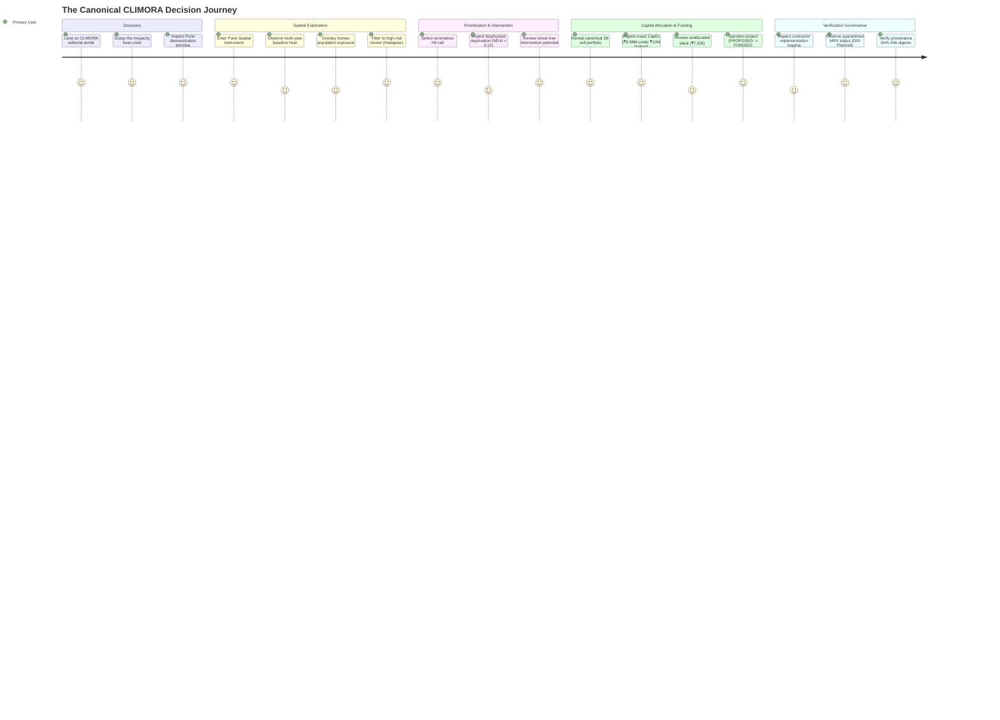

# CLIMORA — PHASE 2C.1 INFORMATION ARCHITECTURE & USER JOURNEY DESIGN
## Product UX Architecture, Spatial Decision Engine & Interaction Governance

**Document Version:** 1.0.0  
**Phase:** Phase 2C.1 — Information Architecture & User Journey Design  
**Target Document Path:** `docs/frontend/design/phase-2c1-information-architecture.md`  
**Companion Document:** [`docs/frontend/design/phase-2c1-user-journey.md`](file:///c:/Users/lenovo/climora/docs/frontend/design/phase-2c1-user-journey.md)  
**Governing Roles:** Principal Product Designer, Senior UX Architect, Information Architect, Senior UI/UX Engineer, Product Strategist  
**Status:** **RATIFIED PRODUCT ARCHITECTURE SPECIFICATION**  
**Upstream System Frozen Baseline:** Phase 1A through Phase 1H.2, Phase 2A, Phase 2B, Phase 2C.0 (160 tests passing, 0 failures, 0 regressions)  
**Scientific Formulations Introduced:** **NONE** (Zero scientific recalculation; formulations $F\text{-}19$ through $F\text{-}28.1$ remain frozen)  

---

## 1. EXECUTIVE UX THESIS

> **"CLIMORA turns spatial climate evidence into fundable urban interventions."**

The defining tragedy of municipal climate adaptation is not a lack of earth-observation data; it is the **inability to translate planetary observations into bankable municipal capital allocations**. 

Satellite remote sensing produces millions of thermal and spectral pixels that languish inside scientific academic papers. Meanwhile, municipal commissioners and urban development authorities allocate infrastructure budgets using historical intuition, political lobbying, or coarse administrative boundary averages. 

CLIMORA bridges this gap. It does not treat the user as a data scientist operating a Python notebook, nor does it degrade the intelligence into a superficial SaaS administrative dashboard. Instead, CLIMORA is structured as an **editorial spatial decision instrument** that transforms raw planetary observations into a mathematically defensible, fundable project proposal:

$$\mathbf{OBSERVE} \longrightarrow \mathbf{UNDERSTAND} \longrightarrow \mathbf{IDENTIFY} \longrightarrow \mathbf{PRIORITIZE} \longrightarrow \mathbf{INTERVENE} \longrightarrow \mathbf{FUND} \longrightarrow \mathbf{IMPLEMENT} \longrightarrow \mathbf{VERIFY}$$

The user experience moves purposefully from **planetary evidence** to **local street-corridor interventions**, answering seven fundamental executive questions in a calm, progressive sequence:
1. *Where is the microclimatic heat crisis?* (Spatial Thermal Signal)
2. *Why does this area suffer?* (Biophysical and Structural Deprivation)
3. *Who is bearing the human burden?* (Demographic & Infrastructure Exposure)
4. *Where should municipal capital be prioritized?* (H3 Spatial Autocorrelation & LISA Hotspots)
5. *What specific physical infrastructure should be deployed?* (Street-Tree Shading)
6. *What does it cost and what is the exact budget slack?* (₹9,992,500 CapEx vs ₹10M Envelope)
7. *How do we prove to financiers that it worked?* (MRV Difference-in-Differences Verification)

---

## 2. PRIMARY PERSONA & STAKEHOLDER ECOSYSTEM

To prevent feature creep and interface dilution, the entire Phase 2C frontend is architected around a single **Primary Persona**. Secondary personas are accommodated strictly through progressive disclosure drawers and exportable forensic artifacts.

```
+----------------------------------------------------------------------------------------------------+
|                                    CLIMORA USER ECOSYSTEM                                          |
|                                                                                                    |
|  [ PRIMARY USER ]                  [ SECONDARY USER A ]             [ SECONDARY USER B ]           |
|  Municipal Resilience Director /   Climate Infrastructure Funder /  Geospatial Environmental       |
|  Urban Development Commissioner    Green Bond Assessor              Data Scientist                 |
|                                                                                                    |
|  Goal: Allocate ₹10M municipal     Goal: Underwrite municipal debt; Goal: Audit formulas, band     |
|  budget to verified cooling.       verify additionality & MRV.      math, and spatial weights.     |
|  Needs: Decisions, costs, wards.   Needs: Immutability, audit logs. Needs: Parquet, SHA256, code.  |
|  Entry: Level 1-2 Disclosure       Entry: Level 3-4 Disclosure      Entry: Level 4 Deep Provenance |
+----------------------------------------------------------------------------------------------------+
```

### 2.1 Primary Persona: The Municipal Resilience Director (Dr. Aris Thorne)
- **Role:** Additional Commissioner (Projects & Environment), Pune Municipal Corporation (PMC).
- **Mandate:** Disburse a ₹10,000,000 Special Climate Resilience Grant before fiscal year closing.
- **Mental Model:**
  - Thinks in terms of statutory administrative wards, street corridors, capital expenditure (CapEx), citizen welfare, contractor tenders, and public accountability.
  - Understands climate risks, heat waves, and canopy cover, but **does not** write code, run linear solvers, or process raster GeoTIFF files.
  - Needs absolute legal and scientific defensibility when answering to the Municipal Standing Committee.
- **Core Friction:** Terrified of committing public funds to non-performing projects or greenwashed initiatives that fail audit inspection.
- **UX Requirement:** Must see the exact physical scope (2,695 trees), exact cost (₹9,992,500), exact remaining slack (₹7,500), and protected population (118,941) without wading through algorithmic code.

### 2.2 Secondary Personas (Progressively Disclosed)
1. **The Green Bond Underwriter / Institutional Funder:**
   - Needs: Immutability guarantees, SHA-256 asset verification, third-party MRV audit readiness, and clear quarantine of modeled projections from verified impacts.
2. **The Geospatial Scientific Auditor:**
   - Needs: Sensor metadata (Landsat-8/9 TIRS vs Sentinel-2 MSI), temporal window comparability (DOY 105 $\pm$ 15), QA pixel masking percentages, and mathematical formulation references ($F\text{-}19$ to $F\text{-}28$).

---

## 3. PRODUCT MENTAL MODEL

CLIMORA operates on a **four-stage transformation pipeline** that matches how institutional capital actually flows:

```
+----------------------------------------------------------------------------------------------------+
|                                    THE CLIMORA MENTAL MODEL                                        |
|                                                                                                    |
|   1. THE PLANETARY SIGNAL          2. THE MUNICIPAL NEED           3. THE CAPITAL BLUEPRINT        |
|   Earth Observation Satellites     H3 Spatial Discretization       Mixed-Integer Optimization      |
|   (Landsat 8/9 TIRS & Sentinel-2)  (Thermal Hazard + Exposure)     (₹10M Budget + 28 Selected Cells)|
|                │                                │                                │                 |
|                ▼                                ▼                                ▼                 |
|         [ RAW EVIDENCE ]                [ PRIORITIZED RISK ]             [ FUNDABLE PROJECT ]      |
|                │                                │                                │                 |
|                └────────────────────────────────┴────────────────────────────────┘                 |
|                                                 │                                                  |
|                                                 ▼                                                  |
|                                    4. THE AUDITABLE VERIFICATION                                   |
|                                    MRV & Difference-in-Differences                                 |
|                                    (Quarantined until empirical overpass)                          |
+----------------------------------------------------------------------------------------------------+
```

1. **Planetary Signal $\rightarrow$ Evidence:** Raw thermal infrared radiances and optical bands are converted into calibrated Land Surface Temperature ($LST$), NDVI, and multi-year anomalies.
2. **Evidence $\rightarrow$ Risk:** Biophysical evidence is combined with WorldPop dasymetric population counts and OSM road networks onto an invariant H3 Resolution 9 mesh.
3. **Risk $\rightarrow$ Fundable Project:** An allocation engine applies mathematical optimization under a hard budgetary constraint (₹10,000,000), producing an immutable portfolio.
4. **Project $\rightarrow$ Verified Reality:** Physical deployment is tracked via contractor logs, and impact is locked until rigorous post-implementation satellite MRV audits certify cooling.

---

## 4. THE CORE PRODUCT LOOP

The user progresses through nine discrete stages. Each stage is strictly anchored in specific backend endpoints, UI components, and disclosure levels:

```
+----------------------------------------------------------------------------------------------------+
| STAGE        | USER QUESTION             | BACKEND CONTRACT       | PRIMARY UI OBJECT              |
+--------------+---------------------------+------------------------+--------------------------------+
| 1. DISCOVER  | What is CLIMORA?          | Static Editorial       | Editorial Hero & Narrative Hook|
| 2. EXPLORE   | Where is Pune's heat?     | QueryLayer / Baseline  | Full-Bleed H3 Mesh Map         |
| 3. DIAGNOSE  | Why is this cell hot?     | GET /baseline?h3=...   | Cell Inspection Drawer         |
| 4. PRIORITIZE| Where is risk concentrated?| QueryLayer (LISA)     | Hotspot Cluster Selector       |
| 5. INTERVENE | What can we build here?   | GET /projects/{id}     | Intervention Action Blueprint  |
| 6. ALLOCATE  | Where does money go?      | GET /allocation        | 28-Cell Capital Breakdown      |
| 7. FUND      | How do we sanction this?  | POST /transition       | Fundable Proposal Artifact     |
| 8. IMPLEMENT | Is the work being done?   | POST /impl-events      | Contractor Deployment Ledger   |
| 9. VERIFY    | Did it actually cool?     | GET /mrv & POST /verif | Locked MRV Difference Gate     |
+----------------------------------------------------------------------------------------------------+
```

---

## 5. USER JOURNEY ARCHITECTURE

The end-to-end user journey is designed as an unbroken narrative arc. The user never encounters an empty state, a dead-end screen, or an uncontextualized configuration panel.



---

## 6. INFORMATION ARCHITECTURE & NAVIGATION MODEL

CLIMORA deliberately rejects the traditional SaaS layout consisting of a bulky left-sidebar navigation and a cluttered top bar. 

### 6.1 Top-Level Canonical Navigation
The navigation is ultra-minimalist, editorial, and persistent across the public and operational environments:

```
+----------------------------------------------------------------------------------------------------+
|  CLIMORA                     [ 01 / OVERVIEW ]   [ 02 / EXPLORE ]   [ 03 / PROJECT ]   [ PUNE: ACTIVE ]|
+----------------------------------------------------------------------------------------------------+
```

- **Brand Anchor (`CLIMORA`):** Always returns to the top-level narrative landing surface.
- **`01 / OVERVIEW`:** Public-facing editorial briefing, problem statement, and methodology primer.
- **`02 / EXPLORE`:** Interactive spatial instrument for Pune; citywide thermal baseline, exposure, and cluster exploration.
- **`03 / PROJECT`:** The canonical demonstration project (`PROJ-PUNE-2025-BA225D6A`), structured into six contextual views.
- **Status Indicator (`[ PUNE: 2025 BASELINE ]`):** Technical monospace status chip indicating active geographic corpus and data lake status.

### 6.2 Structural View Hierarchy
Rather than creating dozens of disconnected URLs, the application organizes complex spatial intelligence into **3 Canonical Routes** with contextual sub-views and inspection drawers:

```
/ (ROOT: Editorial Public Landing)
│
├── /explore/pune (Citywide Spatial Intelligence Instrument)
│   ├── View Mode: Thermal Baseline (Observed LST & Derived Anomaly)
│   ├── View Mode: Demographic Exposure (WorldPop 2020 & Road Density)
│   ├── View Mode: Climate Risk Surface (F-22 Composite Risk Surface)
│   ├── View Mode: Spatial Hotspots (LISA Moran's I Quadrants)
│   └── Drawer: Single H3 Cell Forensic Inspector
│
└── /projects/PROJ-PUNE-2025-BA225D6A (Canonical Project Decision Suite)
    ├── Tab 1: Executive Overview (Decision Briefing & Sanction Status)
    ├── Tab 2: Allocation Blueprint (Interactive 28-Cell Mesh & Planting Blueprint)
    ├── Tab 3: Baseline Evidence (Cell-by-Cell Observed & Derived Metrics)
    ├── Tab 4: Capital & Budget (₹10M Financial Envelope, Unit Costs & Slack)
    ├── Tab 5: Implementation & MRV (Contractor Ledger & Verification Gateway)
    └── Modal: Forensic Lineage (Parquet SHA-256 & Mathematical Formulations)
```

---

## 7. ROUTE ARCHITECTURE & NAVIGATION SPECS

| Route Path | View Title | User Objective | Primary Data Source | Key Interactions |
| :--- | :--- | :--- | :--- | :--- |
| `/` | *The Climate-Capital Crisis* | Understand the urban heat problem and CLIMORA's decision thesis. | Static CMS / Narrative Markdown | Scrollytelling, case study cards, `[ Enter Pune Instrument ]` CTA. |
| `/explore/pune` | *Pune Spatial Intelligence Instrument* | Diagnose spatial heat hazard, population exposure, and priority clusters across Pune. | `query_layer.py` (Feature Matrix & Risk Surface) | Map layer toggles, H3 hover, cell selection, drawer reveal, `[ View Optimized Project ]`. |
| `/projects/:id` | *Canonical Project Decision Suite* | Review, sanction, budget, track, and verify the municipal intervention. | `GET /projects/{id}`, `/allocation`, `/baseline`, `/mrv` | Tab navigation, budget slider, state transition, contractor log form, lineage modal. |

---

## 8. PUBLIC EXPERIENCE ARCHITECTURE (`/`)

The public-facing experience (`/`) is an **award-winning digital climate monograph**. It establishes intellectual gravitas and municipal urgency before introducing software controls.

```
+----------------------------------------------------------------------------------------------------+
| SECTION 1: EDITORIAL HERO                                                                          |
| "Turning Planetary Observations into Fundable Urban Interventions."                                |
| Subhead: A mathematical decision-support instrument for municipal heat resilience in Pune, India. |
| CTA: [ Explore Pune Spatial Evidence ]                                                             |
+----------------------------------------------------------------------------------------------------+
| SECTION 2: THE METROPOLITAN CRISIS (Editorial Layout)                                              |
| 3 Columns:                                                                                         |
| Col 1: The Thermal Reality (Landsat 5-Year Pre-Monsoon Peak: 46.36°C baseline mean).               |
| Col 2: The Human Vulnerability (118,941 residents in critical built-up corridors).                 |
| Col 3: The Capital Impasse (Ad-hoc spending without spatial optimization or empirical proof).       |
+----------------------------------------------------------------------------------------------------+
| SECTION 3: THE DECISION SYSTEM (Interactive Visual Flow)                                           |
| Visualizing the shift: SATELLITE RASTER -> H3 RES-9 MESH -> MILP OPTIMIZATION -> MUNICIPAL BOND     |
+----------------------------------------------------------------------------------------------------+
| SECTION 4: THE PUNE DEMONSTRATION BRIEFING                                                         |
| Highlighting: 28 Cells | 2,695 Street Trees | ₹9,992,500 CapEx | ₹10M Envelope                     |
| CTA: [ Open Canonical Project PROJ-PUNE-2025-BA225D6A ]                                            |
+----------------------------------------------------------------------------------------------------+
| SECTION 5: INSTITUTIONAL FOOTER & REPOSITORY TELEMETRY                                             |
| Live system status, SHA-256 verified badges, USGS/Copernicus citations, legal disclaimers.         |
+----------------------------------------------------------------------------------------------------+
```

---

## 9. EXPLORE / PUNE ARCHITECTURE (`/explore/pune`)

The spatial exploration environment is the primary analytical instrument of CLIMORA. It is engineered to give decision-makers instant spatial intuition without confusing GIS layers.

```
+----------------------------------------------------------------------------------------------------+
|  TOP BAR: CLIMORA   [ OVERVIEW ]  [ EXPLORE: PUNE ]  [ PROJECT ]          [ H3 RES-9 | AOI: 4194 ] |
+----------------------------------------------------------------------------------------------------+
|                                                                    | FLOATING VIEWPORT HUD         |
|                                                                    | [ Thermal ] [ Exposure ]      |
|                                                                    | [ Risk ]    [ Hotspots ]      |
|                                                                    +-------------------------------+
|                                                                    | ACTIVE SELECTION CARD         |
|                                                                    | Ward 14: Hadapsar Corridors   |
|                                                                    | Treated Cells: 28 / 2,695     |
|                                                                    | Mean LST: 46.69°C             |
|                                                                    | [ View Project Portfolio -> ] |
|                                                                    +-------------------------------+
|                      FULL-SCREEN INTERACTIVE MAP                   |                               |
|                     (Uber H3 Res-9 Mesh over Pune)                 |                               |
|                                                                    |                               |
|                                                                    |                               |
|                                                                    |                               |
+--------------------------------------------------------------------+-------------------------------+
| BOTTOM INSTRUMENT BAR:                                                                             |
| [ Metric: Land Surface Temp ]  [ Sensor: Landsat-8/9 TIRS ]  [ DOY: 105 ]  [ Cloud: 0.0% ] [ SHA: OK ]|
+----------------------------------------------------------------------------------------------------+
```

### 9.1 The Four Spatial Analytical View Modes
1. **Thermal Baseline View:** Displays 2025 observed Land Surface Temperature ($LST_{2025}$) and 5-year derived anomaly ($\Delta LST$). Palettes range from warm sand to scorched terracotta.
2. **Demographic Exposure View:** Overlays WorldPop 2020 dasymetric population density and OSM road lengths. Highlights where high human density coincides with zero tree canopy.
3. **Compound Climate Risk View:** Visualizes the canonical $F\text{-}22$ Climate Risk Surface ($Risk_i = H_i \cdot E_i \cdot V_i$). Demonstrates that unpopulated areas have zero risk by mathematical axiom.
4. **Spatial Hotspot (LISA) View:** Displays Anselin Local Moran's $I$ spatial clusters (High-High priority intervention zones vs Low-Low spatial cold spots).

---

## 10. H3 CELL INTERACTION ARCHITECTURE

The primary unit of spatial reasoning is the **H3 Resolution 9 hexagon** (~0.10 $\text{km}^2$). Clicking any cell on the map halts camera motion and opens the **Contextual Cell Inspector Drawer** on the right side of the screen.

```
+---------------------------------------------------------------------------------------------------+
| CONTEXTUAL CELL INSPECTOR DRAWER (Right Rail, 420px Width)                                        |
+---------------------------------------------------------------------------------------------------+
| HEADER: H3 Cell 89608850003ffff                                      [ CLOSE (ESC) ]              |
| Context: Hadapsar Industrial Corridor | Administrative Ward: 14 (Display Context Only)            |
+---------------------------------------------------------------------------------------------------+
| LEVEL 1: THE EXECUTIVE SUMMARY                                                                    |
| Status: INCLUDED IN CANONICAL OPTIMIZATION (1 of 28 Treated Footprint)                            |
| Action: Deploy 110 Street Trees | Allocated Cost: ₹405,000                                        |
+---------------------------------------------------------------------------------------------------+
| LEVEL 2: OBSERVED BIOPHYSICAL EVIDENCE                                                            |
| Observed Surface Temp (2025):  46.69°C       [ OBSERVED | Landsat-9 TIRS DOY 105 ]                 |
| 5-Year Baseline Mean LST:      46.36°C       [ DERIVED  | 5-Yr Pre-Monsoon Mean ]                 |
| Surface Thermal Anomaly:       +0.33°C       [ DERIVED  | Absolute Deviation ]                    |
| Biophysical Canopy (NDVI):     0.082         [ OBSERVED | Sentinel-2 MSI (Severely Deficient) ]   |
| Built-Up Density (NDBI):       0.241         [ OBSERVED | Sentinel-2 MSI (High Thermal Mass) ]    |
+---------------------------------------------------------------------------------------------------+
| LEVEL 3: COMPOUND RISK & EXPOSURE                                                                 |
| Protected Human Population:    4,281 residents                                                    |
| Arterial Road Length:          1,840 meters                                                       |
| Moran's I Spatial Cluster:     HIGH-HIGH HOTSPOT (p < 0.01)                                       |
| Composite Risk Score:          0.2345        [ MODELED  | F-22 Formulation ]                      |
+---------------------------------------------------------------------------------------------------+
| LEVEL 4: INTERVENTION BLUEPRINT                                                                   |
| Selected Intervention:         Street Tree Canopy Shading (10m crown)                             |
| Roadside Spacing:              15.0m intervals along public right-of-way                          |
| Modeled Cell Cooling:          0.078°C       [ MODELED  | F-25.1 Scenario ]                       |
+---------------------------------------------------------------------------------------------------+
| LEVEL 5: FORENSIC PROVENANCE & AUDIT TRAIL                                                        |
| Source Parquet: canonical_feature_matrix.parquet (SHA: 76f344b1...)                                |
| Solver Status: OPTIMAL (HiGHS MILP, F-24 Optimization Formulation)                                |
+---------------------------------------------------------------------------------------------------+
```

### 10.2 UX Rationale for the Side Drawer Form-Factor
- **Why a Side Drawer (not a modal)?** A modal obscures the spatial context. The user must see the selected hexagon and its spatial neighbors while reading its analytical metrics.
- **Why not a floating tooltip?** Tooltips cannot support five levels of progressive disclosure and forensic provenance without becoming visually chaotic.

---

## 11. PROJECT EXPERIENCE ARCHITECTURE (`/projects/:id`)

The demonstration project representation ([`PROJ-PUNE-2025-BA225D6A`](file:///c:/Users/lenovo/climora/data/processed/projects/project_pune_2025_tree_shade_10m.json)) transforms the 13 canonical backend sections into an **authoritative, 6-view municipal investment prospectus**:

```
+----------------------------------------------------------------------------------------------------+
| PROJECT BANNER: PROJ-PUNE-2025-BA225D6A                                                            |
| Pune Urban Heat Island Mitigation & Street Canopy Initiative                                       |
| Status: PROPOSED  | Beneficiary: Pune Municipal Corporation | Price Basis: 2025 INR                |
+----------------------------------------------------------------------------------------------------+
| NAVIGATION TABS:                                                                                   |
| [ 1. OVERVIEW ]  [ 2. ALLOCATION ]  [ 3. BASELINE ]  [ 4. BUDGET ]  [ 5. MRV ]  [ 6. PROVENANCE ]  |
+----------------------------------------------------------------------------------------------------+
```

### 11.1 View 1: Executive Overview (The Decision Brief)
- **Primary Metric Bar:**
  - *Capital Required:* **₹9,992,500** (`MODELED`)
  - *Budget Ceiling:* **₹10,000,000** (Municipal Allocation Envelope)
  - *Unallocated Slack:* **₹7,500** (Surplus retained by treasury)
  - *Target Scope:* **2,695 Street Trees** across **28 H3 Cells**
  - *Protected Population:* **118,941 residents** (`OBSERVED`, WorldPop 2020)
  - *Modeled Objective Score:* **0.106048** (`MODELED`, F-24 Risk-Objective Reduction)
- **The Decision Action:** A prominent municipal sanction module allowing the Director to execute the state transition `PROPOSED -> FUNDED` by attaching a Sanction Order ID and notes.

### 11.2 View 2: Spatial Allocation Blueprint
- Visualizes the 28 treated cells as an interconnected municipal deployment network.
- Paginated tabular view (28 rows default) showing: Cell Index, Ward Context, Allocated Trees, Direct Planting Cost (₹3,500/tree), Mobilization Cost (₹20,000/cell), and Total Cell CapEx.
- Enforces **Allocation Immutability:** Any direct edit attempt triggers a clear notice: *"Canonical optimization is immutable. Proposed modifications must be branched as an auditable revision."*

### 11.3 View 3: Baseline Evidence Grid
- Cell-by-cell scientific baseline comparing observed 2025 summer temperatures with the 5-year historical average (2021–2025).
- Displays explicit biophysical indices: NDVI canopy deficit, NDBI built-up density, and absolute thermal anomalies.

### 11.4 View 4: Capital & Budget Transparency
- Transparent breakdown of every rupee in the ₹10M envelope:
  - Direct Sapling Procurement & 2m Tree Guards: **₹9,432,500** (2,695 $\times$ ₹3,500)
  - Cell Mobilization, Utility Clearance & Logistics: **₹560,000** (28 $\times$ ₹20,000)
  - Total Modeled CapEx: **₹9,992,500**
  - Unallocated Treasury Slack: **₹7,500**
- Compares against traditional ad-hoc municipal tree-planting budgets to demonstrate that spatial optimization avoids capital misallocation.

### 11.5 View 5: Physical Implementation & MRV Gateway
- Tracks physical deployment progress as contractors complete street planting.
- Exposes the contractor logging form (`POST /projects/{id}/implementation-events`).
- Evaluates operational deviations against the canonical target using the frozen $F\text{-}27.2$ formulation.
- Displays the locked verification gate, preventing premature claims.

### 11.6 View 6: Scientific Lineage & Provenance Modal
- Displays full cryptographic and mathematical traceability:
  - Solver Engine: `HiGHS (scipy.optimize.milp)`
  - Optimization Runtime: `70.13 seconds`
  - Candidate Pairs Evaluated: `7,115 pairs`
  - Canonical Parquet Artifact SHA-256 Checksums.

---

## 12. THE "FUNDABLE PROJECT MOMENT"

The climax of the CLIMORA user experience occurs when exploratory spatial evidence coalesces into a **certified, fundable municipal project**.

```
+----------------------------------------------------------------------------------------------------+
|                                THE FUNDABLE PROJECT TRANSFORMATION                                 |
|                                                                                                    |
|  EXPLORATORY STAGE                     OPTIMIZATION STAGE                 SANCTIONED STAGE         |
|  "Pune is hot; 118k people             "HiGHS solver identifies 28        "Official Project        |
|  are exposed in Hadapsar."             cells and 2,695 trees under        PROJ-PUNE-2025-BA225D6A  |
|                                        ₹10,000,000 budget."               sanctioned for tenders." |
|             │                                   │                                   │              |
|             ▼                                   ▼                                   ▼              |
|     [ RAW RISK HEATMAP ]               [ CANDIDATE PORTFOLIO ]             [ MUNICIPAL PROSPECTUS ]|
+----------------------------------------------------------------------------------------------------+
```

### The UX Anatomy of the Moment:
1. **The Culmination Trigger:** The user clicks `[ Assemble Fundable Proposal ]` after exploring the 28 priority cells.
2. **The Assembly Animation (Engineered & Calm):** The map smoothly frames the 28-cell boundary. The sidebar collapses, and the **Canonical Project Proposal Document** materializes with quiet authority.
3. **The Executive Summary Card:** Highlights the exact budgetary balance (₹9,992,500 with ₹7,500 slack), removing all uncertainty.
4. **The Sanction Action:** Clicking `[ Sanction Project & Issue Tender ]` prompts for a municipal administrative sanction number (e.g., `PMC-RESILIENCE-2025-084`), transitioning the lifecycle state from `PROPOSED` to `FUNDED`.

---

## 13. MRV EXPERIENCE & VERIFICATION GATEWAY

CLIMORA treats verification with scientific solemnity. It refuses to flatter the user with synthetic successes or premature impact claims.

```
+----------------------------------------------------------------------------------------------------+
|                               THE MRV VERIFICATION STATE MACHINE                                   |
|                                                                                                    |
|  [ PROPOSED ] ──► [ FUNDED ] ──► [ IMPLEMENTING ] ──► [ IMPLEMENTED ] ──► [ MONITORING ]           |
|                                                                                 │                  |
|                                                                                 ▼                  |
|  [ VERIFIED ] ◄── [ 3RD-PARTY AUDIT ] ◄── [ QC PASS ] ◄── [ SATELLITE PASS ] ◄──┘                  |
+----------------------------------------------------------------------------------------------------+
```

### 13.1 State Definitions & Visual UI Rules

| Lifecycle State | Visual Indicator | UI Permissions | Status Description & Data Rules |
| :--- | :--- | :--- | :--- |
| **`PROPOSED`** | Neutral Stone Pill | Read / Propose Revision / Sanction | Project generated from canonical optimization; awaiting budget sanction. |
| **`FUNDED`** | Amber Pill | Read / Begin Implementation | Capital sanctioned; ready for contractor mobilization. |
| **`IMPLEMENTING`** | Cool Slate Pill | Log Implementation Events | Contractors actively planting street trees; logging physical units. |
| **`IMPLEMENTED`** | Botanical Sage Pill| Lock Implementation / Await Overpass | All 2,695 trees planted; awaiting post-intervention summer overpass. |
| **`MONITORING`** | Deep Forest Pill | Submit Satellite Observation | Saplings maturing; waiting for canonical April window (DOY 95–115). |
| **`VERIFIED`** | Audited Gold / Diamond | Read-Only Immutable Certified | **Currently Locked / Unobserved.** Requires empirical overpass and audit. |

### 13.2 The Anti-Contamination Gate in the UI
If a user attempts to submit synthetic data or incompatible sensors, the UI immediately surfaces an educational error envelope adhering to the Phase 2B contract:
- **Synthetic Data Rejection:** *"Synthetic demonstration data (`DEMO_ONLY_SYNTHETIC_MRV_DATA`) detected. In accordance with CLIMORA verification governance, synthetic fixtures cannot certify production projects."*
- **Sentinel-2 Thermal Rejection:** *"Sensor `Sentinel-2 MSI` is an optical instrument and lacks a thermal infrared payload. Verification of Land Surface Temperature ($LST$) requires Landsat-8/9 TIRS or calibrated radiometers."*
- **Temporal Window Rejection:** *"Observation date is outside the canonical pre-monsoon peak window (DOY 95–115). Observations outside this window cannot be compared against the baseline."*

---

## 14. PROGRESSIVE DISCLOSURE MODEL

CLIMORA enforces a strict **4-Tier Progressive Disclosure Model** across all views:

```
+----------------------------------------------------------------------------------------------------+
| LEVEL 1: EXECUTIVE DECISION                                                                        |
| "Deploy 2,695 street trees across 28 critical heat zones in Pune for ₹9.99M."                      |
| Visible to all users immediately. Zero scientific jargon.                                          |
+----------------------------------------------------------------------------------------------------+
  │
  ▼  [ Click "Why these 28 cells?" ]
+----------------------------------------------------------------------------------------------------+
| LEVEL 2: SPATIAL EVIDENCE                                                                          |
| "Persistent summer heat > 46.3°C, vegetative deficit (NDVI < 0.12), 118,941 exposed citizens."    |
| Surfaces observed biophysical and demographic realities.                                           |
+----------------------------------------------------------------------------------------------------+
  │
  ▼  [ Click "Inspect Optimization Model" ]
+----------------------------------------------------------------------------------------------------+
| LEVEL 3: ANALYTICAL & ECONOMIC FORMULATION                                                         |
| "MILP Formulation F-24 under ₹10M budget ceiling with minimum lot size 50 trees/cell."             |
| Surfaces mathematical objective function, decision variables, and unit cost parameters.            |
+----------------------------------------------------------------------------------------------------+
  │
  ▼  [ Click "View Cryptographic & Sensor Lineage" ]
+----------------------------------------------------------------------------------------------------+
| LEVEL 4: FORENSIC SCIENTIFIC PROVENANCE                                                            |
| "Landsat-9 C2 L2 ST_B10 (DOY 105), QA_PIXEL cloud screening, Parquet SHA-256: 76f344b147..."       |
| Complete reproducibility for scientific auditors, bond underwritings, and legal inquiries.         |
+----------------------------------------------------------------------------------------------------+
```

---

## 15. BACKEND / API → UX MAPPING MATRIX

The following contract binds every frontend screen and interaction to the hardened Phase 2B backend:

| Product View / Action | Backend Endpoint | HTTP Method | Expected Payload / Response Keys | Truth Layer | UI Error Handling Strategy |
| :--- | :--- | :---: | :--- | :--- | :--- |
| **Project Summary List** | `/projects` | `GET` | `projects`: Array of high-level summaries | Mixed | Display retry banner; fallback to cached summary. |
| **Project Detail Suite** | `/projects/{id}` | `GET` | `project`: 13-section canonical object | Mixed | 404 triggers clean "Project Not Found" screen. |
| **28-Cell Allocation Mesh**| `/projects/{id}/allocation` | `GET` | `allocations`, `portfolio_summary` | `MODELED` | 400 triggers query parameter sanitization. |
| **Allocation Mutation Attempt**| `/projects/{id}/allocation` | `PUT/PATCH` | Rejected with HTTP 405 (`ALLOCATION_IMMUTABLE`) | N/A | UI prevents direct PUT; redirects to `/revisions`. |
| **Baseline Evidence Grid** | `/projects/{id}/baseline` | `GET` | `cells`: Array of observed & derived metrics | `OBSERVED` / `DERIVED` | Graceful fallback to portfolio-level baseline. |
| **MRV & DID Status** | `/projects/{id}/mrv` | `GET` | `mrv_status`, `implementation_progress` | `MODELED` / `VERIFIED` | Surfaces `PLANNED / NOT_YET_EXECUTABLE` notice. |
| **Log Contractor Planting** | `/projects/{id}/implementation-events` | `POST` | Body: `ImplementationEventCreateRequest` | `OBSERVED` | Displays form validation error details cleanly. |
| **Propose Revised Allocation**| `/projects/{id}/revisions` | `POST` | Body: `AllocationRevisionRequest` | `MODELED` | Replaces active cache; shows audit branch notice. |
| **Sanction Lifecycle State**| `/projects/{id}/transition` | `POST` | Body: `StateTransitionRequest` | `MODELED` | 422 surfaces illegal state machine transition notice. |
| **Submit Verification Event**| `/projects/{id}/verification-events` | `POST` | Body: `VerificationEventCreateRequest` | `VERIFIED` | 422 explains synthetic or sensor mismatch gate. |

---

## 16. UI STATE ARCHITECTURE

To ensure visual consistency, the frontend defines 12 authoritative UI states. In particular, the system enforces **unmistakable visual divergence between `MODELED` and `VERIFIED`**:

```
+----------------------------------------------------------------------------------------------------+
|                                  TRUTH STATE VISUAL CONTRAST                                       |
|                                                                                                    |
|  MODELED STATE (Prospective Simulation)          VERIFIED STATE (Empirical Confirmation)           |
|  - Surface: Warm Ochre / Amber tint              - Surface: High-Contrast Forest & Diamond Emblem  |
|  - Border: 1px dashed amber hairline             - Border: 1px solid deep emerald hairline         |
|  - Text: "MODELED (F-24 Optimization Projection)"- Text: "VERIFIED (Audited Satellite Overpass)"   |
|  - Icon: Math Sigma / Scenario glyph             - Icon: Cryptographic Check / Audit Stamp         |
|  - Disclaimer: Ex-ante simulation; not empirical - Disclaimer: Certified empirical impact          |
+----------------------------------------------------------------------------------------------------+
```

### Complete UI State Inventory:
1. **Default State:** Pristine, calibrated display of baseline evidence and canonical metrics.
2. **Loading State:** Content-preserving hairline skeleton screens. Map displays an understated pulsing coordinate marker; numbers display soft opacity fades.
3. **Empty State:** Never a dead end. Displays explanatory guidance (e.g., *"No contractor implementation events logged yet. Groundbreaking scheduled for Q4 2025."*).
4. **Error State:** Standardized error modal/banner parsing the backend's unified error envelope (`error.code`, `error.message`, `error.details`).
5. **Partial Data State:** Cells with missing temporal data ($K_{valid} < 4$) clearly show a hatch pattern and an explicit notice: *"Insufficient clear-sky Landsat overpasses."*
6. **No Selection State:** Map displays the global 28-cell boundary; right drawer displays portfolio-level executive metrics.
7. **Cell Selected State:** The active hexagon receives a 1.5px acid lime focal border; contextual drawer opens with 5 levels of disclosure.
8. **Drawer Open State:** Map dims subtly (10% darkening) to focus attention while retaining spatial landmark orientation.
9. **Modal Open State:** Centered dialog for deep lineage or revision submission; background blurred with backdrop-filter.
10. **Immutable Guard State:** When hovering over locked fields, a padlock icon appears with the tooltip: *"Canonical allocation is immutable by governance mandate."*
11. **Verification Blocked State:** Verification button is disabled with an amber safety pill: *"Requires 100% completed physical planting and valid post-deployment Landsat overpass."*
12. **Quarantined Synthetic State:** Any demo fixture triggers a diagonal watermark: `SYNTHETIC DEMONSTRATION FIXTURE — NOT PRODUCTION VERIFIED`.

---

## 17. THE MAP AS A PRIMARY SCIENTIFIC INSTRUMENT

The map in CLIMORA is not an accessory widget; it is the **primary cognitive anchor** of the platform.

```
+----------------------------------------------------------------------------------------------------+
|                                    MAP INSTRUMENT CONTROLS                                         |
|                                                                                                    |
|  1. COORDINATE TICK MARKS           Hairline latitude/longitude markers along canvas borders.      |
|  2. GEOMETRIC PROJECTION            EPSG:4326 WGS-84 coordinate system with local meter scaling.   |
|  3. VIEWPORT TELEMETRY HUD          Top-right chip: Lat 18.5204° N, Lon 73.8567° E | Zoom: 13.5    |
|  4. MINIMALIST LAYER TOGGLE         Understated pill group: [ Thermal ] [ Canopy ] [ Risk ]        |
|  5. RESOLUTION CALIBRATOR           Indicates Uber H3 Resolution 9 (~0.10 km² average hexagon area)|
|  6. ACCESSIBLE TABULAR SWITCH       One-click toggle: [ View as Accessible Data Table (Alt+T) ]    |
+----------------------------------------------------------------------------------------------------+
```

### 17.1 Map Viewport States for Pune
- **Citywide View (Zoom 10.5):** Centers on Pune Municipal Corporation statutory boundary (AOI: 4194). Displays broad urban heat island morphology.
- **Corridor View (Zoom 12.5):** Focuses on the primary arterial heat corridors (Hadapsar, Bhavani Peth, Shivajinagar).
- **Project View (Zoom 14.0):** Camera smoothly fits the bounding box of the **28 Canonical Treated Cells**, highlighting the intervention footprint.
- **Cell Deep-Dive (Zoom 16.0):** Tight framing of an individual hexagon, revealing 30m Landsat pixel grids, road network paths, and planting lots.

### 17.2 Accessibility Alternative View
For screen-reader users and keyboard-only navigation, pressing `Alt+T` instantly transitions the spatial canvas into a **Semantic Data Table** sorting the 28 cells by temperature anomaly, population exposure, and allocated tree count.

---

## 18. HACKATHON DEMONSTRATION JOURNEY (THE 3–5 MINUTE SCRIPT)

This canonical sequence is optimized for maximum impact during live judging, combining storytelling, technical depth, and flawless narrative flow:

```
+----------------------------------------------------------------------------------------------------+
| BEAT | TIME   | SCREEN / VIEW             | DEMO ACTION & KEY SPOKEN NARRATIVE                     |
+------+--------+---------------------------+--------------------------------------------------------+
| 01   | 0:00   | `/` (Public Landing)      | "Most climate platforms show pretty heat maps that lead|
|      |        |                           | to no action. CLIMORA turns satellite evidence into     |
|      |        |                           | bankable, fundable municipal urban interventions."      |
+------+--------+---------------------------+--------------------------------------------------------+
| 02   | 0:30   | `/explore/pune`           | Enter Pune instrument. Show 5-year pre-monsoon baseline|
|      |        | (Thermal Baseline View)   | Landsat thermal surface. "Pune peaks at 46.36°C."       |
+------+--------+---------------------------+--------------------------------------------------------+
| 03   | 1:00   | `/explore/pune`           | Toggle Human Exposure overlay. "Where does extreme heat|
|      |        | (Exposure View)           | collide with human density? WorldPop 2020 dasymetric." |
+------+--------+---------------------------+--------------------------------------------------------+
| 04   | 1:30   | `/explore/pune`           | Toggle LISA Hotspots. Show Hadapsar High-High cluster. |
|      |        | (Hotspots View)           | "Mathematically verified spatial autocorrelation."     |
+------+--------+---------------------------+--------------------------------------------------------+
| 05   | 2:00   | `/explore/pune`           | Click cell `89608850003ffff`. Drawer slides in. Reveal |
|      |        | (Cell Inspector Drawer)   | biophysical deficit (NDVI = 0.082 vs 46.69°C LST).     |
+------+--------+---------------------------+--------------------------------------------------------+
| 06   | 2:30   | `/projects/:id`           | Click [ Assemble Fundable Project ]. Camera frames the |
|      |        | (Executive Overview)      | 28 cells. Reveal ₹10M budget, ₹9.99M CapEx, ₹7.5k slack|
+------+--------+---------------------------+--------------------------------------------------------+
| 07   | 3:00   | `/projects/:id`           | Open Allocation tab. Show 2,695 trees across 28 cells. |
|      |        | (Allocation Blueprint)    | Attempt direct edit -> show Allocation Immutability.   |
+------+--------+---------------------------+--------------------------------------------------------+
| 08   | 3:30   | `/projects/:id`           | Click [ Sanction Project ]. Input sanction order number|
|      |        | (Lifecycle Transition)    | `PMC-2025-084`. State transitions from PROPOSED->FUNDED|
+------+--------+---------------------------+--------------------------------------------------------+
| 09   | 4:00   | `/projects/:id`           | Open MRV tab. Log 110 planted trees in Hadapsar. Show  |
|      |        | (Implementation Ledger)   | zero deviation. Highlight locked verification gate.    |
+------+--------+---------------------------+--------------------------------------------------------+
| 10   | 4:30   | `/projects/:id`           | Open Lineage Modal. Show SHA-256 digests and HiGHS     |
|      |        | (Provenance Modal)        | solver status. "Every rupee and degree is auditable."   |
+------+--------+---------------------------+--------------------------------------------------------+
| 11   | 4:55   | `/projects/:id`           | Concluding statement: "From planetary observation to   |
|      |        | (Summary Stance)          | municipal ground reality. That is CLIMORA."            |
+------+--------+---------------------------+--------------------------------------------------------+
```

---

## 19. INFORMATION-DENSITY GOVERNANCE

To preserve editorial calm, the frontend adheres to strict mathematical limits on visual density:

1. **Maximum Simultaneous Metrics:** A single screen or drawer zone may display a maximum of **6 primary metrics**. Additional metrics must be relegated to secondary tabs or disclosure drawers.
2. **Whitespace Budget:** At least **35% of the total viewport canvas** must remain negative space, preventing cognitive fatigue.
3. **Monospace Tabular Figure Mandate:** All numerical values, prices, coordinates, dates, and cell identifiers must use tabular monospace (`font-variant-numeric: tabular-nums`) to prevent optical jitter.
4. **No Unranked Card Walls:** Card containers must never be laid out in uniform 3x3 grids. Data is organized in structured, asymmetric editorial sections.

---

## 20. MICROINTERACTION INTENT & CAUSAL MOTION

Motion in CLIMORA is strictly functional, engineered to communicate **cause and effect**:

1. **Spatial Camera Choreography:** Camera moves between Pune city scale and project footprint use a dampened cubic-bezier curve (`cubic-bezier(0.25, 1, 0.5, 1)`) over 900ms.
2. **Tabular Number Interpolation:** When budget sliders or scenario parameters are adjusted, displayed totals interpolate smoothly over 400ms.
3. **Drawer Elasticity:** The cell inspector drawer slides in from the right with a soft physical deceleration, anchoring the user's attention.
4. **Respect for Reduced Motion:** When `prefers-reduced-motion` is detected, all transitions become instantaneous cuts.

---

## 21. ANTI-GENERIC UX AUDIT

Each core screen is evaluated against traditional SaaS failure modes:

| Proposed Screen | Why It Must Exist | Why It Is Not Just a Dashboard | What Makes It Uniquely CLIMORA? |
| :--- | :--- | :--- | :--- |
| **`/` (Public Editorial)** | Establishes the municipal heat crisis and the economic thesis. | It is a long-form climate publication, not a landing page feature list. | Combines institutional gravitas with live data lake telemetry. |
| **`/explore/pune`** | Gives decision-makers spatial intuition across the city. | The map is an active instrument, not a background widget. | H3 Resolution 9 analytical topology completely decoupled from ward politics. |
| **`/projects/:id`** | Delivers the bankable, fundable municipal project proposal. | It is a municipal bond-grade prospectus with legal immutability. | Enforces truth-layer quarantine; guarantees zero client-side calculation. |

---

## 22. OPEN DESIGN DECISIONS FOR PHASE 2C.2

The following visual and structural elements are designated for prototyping in **Phase 2C.2 (Wireframing & Visual System Exploration)**:

1. **Side-by-Side Typography Evaluation:** Testing *Newsreader* vs *Instrument Serif* for Editorial Display; *Geist* vs *Inter Tight* for UI Grotesk.
2. **Calibrated Color Tokens:** Generating exact CSS hex tokens for the mineral/basalt surfaces and terracotta hazard ramps, ensuring WCAG 2.1 AAA contrast.
3. **Wireframe Spatial Proportions:** Testing the split-screen ratio (60% map / 40% inspector vs 70% map / 30% drawer) across standard laptop viewports.
4. **H3 Mesh WebGL Shader Parameters:** Fine-tuning hexagon boundary stroke widths (0.5px vs 1.0px) and fill opacities for dense urban areas.

---

## 23. DESIGN DECISION REGISTER

| Decision Area | Status | Governance Rationale | Requires Phase 2C.2 Exploration? |
| :--- | :--- | :--- | :---: |
| **Primary User Persona** | **FROZEN** | Focused on Municipal Resilience Director; avoids feature creep. | **NO** |
| **Information Architecture Routes** | **FROZEN** | Clean 3-route model: `/`, `/explore/pune`, `/projects/:id`. | **NO** |
| **Top-Level Navigation Model** | **FROZEN** | Editorial top bar + floating spatial HUD. | **NO** |
| **Progressive Disclosure Levels** | **FROZEN** | 4-tier model (Decision $\rightarrow$ Evidence $\rightarrow$ Model $\rightarrow$ Provenance). | **NO** |
| **Cell Inspector Form Factor** | **FROZEN** | Contextual right side drawer (420px width). | **NO** |
| **Demonstration Constants** | **FROZEN** | Pune 28 cells, 2,695 trees, ₹9.99M CapEx, ₹10M budget, ₹7.5k slack. | **NO** |
| **Truth-Layer Visualization Rules** | **FROZEN** | Strict visual divergence between `MODELED` and `VERIFIED`. | **NO** |
| **Hackathon 11-Beat Demo Arc** | **FROZEN** | Scripted 3–5 minute presentation sequence. | **NO** |
| **Exact Typography Pairings** | **NOT FROZEN** | Requires optical comparison in wireframes. | **YES** |
| **Exact Color Hex Values** | **NOT FROZEN** | Requires WCAG 2.1 contrast calibration in CSS tokens. | **YES** |
| **Responsive Mobile Layouts** | **PROVISIONAL**| Bottom-sheet drawer behavior on mobile viewports. | **YES** |

---

## CONCLUSION & ARCHITECTURAL HANDOFF

Phase 2C.1 ratifies the canonical Information Architecture and User Journey Design for CLIMORA. The experience establishes an unshakeable bridge between planetary observation and municipal infrastructure investment.

Execution must now proceed strictly to **Phase 2C.2: Wireframe & Visual System Exploration**.
No frontend code, React components, Tailwind styling, or visual mockups shall be implemented until Phase 2C.2 wireframes are reviewed.
