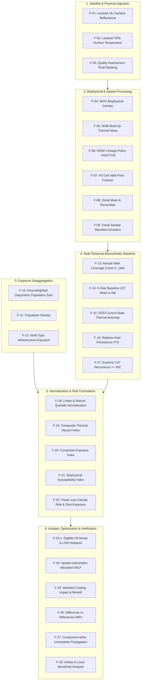

# CLIMORA — Mathematical Formulation Register

**Document Version:** 1.0.0  
**Phase:** Phase 1B Analytical Execution & Scientific Formulation Gate  
**Contract Companion:** [`data/manifests/scientific_formulation_contract.json`](file:///c:/Users/lenovo/climora/data/manifests/scientific_formulation_contract.json)  
**Status:** **RATIFIED & CANONICAL**  
**Lead Roles:** Lead Scientific Systems Architect, Mathematical Modeler, Geospatial ML Engineer, Data Engineer, Software Architect, and Hackathon Chief Engineer  

---

## 1. Executive Summary & Governance Mandate

This Register establishes the authoritative, mathematically explicit, and scientifically qualified formulation contract for the **CLIMORA Climate-Risk Analytical System**.

Operating strictly under frozen Phase 1A baseline data (109 raw assets, 160 processed assets, 5-year April pre-monsoon Landsat stack 2021–2025) and Phase 1B analytical decisions (Uber H3 Resolution 9 primary mesh, PMC statutory wards administrative reporting tier, WorldPop 2020 dasymetric population conservation), this document codifies every equation across the complete analytical lineage:

```text
Raw Observation
  → Preprocessing & QA Masking
  → Spectral Biophysical Indices (NDVI, NDBI)
  → Land Surface Temperature (USGS C2 L2 ST)
  → Spatial Discretization & Zonal Aggregation
  → 5-Year Pre-Monsoon Microclimatic Baseline
  → Current-State Thermal Anomaly (Absolute & Standardized)
  → Relative Heat Persistence (P75 Frequency)
  → Extreme LST Recurrence (>= 45°C Methodological Threshold)
  → Demographic & Infrastructure Exposure Aggregation
  → Biophysical & Structural Susceptibility
  → Composite Hazard, Exposure, and Susceptibility Indices
  → Multiplicative Climate Risk & Zero-Exposure Axiom
  → Spatial Autocorrelation & Hotspot Detection (Global & Local Moran's I)
  → Intervention Allocation & Multi-Objective Spatial Optimization (MILP)
  → Modeled Intervention Cooling Impact & Population-Weighted Benefit
  → Monitoring, Reporting, and Verification (MRV / Difference-in-Differences)
  → Uncertainty Propagation & Sensitivity Analysis
  → Scientific Validation Hierarchy (Level 0 to Level 6)
```

### 1.1 Governance Constraints & Non-Negotiable Axioms
1. **Frozen Temporal Baseline:** Historical statistics strictly derive from the 5 frozen April peak-summer Landsat scenes (`LC08_20210424`, `LC08_20220411`, `LC09_20230422`, `LC08_20240416`, `LC08_20250419`). No scenes are replaced.
2. **Missing Data Rule:** Baseline central tendencies and anomalies require $K_{\text{valid}} \ge 4$ valid years with cell clear-pixel coverage $f_{\text{valid}} \ge 0.70$. No silent imputation is permitted.
3. **Spatial Autocorrelation Caveat:** Spatial pixels are positively autocorrelated ($\text{Moran's } I > 0$). Reporting $\sigma / \sqrt{n}$ as an independent-pixel standard error is strictly prohibited.
4. **Vulnerability Semantics:** Susceptibility is strictly restricted to **Biophysical and Structural Susceptibility** ($1 - \text{NDVI}$ and $\text{NDBI}$). Satellite spectral indices must NEVER be described as measuring human poverty, income, or social deprivation. True socioeconomic vulnerability remains `UNAVAILABLE / PENDING STATUTORY SURVEYS`.
5. **Attribution Separation:** The IPCC AR6 conceptual framework ($\text{Risk} = f(\mathcal{H}, \mathcal{E}, \mathcal{V})$) is explicitly separated from CLIMORA's mathematical aggregation ($\text{Risk}_i = \mathcal{H}_i^\alpha \mathcal{E}_i^\beta \mathcal{V}_i^\gamma$). Parameters $\alpha, \beta, \gamma$ are default $1.0$ and declared `PENDING_METHODOLOGICAL_CALIBRATION`.
6. **Zero-Exposure Axiom:** $\mathcal{E}_i = 0 \implies \text{Risk}_i = 0$. Human climate risk cannot exist where human presence or critical infrastructure is zero.
7. **Threshold Qualification:** $45.0^\circ\text{C}$ is a **CLIMORA Methodological Surface Temperature Screening Threshold** on radiant built surfaces, NOT an epidemiological, WHO, or physiological air-temperature threshold.
8. **Feature Scope:** NDWI remains strictly removed from the active feature dictionary because dedicated GeoTIFF rasters do not currently exist in the data lake.
9. **Truth-Layer Integrity:** Every feature is assigned to exactly one truth layer: `OBSERVED`, `DERIVED`, `MODELED`, or `VERIFIED`.

---

## 2. Formulation Inventory & Status Taxonomy

Every mathematical formulation in CLIMORA is classified under one of six lifecycle statuses:

- `IMPLEMENTED`: Actively running in the validated codebase (`processing/`).
- `IMPLEMENTED_BUT_UNVALIDATED`: Coded in the pipeline, but pending empirical field validation.
- `IMPLEMENTABLE_NEXT`: Fully specified mathematically; ready for immediate deployment against existing data lake assets.
- `ASSUMPTION`: Methodological hypothesis, scenario parameter, or planning heuristic.
- `PENDING_CALIBRATION`: Mathematical structure established; parameter weights require optimization/calibration.
- `PENDING_DATA`: Formulation specified; requires newly ingested external or ground-truth datasets.
- `PENDING_VALIDATION`: Requires future empirical measurements or post-intervention audit observations.

---

## 3. Mathematical Formulations Register



---

### GROUP 1: Raw Observation & Radiometric Preprocessing

#### FORMULATION F-01: Landsat 8/9 OLI Surface Reflectance (SR)
* **Symbol:** $\rho_\lambda$
* **Mathematical Expression:**
  $$\rho_\lambda = \text{DN}_\lambda \times 0.0000275 - 0.2$$
* **Variable Definitions:**
  * $\text{DN}_\lambda$: 16-bit unsigned integer digital number from Landsat Collection 2 Level-2 Surface Reflectance product for band $\lambda \in \{\text{B2 (Blue)}, \text{B3 (Green)}, \text{B4 (Red)}, \text{B5 (NIR)}, \text{B6 (SWIR1)}, \text{B7 (SWIR2)}\}$.
  * $\rho_\lambda$: Unitless surface reflectance value.
* **Units:** Dimensionless ratio ($0.0 \le \rho_\lambda \le 1.0$).
* **Input Data:** Native raw GeoTIFF rasters in `data/raw/landsat/{year}/{scene_id}/SR_B*.tif`.
* **Output:** Scaled surface reflectance float32 raster in `data/processed/landsat/{year}/{scene_id}/`.
* **Truth Layer:** `DERIVED` (deterministic linear scaling of `OBSERVED` radiance).
* **Scientific Purpose:** Correct for atmospheric scattering and absorption to recover intrinsic terrestrial surface reflectance.
* **Assumptions:** USGS Land Surface Reflectance Code (LaSRC) atmospheric radiative transfer inversion accurately models aerosol optical depth and column ozone over Pune.
* **Limitations:** Residual adjacency and terrain illumination shadow effects on steep hillslopes (Sinhagad, Vetal Tekdi).
* **Validation Method:** USGS post-launch cross-calibration against MODIS and Sentinel-2 MSI radiances ($\pm 2\%$ radiometric accuracy).
* **Provenance / Source:** USGS Landsat 8-9 Collection 2 Level 2 Science Product Guide (v2.0, Section 5.1).
* **Implementation Status:** `IMPLEMENTED` (in [`processing/landsat_processor.py`](file:///c:/Users/lenovo/climora/processing/landsat_processor.py)).

---

#### FORMULATION F-02: Landsat 8/9 TIRS Surface Temperature (LST)
* **Symbol:** $T_K$, $T_C$
* **Mathematical Expression:**
  $$T_K = \text{DN}_{\text{ST\_B10}} \times 0.00341802 + 149.0$$
  $$T_C = T_K - 273.15 = \text{DN}_{\text{ST\_B10}} \times 0.00341802 - 124.15$$
* **Variable Definitions:**
  * $\text{DN}_{\text{ST\_B10}}$: 16-bit unsigned integer from USGS Collection 2 Level-2 Surface Temperature band (Band 10).
  * $T_K$: Land surface temperature in Kelvin.
  * $T_C$: Land surface temperature in degrees Celsius.
* **Units:** Degrees Celsius ($^\circ\text{C}$).
* **Nodata & QA Handling:** $\text{DN} = 0$ is reserved as fill/nodata. Physical bounds on terrestrial Pune pre-monsoon temperatures enforce a validity window of $[15.0^\circ\text{C}, 65.0^\circ\text{C}]$. Values outside are treated as non-physical artifacts.
* **Input Data:** Native GeoTIFF rasters in `data/raw/landsat/{year}/{scene_id}/*_ST_B10.TIF`.
* **Output:** Scaled LST GeoTIFF in `data/derived/landsat/{year}/{scene_id}/lst_celsius.tif`.
* **Truth Layer:** `DERIVED` (from `OBSERVED` thermal infrared digital numbers).
* **Scientific Purpose:** Measure radiometric skin temperature of the urban canopy and ground surface during morning satellite overpass (~10:30 AM local solar time).
* **Assumptions:** USGS Single-Channel algorithm accurately estimates surface emissivity using ASTER GED and atmospheric profiles from NCEP/MERRA-2 reanalysis.
* **Limitations:** Measures surface skin temperature, not ambient air temperature ($T_{2m}$) experienced by pedestrians; morning overpass precedes peak afternoon diurnal heating by 4 to 5 hours.
* **Validation Method:** USGS validation against NOAA CRN ground pyrometers indicates root-mean-square error (RMSE) of $\pm 1.0\text{ K}$ to $\pm 1.5\text{ K}$ under clear-sky conditions (Cook et al. 2014; Malakar et al. 2018).
* **Provenance / Source:** USGS Landsat Collection 2 Level-2 Surface Temperature Technical Documentation.
* **Implementation Status:** `IMPLEMENTED` (in [`processing/landsat_processor.py`](file:///c:/Users/lenovo/climora/processing/landsat_processor.py)).

---

#### FORMULATION F-03: Quality Assessment (QA) Pixel Masking
* **Symbol:** $M_{\text{valid}}(x, y)$
* **Mathematical Expression:**
  $$M_{\text{valid}}(x, y) = \begin{cases} 1 & \text{if } \text{is\_clear}(\text{QA\_PIXEL}(x, y)) \land \text{QA\_RADSAT}(x, y) == 0 \\ 0 & \text{otherwise} \end{cases}$$
  where $\text{is\_clear}$ evaluates the bitwise flags of `QA_PIXEL`:
  $$\text{Bit 1 (Dilated Cloud)} == 0 \land \text{Bit 3 (Cloud)} == 0 \land \text{Bit 4 (Cloud Shadow)} == 0 \land \text{Bit 6 (Clear)} == 1$$
* **Variable Definitions:**
  * $\text{QA\_PIXEL}$: 16-bit integer bitmask containing CFMask cloud, shadow, water, and snow flags.
  * $\text{QA\_RADSAT}$: Radiometric saturation bitmask (0 indicates no band saturation).
  * $M_{\text{valid}}$: Binary indicator ($1 = \text{valid clear terrestrial pixel}$, $0 = \text{invalid/masked}$).
* **Units:** Binary boolean flag $\{0, 1\}$.
* **Input Data:** `*_QA_PIXEL.TIF` and `*_QA_RADSAT.TIF`.
* **Output:** Binary raster mask in `data/processed/landsat/{year}/{scene_id}/qa_mask.tif`.
* **Truth Layer:** `DERIVED`.
* **Scientific Purpose:** Purge cloud-contaminated, cloud-shadowed, and radiometrically saturated pixels prior to calculating biophysical indices or zonal summaries.
* **Assumptions:** CFMask algorithm reliably identifies tropical cirrus and convective cumulus clouds over dry pre-monsoon urban surfaces.
* **Limitations:** Thin sub-pixel cirrus or thermal plume artifacts may evade spectral detection.
* **Validation Method:** Spatial cross-check against visual true-color RGB composite rasters (0.0% cloud cover over Pune AOI for 2021, 2023, 2024, 2025; 1.71% cloud in 2022).
* **Provenance / Source:** USGS Landsat Collection 2 Quality Assessment Guide.
* **Implementation Status:** `IMPLEMENTED` (in [`processing/qa_masking.py`](file:///c:/Users/lenovo/climora/processing/qa_masking.py)).

---

### GROUP 2: Spectral Biophysical Indices

#### FORMULATION F-04: Normalized Difference Vegetation Index (NDVI)
* **Symbol:** $\text{NDVI}$
* **Mathematical Expression:**
  $$\text{NDVI} = \frac{\rho_{\text{NIR}} - \rho_{\text{Red}}}{\rho_{\text{NIR}} + \rho_{\text{Red}}}$$
* **Variable Definitions:**
  * $\rho_{\text{NIR}}$: Surface reflectance in Near-Infrared (Band 5 for Landsat 8/9 OLI, $0.851 - 0.879\,\mu\text{m}$; Band 8 for Sentinel-2 MSI).
  * $\rho_{\text{Red}}$: Surface reflectance in Red (Band 4 for Landsat 8/9 OLI, $0.636 - 0.673\,\mu\text{m}$; Band 4 for Sentinel-2 MSI).
* **Units:** Dimensionless index bounded in $[-1.0, 1.0]$.
* **Physical Interpretation:**
  * $\text{NDVI} < 0.0$: Water surfaces, bare rock, deep asphalt, clouds.
  * $0.0 \le \text{NDVI} < 0.2$: Built impervious surfaces, bare dry soil, road networks.
  * $0.2 \le \text{NDVI} < 0.4$: Sparse shrubs, urban grasslands, roadside verge trees.
  * $\text{NDVI} \ge 0.4$: Dense urban tree canopy, botanical gardens (e.g. Empress Garden, Pune University campus), irrigated agriculture.
* **Scientific Qualification & Boundary:**
  > **MANDATORY BOUNDARY:** NDVI measures biophysical chlorophyll density and vegetative evapotranspiration potential. It does **NOT** measure socioeconomic poverty, household income, or human deprivation. Conflating low canopy cover directly with slum poverty is unscientific and prohibited.
* **Truth Layer:** `DERIVED`.
* **Scientific Purpose:** Quantify vegetative canopy cover capable of microclimatic cooling through shading and latent heat flux (evapotranspiration).
* **Assumptions:** Atmospheric correction completely eliminates aerosol path radiance differences between Red and NIR bands.
* **Limitations:** Saturates in high-biomass dense forest; affected by seasonal pre-monsoon leaf senescence.
* **Validation Method:** Rouse et al. (1974); cross-sensor consistency check against Sentinel-2 10m NDVI ($R^2 > 0.92$).
* **Provenance / Source:** Rouse et al. (1974); Tucker (1979).
* **Implementation Status:** `IMPLEMENTED` (in [`processing/derived_indices.py`](file:///c:/Users/lenovo/climora/processing/derived_indices.py)).

---

#### FORMULATION F-05: Normalized Difference Built-up Index (NDBI)
* **Symbol:** $\text{NDBI}$
* **Mathematical Expression:**
  $$\text{NDBI} = \frac{\rho_{\text{SWIR1}} - \rho_{\text{NIR}}}{\rho_{\text{SWIR1}} + \rho_{\text{NIR}}}$$
* **Variable Definitions:**
  * $\rho_{\text{SWIR1}}$: Surface reflectance in Shortwave Infrared 1 (Band 6 for Landsat 8/9 OLI, $1.566 - 1.651\,\mu\text{m}$; Band 11 for Sentinel-2 MSI).
  * $\rho_{\text{NIR}}$: Surface reflectance in Near-Infrared (Band 5 for Landsat 8/9; Band 8 for Sentinel-2).
* **Units:** Dimensionless index bounded in $[-1.0, 1.0]$.
* **Physical Interpretation:**
  * $\text{NDBI} > 0.0$: Predominance of concrete, masonry, asphalt, brick, tin sheets, and industrial roofs.
  * $\text{NDBI} \le 0.0$: Vegetated canopy, bare moist soil, open water.
* **Scientific Qualification & Boundary:**
  > **MANDATORY BOUNDARY:** NDBI is an optical proxy for impervious surface materials and high-thermal-mass built infrastructure. It does **NOT** measure population density, structural building safety, or household income.
* **Truth Layer:** `DERIVED`.
* **Scientific Purpose:** Map impervious urban surface materials characterized by high thermal admittance, low albedo, and high sensible heat emission.
* **Assumptions:** Built-up materials reflect higher in SWIR than in NIR, whereas vegetation reflects higher in NIR.
* **Limitations:** Bare dry soil and rocky basalt outcrops in the Deccan Plateau exhibit positive NDBI values mimicking built structures.
* **Validation Method:** Zha et al. (2003); verified against OSM building footprints and road polygons.
* **Provenance / Source:** Zha, Gao, and Ni (2003).
* **Implementation Status:** `IMPLEMENTED` (in [`processing/derived_indices.py`](file:///c:/Users/lenovo/climora/processing/derived_indices.py)).

---

#### FORMULATION F-06: Normalized Difference Water Index (NDWI) — GOVERNANCE BOUNDARY
* **Symbol:** $\text{NDWI}$
* **Mathematical Expression:**
  $$\text{NDWI}_{\text{McFeeters}} = \frac{\rho_{\text{Green}} - \rho_{\text{NIR}}}{\rho_{\text{Green}} + \rho_{\text{NIR}}} \quad \text{or} \quad \text{NDWI}_{\text{Gao}} = \frac{\rho_{\text{NIR}} - \rho_{\text{SWIR1}}}{\rho_{\text{NIR}} + \rho_{\text{SWIR1}}}$$
* **Lineage & Operational Policy:**
  > **FROZEN AUDIT FINDING:** NDWI is **NOT ACTIVE** in CLIMORA Phase 1B. No native NDWI raster was generated in `data/derived/` during Phase 1A.8. In accordance with Section 11 of the Forensic Amendment Gate, NDWI is excluded from the active feature dictionary. Surface moisture is currently proxied through OpenStreetMap water body vector polygon area (`feat_water_body_area_m2`).
* **Truth Layer:** `DERIVED`.
* **Implementation Status:** `PENDING_DATA` / `REMOVED_FROM_ACTIVE_FEATURES`.

---

### GROUP 3: Spatial Discretization & Zonal Statistics

#### FORMULATION F-07: H3 Cell Valid Pixel Coverage Fraction
* **Symbol:** $f_{\text{valid}, i, t}$
* **Mathematical Expression:**
  $$f_{\text{valid}, i, t} = \frac{\sum_{p \in \mathcal{P}_i} M_{\text{valid}, t}(p)}{|\mathcal{P}_i|}$$
* **Variable Definitions:**
  * $i$: Index of Uber H3 Resolution 9 hexagonal cell ($i \in \{1, \dots, 3181\}$).
  * $t$: Observation year ($t \in \{2021, 2022, 2023, 2024, 2025\}$).
  * $\mathcal{P}_i$: Set of raster pixel centroids whose coordinates fall within hexagon $h_i$ (nominal $|\mathcal{P}_i| \approx 109.6$ for 30m Landsat, $|\mathcal{P}_i| \approx 986.2$ for 10m Sentinel-2).
  * $M_{\text{valid}, t}(p)$: Binary QA mask value for pixel $p$ at year $t$.
  * $f_{\text{valid}, i, t}$: Fraction of valid, clear, unmasked pixels in cell $i$ for year $t$.
* **Units:** Dimensionless fraction ($0.0 \le f_{\text{valid}, i, t} \le 1.0$).
* **Quality Eligibility Gate:**
  $$\text{Cell } i \text{ is ELIGIBLE in year } t \iff f_{\text{valid}, i, t} \ge 0.70$$
  If $f_{\text{valid}, i, t} < 0.70$, the observation is flagged `INVALID_ANNUAL_COVERAGE` and excluded from all baseline statistics for that cell.
* **Truth Layer:** `DERIVED`.
* **Scientific Purpose:** Prevent partially clouded or edge-truncated cells from biasing microclimatic baseline calculations.
* **Assumptions:** 70% unmasked area provides a representative spatial sample of the hexagon's microclimate.
* **Limitations:** Cells near water boundaries or municipal boundary edges may have reduced candidate pixels.
* **Validation Method:** Automated unit tests in [`tests/test_phase_1b_analytical_contracts.py`](file:///c:/Users/lenovo/climora/tests/test_phase_1b_analytical_contracts.py).
* **Implementation Status:** `IMPLEMENTED` (in [`processing/spatial_harmonization.py`](file:///c:/Users/lenovo/climora/processing/spatial_harmonization.py)).

---

#### FORMULATION F-08: Continuous Raster Zonal Mean, Median, and Percentiles
* **Symbol:** $\bar{x}_{i, t}$, $\tilde{x}_{i, t}$, $P_{75, i, t}$, $P_{90, i, t}$
* **Mathematical Expressions:**
  * **Zonal Mean:**
    $$\bar{x}_{i, t} = \frac{1}{N_{\text{valid}, i, t}} \sum_{p \in \mathcal{P}_i \land M_{\text{valid}, t}(p) = 1} x_{p, t}$$
  * **Zonal Median:**
    $$\tilde{x}_{i, t} = \text{Median}\left(\{x_{p, t} \mid p \in \mathcal{P}_i \land M_{\text{valid}, t}(p) = 1\}\right)$$
  * **Zonal Percentile 75 / 90:**
    $$P_{k, i, t} = \text{Quantile}_{k/100}\left(\{x_{p, t} \mid p \in \mathcal{P}_i \land M_{\text{valid}, t}(p) = 1\}\right)$$
* **Variable Definitions:**
  * $x_{p, t}$: Value of continuous raster (e.g. LST, NDVI, NDBI, Elevation, Slope) at pixel $p$.
  * $N_{\text{valid}, i, t} = \sum_{p \in \mathcal{P}_i} M_{\text{valid}, t}(p)$: Number of valid pixels in cell $i$.
* **Units:** Matches input raster ($^\circ\text{C}$ for LST, dimensionless for NDVI/NDBI, meters for DEM elevation, degrees for slope).
* **Truth Layer:** `DERIVED`.
* **Scientific Purpose:** Synthesize continuous sub-cell physical measurements into the canonical H3 Res 9 analytical modeling mesh.
* **Implementation Status:** `IMPLEMENTED` (in [`processing/spatial_harmonization.py`](file:///c:/Users/lenovo/climora/processing/spatial_harmonization.py)).

---

#### FORMULATION F-09: Zonal Sample Standard Deviation & Spatial Autocorrelation Caveat
* **Symbol:** $s_{i, t}$
* **Mathematical Expression:**
  $$s_{i, t} = \sqrt{\frac{1}{N_{\text{valid}, i, t} - 1} \sum_{p=1}^{N_{\text{valid}, i, t}} (x_{p, t} - \bar{x}_{i, t})^2}$$
* **Variable Definitions:**
  * $s_{i, t}$: Within-cell spatial sample standard deviation of pixel values.
* **Units:** Matches input raster ($^\circ\text{C}$ for LST).
* **Scientific & Mathematical Disqualification:**
  > **STRICT FORENSIC BAN:** Reporting $s_{i, t} / \sqrt{N}$ as the standard error of the cell mean is **MATHEMATICALLY INVALID**. The standard error formula assumes independent and identically distributed (i.i.d.) observations. Satellite pixels within a $350\text{m}$ diameter hexagon exhibit strong positive spatial autocorrelation ($\text{Moran's } I > 0$). Pixels are spatially clustered, meaning effective sample size $N_{\text{eff}} \ll N$. $s_{i, t}$ must strictly be interpreted as an empirical metric of **within-cell sub-grid spatial heterogeneity**, never as measurement uncertainty.
* **Truth Layer:** `DERIVED`.
* **Implementation Status:** `IMPLEMENTED` (with standard error formula permanently removed).

---

### GROUP 4: Demographic & Infrastructure Exposure

#### FORMULATION F-10: Area-Weighted Dasymetric Population Sum
* **Symbol:** $C_i$
* **Mathematical Expression:**
  $$C_i = \sum_{P \in \mathcal{R}} C_P \times \frac{\text{Area}(h_i \cap P)}{\text{Area}(P)}$$
* **Variable Definitions:**
  * $C_i$: Estimated resident population count in H3 Resolution 9 cell $h_i$.
  * $C_P$: Estimated population count in WorldPop 1km raster grid cell $P$ (from `ind_ppp_2020_1km_Aggregated_UNadj.tif`).
  * $\text{Area}(h_i \cap P)$: Planar intersection area between hexagon $h_i$ and 1km raster cell $P$, evaluated in `EPSG:32643`.
  * $\text{Area}(P)$: Total area of raster cell $P$.
* **Units:** Estimated persons (count).
* **Demographic Mass Conservation Guarantee:**
  $$\left| \sum_{i=1}^{3181} C_i - \text{Pop}_{\text{exact\_clip}} \right| \le 0.05\% \times \text{Pop}_{\text{exact\_clip}}$$
  * Exact Polygon-Clipped Population: $5,011,396.9$ persons.
  * H3 Res 9 Aggregated Population: $5,011,229.6$ persons.
  * Observed Conservation Delta: **$0.0033\%$** (error of $167.3$ people out of $5.01\text{M}$ residents).
* **Truth Layer:** `DERIVED` (from WorldPop `OBSERVED` model count).
* **Scientific Purpose:** Disaggregate coarse administrative and regional demographic counts into high-resolution micro-neighborhoods while rigorously conserving demographic mass.
* **Assumptions:** Population is distributed uniformly within each 1km WorldPop dasymetric pixel cell.
* **Limitations:** Captures nighttime residential population; does not account for diurnal floating worker populations commuting into commercial zones (Shivajinagar, Swargate, Hinjawadi corridor).
* **Validation Method:** Demographic conservation audit against statutory municipal boundary in [`tests/test_phase_1b_analytical_contracts.py`](file:///c:/Users/lenovo/climora/tests/test_phase_1b_analytical_contracts.py).
* **Implementation Status:** `IMPLEMENTED` (in [`processing/population_exposure.py`](file:///c:/Users/lenovo/climora/processing/population_exposure.py)).

---

#### FORMULATION F-11: Population Density
* **Symbol:** $D_i$
* **Mathematical Expression:**
  $$D_i = \frac{C_i}{A_i}$$
* **Variable Definitions:**
  * $D_i$: Population density in persons per square kilometer.
  * $C_i$: Resident population count in H3 Resolution 9 cell $i$ (from F-10).
  * $A_i$: Actual geodesic area of H3 Resolution 9 cell $i$ in square kilometers, evaluated via `h3.cell_area(c, unit='km^2')`.
* **Units:** $\text{Persons / km}^2$.
* **Forensic Spatial Amendment (Phase 1C.1):**
  > **SPATIAL & MATHEMATICAL CORRECTION:** Prior Phase 1B/1C implementations applied a uniform nominal area $A_{\text{nominal}} = 0.098623\text{ km}^2$. Forensic geodesic recomputation demonstrated that Res 9 cell areas across Pune's latitudinal span ($18.43^\circ\text{N} - 18.62^\circ\text{N}$) vary continuously from $0.098367\text{ km}^2$ to $0.098871\text{ km}^2$ (standard deviation $0.000115\text{ km}^2$). Formulation F-11 is amended to divide by each cell's exact geodesic area $A_i$.
* **Semantic Distinction:**
  * $C_i$ (Count) = Exposure Quantity (how many humans are physically present).
  * $D_i$ (Density) = Spatial Intensity of Exposure (crowding pressure and evacuation complexity).
  * Neither $C_i$ nor $D_i$ constitutes vulnerability.
* **Truth Layer:** `DERIVED`.
* **Implementation Status:** `IMPLEMENTED` (in [`processing/feature_matrix.py`](file:///c:/Users/lenovo/climora/processing/feature_matrix.py)).

---

#### FORMULATION F-12: Multi-Type Infrastructure Exposure (Point, Line, Polygon)
* **Symbol:** $N_{\text{health}, i}$, $N_{\text{edu}, i}$, $L_{\text{road}, i}$, $A_{\text{green}, i}$, $A_{\text{water}, i}$
* **Mathematical Expressions:**
  * **Point Infrastructure Count (ST_Contains):**
    $$N_{\text{type}, i} = \sum_{p \in \mathcal{V}_{\text{type}}} \mathbb{I}(p \in h_i)$$
    where $\mathcal{V}_{\text{health}} = \{\text{hospitals (666), clinics (417)}\}$ and $\mathcal{V}_{\text{edu}} = \{\text{schools (128), universities (57)}\}$.
  * **Linear Infrastructure Length (ST_Intersection Length):**
    $$L_{\text{road}, i} = \sum_{s \in \mathcal{V}_{\text{road}}} \text{Length}_{\text{EPSG:32643}}(s \cap h_i)$$
  * **Polygon Infrastructure Area (ST_Intersection Area):**
    $$A_{\text{green}, i} = \sum_{g \in \mathcal{V}_{\text{green}}} \text{Area}_{\text{EPSG:32643}}(g \cap h_i)$$
    $$A_{\text{water}, i} = \sum_{w \in \mathcal{V}_{\text{water}}} \text{Area}_{\text{EPSG:32643}}(w \cap h_i)$$
* **Variable Definitions:**
  * Geometries evaluated under planar projection UTM Zone 43N (`EPSG:32643`) to guarantee metric accuracy.
* **Units:** Counts (integers), road length (meters), area (square meters).
* **Truth Layer:** `DERIVED` (from OpenStreetMap `OBSERVED` vector geometries).
* **Scientific Purpose:** Quantify critical civic assets, transportation lifelines, and environmental buffers exposed to thermal stress.
* **Implementation Status:** `IMPLEMENTED` (in [`processing/spatial_harmonization.py`](file:///c:/Users/lenovo/climora/processing/spatial_harmonization.py)).

---

### GROUP 5: Multi-Temporal Microclimatic Baseline & Dynamic Heat Metrics

#### FORMULATION F-13: Valid Annual Observation Count
* **Symbol:** $K_{\text{valid}, i}$
* **Mathematical Expression:**
  $$K_{\text{valid}, i} = \sum_{t \in \{2021, 2022, 2023, 2024, 2025\}} \mathbb{I}\left(f_{\text{valid}, i, t} \ge 0.70\right)$$
* **Variable Definitions:**
  * $K_{\text{valid}, i}$: Number of years with clear, unmasked pixel coverage $\ge 70\%$.
* **Units:** Integer count ($0 \le K_{\text{valid}, i} \le 5$).
* **Historical Baseline Coverage Policy:**
  $$K_{\text{valid}, i} \ge 4 \implies \text{Eligible for 5-Year Baseline Statistics}$$
  $$K_{\text{valid}, i} < 4 \implies \text{Flagged } \texttt{INSUFFICIENT\_HISTORICAL\_COVERAGE} \land \text{Statistics evaluate to } \texttt{null}$$
* **Truth Layer:** `DERIVED`.
* **Scientific Purpose:** Enforce a strict minimum sample size before computing multi-annual microclimatic central tendencies.
* **Implementation Status:** `IMPLEMENTED` (in [`processing/temporal_stack.py`](file:///c:/Users/lenovo/climora/processing/temporal_stack.py)).

---

#### FORMULATION F-14: 5-Year Baseline Mean and Standard Deviation LST
* **Symbol:** $\bar{T}_{\text{base}, i}$, $\sigma_{\text{base}, i}$
* **Mathematical Expressions:**
  $$\bar{T}_{\text{base}, i} = \frac{1}{K_{\text{valid}, i}} \sum_{t \in \mathcal{V}_i} \bar{T}_{i, t}$$
  $$\sigma_{\text{base}, i} = \sqrt{\frac{1}{K_{\text{valid}, i} - 1} \sum_{t \in \mathcal{V}_i} (\bar{T}_{i, t} - \bar{T}_{\text{base}, i})^2}$$
  where $\mathcal{V}_i = \{t \mid f_{\text{valid}, i, t} \ge 0.70\}$ and $K_{\text{valid}, i} = |\mathcal{V}_i| \ge 4$.
* **Variable Definitions:**
  * $\bar{T}_{\text{base}, i}$: 5-year arithmetic mean of April pre-monsoon LST for cell $i$.
  * $\sigma_{\text{base}, i}$: Temporal interannual standard deviation across valid years.
* **Units:** Degrees Celsius ($^\circ\text{C}$).
* **Disambiguation of Variability:**
  * $\sigma_{\text{base}, i}$ = **Temporal Interannual Variability** (how much cell temperature fluctuates year-to-year).
  * $s_{i, t}$ = **Spatial Sub-Grid Heterogeneity** (within-cell temperature variance across its 109 Landsat pixels).
  * $\pm 1.0\text{ K}$ = **USGS Instrument Measurement Uncertainty** (radiometer sensor calibration).
  * Do NOT conflate these quantities into a single variance figure.
* **Truth Layer:** `DERIVED`.
* **Implementation Status:** `IMPLEMENTED` (in [`processing/temporal_stack.py`](file:///c:/Users/lenovo/climora/processing/temporal_stack.py)).

---

#### FORMULATION F-15: 2025 Current-State Thermal Anomaly (Absolute and Standardized)
* **Symbol:** $\Delta T_{2025, i}$, $z_{2025, i}$
* **Mathematical Expressions:**
  * **Absolute Anomaly:**
    $$\Delta T_{2025, i} = \bar{T}_{2025, i} - \bar{T}_{\text{base}, i}$$
  * **Standardized Anomaly (z-score):**
    $$z_{2025, i} = \frac{\bar{T}_{2025, i} - \bar{T}_{\text{base}, i}}{\sigma_{\text{base}, i} + \varepsilon}$$
    where $\varepsilon = 0.001^\circ\text{C}$ is classified as a `NUMERICAL_STABILITY_PARAMETER` preventing division by zero when interannual standard deviation is negligible.
* **Variable Definitions:**
  * $\bar{T}_{2025, i}$: Zonal mean LST for the April 19, 2025 Landsat 8 observation.
  * $\sigma_{\text{base}, i}$: Sample standard deviation over valid baseline years ($K_{\text{valid}, i} \ge 4$).
  * $\varepsilon$: Defensive numerical safeguard constant ($0.001^\circ\text{C}$).
* **Units:** $\Delta T$ in $^\circ\text{C}$; $z$ is dimensionless standard deviations.
* **Scientific Qualification & Semantics:**
  > **SEMANTIC CLARIFICATION:** The standardized anomaly $z_{2025, i}$ is a **numerically stable statistical standardized anomaly** serving as a statistical screening metric. It is **NOT** a validated physiological, epidemiological, or heat-health indicator. Forensic audit of the 3,113 eligible cells established that empirical historical standard deviations range from $s_{\min} = 0.4747^\circ\text{C}$ to $s_{\max} = 7.2053^\circ\text{C}$ (mean $2.4659^\circ\text{C}$). Zero cells have $s_i < 0.05^\circ\text{C}$ or $s_i = 0$. Consequently, $\varepsilon$ exists as a defensive numerical safeguard but was not activated for any eligible cell in the current Pune canonical feature matrix.
* **Validity Condition:** Valid iff $K_{\text{valid}, i} \ge 4 \land f_{\text{valid}, i, 2025} \ge 0.70$.
* **Truth Layer:** `DERIVED`.
* **Scientific Purpose:** Distinguish structural thermal persistence from acute, event-specific thermal departures in the current baseline year.
* **Implementation Status:** `IMPLEMENTED` (in [`processing/temporal_stack.py`](file:///c:/Users/lenovo/climora/processing/temporal_stack.py) and [`processing/feature_matrix.py`](file:///c:/Users/lenovo/climora/processing/feature_matrix.py)).

---

#### FORMULATION F-16: Relative Heat Persistence (Top Quartile Frequency)
* **Symbol:** $\text{Persistence}_i$
* **Mathematical Expression:**
  $$P_{75, t} = \text{Quantile}_{0.75}\left(\{\bar{T}_{j, t} \mid j \in \text{valid cells in year } t\}\right)$$
  $$I_{i, t} = \begin{cases} 1 & \text{if } \bar{T}_{i, t} \ge P_{75, t} \\ 0 & \text{otherwise} \end{cases}$$
  $$\text{Persistence}_i = \frac{1}{K_{\text{valid}, i}} \sum_{t \in \mathcal{V}_i} I_{i, t}$$
* **Variable Definitions:**
  * $P_{75, t}$: City-wide 75th percentile of valid H3 cell mean temperatures in year $t$.
  * $I_{i, t}$: Binary indicator that cell $i$ was in the hottest 25% of the city in year $t$.
  * Denominator is strictly $K_{\text{valid}, i}$ (the number of valid baseline years for that cell).
* **Units:** Dimensionless fraction ($0.0 \le \text{Persistence}_i \le 1.0$).
* **Scientific Qualification:**
  > **QUALIFICATION:** $\text{Persistence}_i$ measures **relative surface temperature recurrence** within the urban boundary, identifying chronically overheated built-up surfaces. It is **NOT** a metric of physiological human heat strain.
* **Truth Layer:** `DERIVED`.
* **Implementation Status:** `IMPLEMENTED` (in [`processing/temporal_stack.py`](file:///c:/Users/lenovo/climora/processing/temporal_stack.py)).

---

#### FORMULATION F-17: Extreme LST Recurrence (>= 45°C Methodological Threshold)
* **Symbol:** $\text{Recurrence}_{45, i}$
* **Mathematical Expression:**
  $$\text{Recurrence}_{45, i} = \sum_{t \in \mathcal{V}_i} \mathbb{I}\left(\bar{T}_{i, t} \ge 45.0^\circ\text{C}\right)$$
* **Variable Definitions:**
  * $\text{Recurrence}_{45, i}$: Integer count of valid baseline years where cell mean LST reached or exceeded $45.0^\circ\text{C}$.
* **Units:** Count of years ($0 \le \text{Recurrence}_{45, i} \le K_{\text{valid}, i}$).
* **Scientific Boundary & Qualification:**
  > **MANDATORY SCIENTIFIC QUALIFICATION:** $45.0^\circ\text{C}$ is a **CLIMORA Methodological Surface Temperature Threshold** calibrated to isolate intense radiative heating on impervious concrete, tin roofs, and blacktop asphalt during pre-monsoon peak summer. It must **NEVER** be described as an epidemiological, WHO, clinical, or mortality air-temperature threshold.
* **Truth Layer:** `DERIVED`.
* **Implementation Status:** `IMPLEMENTED` (in [`processing/temporal_stack.py`](file:///c:/Users/lenovo/climora/processing/temporal_stack.py)).

---

### GROUP 6: Normalization Schemes

#### FORMULATION F-18: Linear Min-Max and Robust Empirical Quantile Normalization
* **Symbols:** $\text{Norm}_{\text{minmax}}(x_i)$, $\text{Norm}_{\text{rank}}(x_i)$, $\text{Norm}_{\text{robust}}(x_i)$
* **Mathematical Expressions:**
  * **Linear Min-Max:**
    $$x'_i = \frac{x_i - x_{\min}}{x_{\max} - x_{\min}}$$
  * **Empirical Quantile Normalization (Percentile Rank):**
    $$x'_i = \frac{\text{Rank}(x_i) - 1}{N - 1}$$
  * **Winsorized Robust Min-Max (2nd to 98th Percentile):**
    $$x'_i = \text{clamp}\left(\frac{x_i - P_2(x)}{P_{98}(x) - P_2(x)}, 0.0, 1.0\right)$$
* **Variable Definitions:**
  * $x_i$: Raw feature value in cell $i$.
  * $x'_i$: Normalized dimensionless score in $[0.0, 1.0]$.
  * $P_2, P_{98}$: 2nd and 98th empirical percentiles across the reference population of $N = 3,181$ cells.
* **Evaluation & Outlier Sensitivity:**
  * Linear min-max is sensitive to single extreme outliers (e.g. industrial flaring, basalt quarries).
  * Robust Winsorized scaling or rank normalization isolates the core urban gradient without clipping realistic hotspots.
* **Truth Layer:** `DERIVED` / `MODELED`.
* **Implementation Status:** `IMPLEMENTED` (min-max); `IMPLEMENTABLE_NEXT` (robust Winsorized option).

---

### GROUP 7: Composite Hazard, Exposure, and Susceptibility Components

#### FORMULATION F-19: Composite Thermal Hazard Index ($\mathcal{H}_i$)
* **Symbol:** $\mathcal{H}_i$
* **Mathematical Expression:**
  $$\mathcal{H}_i = w_{H, 1} \cdot \text{Norm}(\bar{T}_{2025, i}) + w_{H, 2} \cdot \text{Norm}(\Delta T_{2025, i}) + w_{H, 3} \cdot \text{Persistence}_i + w_{H, 4} \cdot \text{Norm}(\text{Recurrence}_{45, i})$$
  subject to $\sum_{k=1}^4 w_{H, k} = 1.0$.
  * Initial Default Weights:
    $$w_{H, 1} = 0.25, \quad w_{H, 2} = 0.25, \quad w_{H, 3} = 0.25, \quad w_{H, 4} = 0.25$$
* **Methodological Qualification:**
  > **GOVERNANCE STATUS:** Equal weighting is classified as `CLIMORA_INITIAL_METHODOLOGICAL_ASSUMPTION` (`PENDING_CALIBRATION`). Weights must be subjected to sensitivity analysis across $[0.1, 0.5]$.
* **Units:** Dimensionless index bounded in $[0.0, 1.0]$.
* **Truth Layer:** `MODELED`.
* **Scientific Purpose:** Aggregate current intensity, acute departure, chronic persistence, and extreme thermal threshold crossing into a unified physical hazard score.
* **Implementation Status:** `IMPLEMENTABLE_NEXT` / `PENDING_CALIBRATION`.

---

#### FORMULATION F-20: Composite Human & Asset Exposure Index ($\mathcal{E}_i$)
* **Symbol:** $\mathcal{E}_i$
* **Mathematical Expression:**
  $$\mathcal{E}_i = w_{E, 1} \cdot \text{Norm}(C_i) + w_{E, 2} \cdot \text{Norm}(D_i) + w_{E, 3} \cdot \text{Norm}(N_{\text{health}, i} + N_{\text{edu}, i}) + w_{E, 4} \cdot \text{Norm}(L_{\text{road}, i})$$
  subject to $\sum_{k=1}^4 w_{E, k} = 1.0$.
  * Initial Default Weights:
    $$w_{E, 1} = 0.40 \text{ (Pop Count)}, \quad w_{E, 2} = 0.30 \text{ (Pop Density)}, \quad w_{E, 3} = 0.20 \text{ (Civic Infra)}, \quad w_{E, 4} = 0.10 \text{ (Road Network)}$$
* **Zero-Exposure Axiom Guarantee:**
  $$\text{If } C_i = 0 \land D_i = 0 \land N_{\text{infra}, i} = 0 \land L_{\text{road}, i} = 0 \implies \mathcal{E}_i = 0.0$$
* **Units:** Dimensionless index bounded in $[0.0, 1.0]$.
* **Truth Layer:** `MODELED`.
* **Scientific Purpose:** Measure the density and presence of human populations and supporting critical infrastructure exposed to heat hazard.
* **Implementation Status:** `IMPLEMENTABLE_NEXT` / `PENDING_CALIBRATION`.

---

#### FORMULATION F-21: Biophysical and Structural Susceptibility Index ($\mathcal{V}_i$)
* **Symbol:** $\mathcal{V}_i$
* **Mathematical Expression:**
  $$\mathcal{V}_i = w_{V, 1} \cdot \left(1 - \text{Norm}(\text{NDVI}_{2025, i})\right) + w_{V, 2} \cdot \text{Norm}(\text{NDBI}_{2025, i}) + w_{V, 3} \cdot \left(1 - \text{Norm}(A_{\text{green}, i})\right)$$
  subject to $\sum_{k=1}^3 w_{V, k} = 1.0$.
  * Initial Default Weights:
    $$w_{V, 1} = 0.45 \text{ (Vegetative Deficit)}, \quad w_{V, 2} = 0.45 \text{ (Built Thermal Mass)}, \quad w_{V, 3} = 0.10 \text{ (Lack of Parks)}$$
* **Semantic Boundary Enforcement:**
  > **STRICT REPOSITORY POLICY:** $\mathcal{V}_i$ measures **Biophysical and Structural Susceptibility** (physical surface properties that exacerbate localized radiant heat). It does **NOT** measure socioeconomic vulnerability, poverty, slum tenure status, or adaptive capacity.
* **Units:** Dimensionless index bounded in $[0.0, 1.0]$.
* **Truth Layer:** `MODELED`.
* **Scientific Purpose:** Quantify the physical amplification of heat stress resulting from lack of evaporative canopy and presence of heat-retaining impervious materials.
* **Implementation Status:** `IMPLEMENTABLE_NEXT` / `PENDING_CALIBRATION`.

---

### GROUP 8: Multiplicative Climate Risk & Zero-Exposure Axiom

#### FORMULATION F-22: Power-Law Climate Risk Model
* **Symbol:** $\text{Risk}_i$
* **Mathematical Expression:**
  $$\text{Risk}_i = \mathcal{H}_i^\alpha \times \mathcal{E}_i^\beta \times \mathcal{V}_i^\gamma$$
* **Variable Definitions:**
  * $\mathcal{H}_i$: Normalized Thermal Hazard Index in $[0.0, 1.0]$.
  * $\mathcal{E}_i$: Normalized Exposure Index in $[0.0, 1.0]$.
  * $\mathcal{V}_i$: Normalized Biophysical Susceptibility Index in $[0.0, 1.0]$.
  * $\alpha, \beta, \gamma$: Exponent scaling parameters, default value $\alpha = 1.0, \beta = 1.0, \gamma = 1.0$.
* **Units:** Dimensionless score bounded in $[0.0, 1.0]$.
* **Zero-Exposure Proof & Computational Axiom:**
  $$\mathcal{E}_i = 0 \implies \text{Risk}_i = \mathcal{H}_i^\alpha \times 0^\beta \times \mathcal{V}_i^\gamma = 0 \quad (\text{for } \beta > 0)$$
  * **Computational Safeguard:** If numerical inputs evaluate to exactly 0.0, Python/NumPy evaluates $0.0^\beta = 0.0$ without division-by-zero or NaN exceptions.
* **Governance Status:**
  > **GOVERNANCE CONTRACT:** $\alpha, \beta, \gamma$ are governed under [`data/manifests/risk_parameter_contract.json`](file:///c:/Users/lenovo/climora/data/manifests/risk_parameter_contract.json). They are explicitly classified as `PENDING_METHODOLOGICAL_CALIBRATION`. The formulation is CLIMORA's methodological implementation, not an IPCC-prescribed equation.
* **Truth Layer:** `MODELED`.
* **Implementation Status:** `IMPLEMENTABLE_NEXT` / `PENDING_CALIBRATION`.

---

### GROUP 9: Spatial Autocorrelation & Hotspot Detection

#### FORMULATION F-23.1: Eligible H3 Spatial Autocorrelation & LISA Significance (AMENDED & RATIFIED)
* **Symbols:** $I$ (Global Moran's I), $I_i$ (Local Moran's I / LISA)
* **Status:** **AMENDED & RATIFIED (Phase 1E.1 Formulation Ratification Gate)**
* **Analytical Population ($N_e$):**
  $$\mathcal{I} = \{i \mid K_{\text{valid}, i} \ge 4\}, \quad N_e = |\mathcal{I}| = 3,113 \text{ eligible H3 Res 9 cells}$$
* **Missingness & Spatial Universe Governance:**
  Ineligible cells ($N = 68$, $K_{\text{valid}} < 4$) remain preserved in the geographic mesh with $\text{Risk} = \text{NaN}$, but are strictly excluded from the inferential observation vector and spatial weights. No imputation, interpolation, or neighbor copying is permitted.
* **Induced Eligible Spatial Graph & Adjacency:**
  For eligible cells $i, j \in \mathcal{I}$:
  $$a_{ij} = \begin{cases} 1 & \text{if } j \text{ is an H3 1-ring topological neighbor of } i \land j \in \mathcal{I} \\ 0 & \text{otherwise} \end{cases}, \quad a_{ii} = 0$$
  Degree $k_i = \sum_{j \in \mathcal{I}} a_{ij}$. Empirical verification demonstrates zero isolated cells ($\min(k_i) = 1, \max(k_i) = 6, \text{mean}(k_i) = 5.7655$).
* **Canonical Spatial Weights Matrix ($w_{ij}$):**
  $$w_{ij} = \begin{cases} \frac{1}{k_i} & \text{if } a_{ij} = 1 \\ 0 & \text{if } a_{ij} = 0 \end{cases}, \quad w_{ii} = 0$$
  Row sums satisfy $\sum_{j \in \mathcal{I}} w_{ij} = 1.000000$ for all eligible cells. Total weight sum satisfies $S_0 = \sum_i \sum_j w_{ij} = N_e = 3,113.0$. The prior fixed $w_{ij} = 1/6$ definition is permanently retired from canonical governance.
* **Global Moran's I:**
  $$I = \frac{N_e}{S_0} \frac{\sum_{i=1}^{N_e} \sum_{j=1}^{N_e} w_{ij} (x_i - \bar{x})(x_j - \bar{x})}{\sum_{i=1}^{N_e} (x_i - \bar{x})^2} = \frac{\sum_i z_i [Wz]_i}{\sum_i z_i^2}$$
  where $x_i = \text{Risk}_i$, $z_i = x_i - \bar{x}$, and expected value under randomness is $E[I] = -\frac{1}{N_e - 1} = -\frac{1}{3112} \approx -0.000321$.
* **Global Inference Procedure:**
  Deterministic Monte Carlo permutation test with $B = 9,999$ permutations, random seed $42$, two-sided finite-sample pseudo-p-value:
  $$p_{\text{pseudo}} = \frac{1 + \#\{b \mid |I^{(b)}| \ge |I_{\text{obs}}|\}}{B + 1} = \frac{1 + 0}{10000} = 0.000100 \quad (p < 0.001)$$
* **Local Moran's I (LISA):**
  $$I_i = \frac{x_i - \bar{x}}{m_2} \sum_{j=1}^{N_e} w_{ij} (x_j - \bar{x}) \quad \text{where } m_2 = \frac{1}{N_e} \sum_{i=1}^{N_e} (x_i - \bar{x})^2$$
  Mathematical identity verified: $\frac{1}{N_e} \sum_{i=1}^{N_e} I_i = I$.
* **Local Significance Procedure:**
  Deterministic conditional permutation test with $B = 9,999$ permutations and random seed $42$. For each eligible focal cell $i$:
  1. Hold $x_i$ fixed at its observed location;
  2. Randomly permute Risk values among the $N_e - 1 = 3,112$ non-focal observations without replacement;
  3. Recompute simulated local Moran statistic $I_i^{(b)}$ using the fixed spatial weights;
  4. Compute two-sided finite-sample pseudo-p-value:
     $$p_i = \frac{1 + \#\{b \mid |I_i^{(b)}| \ge |I_i^{\text{obs}}|\}}{B + 1}$$
* **Multiple-Testing Correction:**
  Benjamini-Hochberg False Discovery Rate (FDR) control at $Q = 0.05$ across the complete family of $N_e = 3,113$ eligible local tests:
  $$p_{(k)} \le \frac{k}{N_e} Q$$
  Yields exactly $339$ statistically significant cells ($10.89\%$).
* **LISA Typology & Spatial Classification:**
  * **High-High (Hotspot):** $z_i > 0 \land [Wz]_i > 0 \land q_i \le 0.05$ ($337$ cells, $10.83\%$).
  * **Low-Low (Coldspot):** $z_i < 0 \land [Wz]_i < 0 \land q_i \le 0.05$ ($0$ cells, $0.00\%$).
  * **High-Low (Spatial Outlier):** $z_i > 0 \land [Wz]_i < 0 \land q_i \le 0.05$ ($0$ cells, $0.00\%$).
  * **Low-High (Spatial Outlier):** $z_i < 0 \land [Wz]_i > 0 \land q_i \le 0.05$ ($2$ cells, $0.06\%$).
  * **Not Significant:** $q_i > 0.05$ ($2,774$ cells, $89.11\%$).
* **Truth Layer:** `MODELED`.
* **Implementation Status:** `IMPLEMENTED` (in [`processing/spatial_autocorrelation.py`](file:///c:/Users/lenovo/climora/processing/spatial_autocorrelation.py)).

---

### GROUP 10: Intervention Allocation & Budget-Constrained Spatial Optimization (MILP)

#### FORMULATION F-24.1: Semi-Continuous Intervention Decision Variables & Minimum Lot-Size Linking
* **Symbols:** $x_{i, a}, q_{i, a}$
* **Mathematical Formulation:**
  For each eligible spatial cell $i \in \mathcal{I} = \{i : K_{\text{valid}, i} \ge 4\}$ and candidate intervention type $a \in \mathcal{A}$:
  $$x_{i, a} \in \{0, 1\} \quad (\text{Binary cell deployment indicator})$$
  $$q_{i, a} \ge 0 \quad (\text{Continuous physical allocation quantity})$$
  linked via the semi-continuous operational constraints:
  $$q^{\min}_a \cdot x_{i, a} \le q_{i, a} \le Q^{\max}_{i, a} \cdot x_{i, a} \quad \forall i \in \mathcal{I}, a \in \mathcal{A}$$
* **Variable & Parameter Definitions:**
  * $x_{i, a}$: Binary activation variable ($1$ if intervention $a$ is deployed in cell $i$, $0$ otherwise).
  * $q_{i, a}$: Allocated physical quantity in units of intervention $a$ (e.g., $\text{m}^2$ of cool roofs, count of trees).
  * $q^{\min}_a$: Minimum viable operational lot size per treated cell (prevents fragmented, logistically infeasible micro-allocations).
  * $Q^{\max}_{i, a}$: Upper physical capacity bound for intervention $a$ in cell $i$.
* **Classification:** `MODELED` (algorithmic decision variables).
* **Implementation Status:** `RATIFIED` (Phase 1F Formulation Gate).

---

#### FORMULATION F-24.2: Candidate-Site Spatial Eligibility & Physical Capacity Bounds
* **Symbols:** $C_{i, a}, Q^{\max}_{i, a}$
* **Mathematical Formulation:**
  Candidate activation is strictly bounded by cell spatial eligibility:
  $$x_{i, a} \le C_{i, a} \quad \forall i \in \mathcal{I}, a \in \mathcal{A}$$
  where $C_{i, a} \in \{0, 1\}$ and $C_{i, a} = 0$ for all $68$ disqualified cells ($K_{\text{valid}, i} < 4$).
  Specific physical eligibility and capacity rules across the canonical portfolio $\mathcal{A}$:
  1. **Cool Roofs ($a = \text{cool\_roofs}$):**
     * Eligibility: $C_{i, \text{roof}} = \mathbb{I}(\text{overall\_risk\_eligibility}_i \land \text{norm\_ndbi}_i > 0.05)$.
     * Capacity: $Q^{\max}_{i, \text{roof}} = f_{\text{roof}} \cdot \text{norm\_ndbi}_i \cdot A_{\text{cell}, i}$, where $f_{\text{roof}} = 0.40$ (planning heuristic: up to 40% of built-up footprint is treatable roof). Unit: $\text{m}^2$.
  2. **Street Trees ($a = \text{street\_trees}$):**
     * Eligibility: $C_{i, \text{trees}} = \mathbb{I}(\text{overall\_risk\_eligibility}_i \land \text{road\_length\_m}_i > 0)$.
     * Capacity: $Q^{\max}_{i, \text{trees}} = \min\left(N^{\max}_{\text{trees}}, \lfloor \frac{2 \cdot \text{road\_length\_m}_i}{d_{\text{tree\_spacing}}} \rfloor\right)$, with $d_{\text{tree\_spacing}} = 15.0\text{ m}$, $N^{\max}_{\text{trees}} = 800$. Unit: tree count.
  3. **Green Corridors ($a = \text{green\_corridor}$):**
     * Eligibility: $C_{i, \text{corridor}} = \mathbb{I}(\text{overall\_risk\_eligibility}_i \land \text{norm\_ndvi\_deficit}_i > 0.15)$.
     * Capacity: $Q^{\max}_{i, \text{corridor}} = f_{\text{corridor}} \cdot A_{\text{open}, i}$, where $A_{\text{open}, i} = \max(0, A_{\text{cell}, i} - \text{green\_space\_area\_m2}_i - \text{water\_body\_area\_m2}_i - \text{norm\_ndbi}_i A_{\text{cell}, i})$ and $f_{\text{corridor}} = 0.10$. Unit: $\text{m}^2$.
  4. **Permeable Surfaces ($a = \text{permeable\_surfaces}$):**
     * Eligibility: $C_{i, \text{perm}} = \mathbb{I}(\text{overall\_risk\_eligibility}_i \land \text{norm\_ndbi}_i > 0.10 \land \text{road\_length\_m}_i > 0)$.
     * Capacity: $Q^{\max}_{i, \text{perm}} = f_{\text{pave}} \cdot \text{road\_length\_m}_i \cdot w_{\text{pavement}}$, with $w_{\text{pavement}} = 3.0\text{ m}$, $f_{\text{pave}} = 0.20$. Unit: $\text{m}^2$.
  5. **Bioswales ($a = \text{bioswales}$):**
     * Eligibility: $C_{i, \text{bioswale}} = \mathbb{I}(\text{overall\_risk\_eligibility}_i \land \text{road\_length\_m}_i \ge 100.0\text{ m})$.
     * Capacity: $Q^{\max}_{i, \text{bioswale}} = f_{\text{swale}} \cdot \text{road\_length\_m}_i \cdot w_{\text{swale}}$, with $w_{\text{swale}} = 2.0\text{ m}$, $f_{\text{swale}} = 0.05$. Unit: $\text{m}^2$.
* **Classification:** `DERIVED` / `METHODOLOGICAL_ASSUMPTION` / `ENGINEERING_ASSUMPTION`.
* **Implementation Status:** `RATIFIED` (Phase 1F Formulation Gate).

---

#### FORMULATION F-24.3: Intervention Cost Model (CapEx & Mobilization Overhead)
* **Symbols:** $\text{Cost}_{i, a}, \text{TotalCost}$
* **Mathematical Formulation:**
  For each allocated intervention, cost comprises cell-level contractor mobilization ($F_a$) and linear unit deployment expenditure ($c_a$):
  $$\text{Cost}_{i, a}(x_{i, a}, q_{i, a}) = F_a \cdot x_{i, a} + c_a \cdot q_{i, a}$$
  Aggregated across the municipal portfolio under budget envelope $B$:
  $$\text{TotalCost} = \sum_{i \in \mathcal{I}} \sum_{a \in \mathcal{A}} \left( F_a \cdot x_{i, a} + c_a \cdot q_{i, a} \right) \le B$$
* **Canonical Parameter Table (2025 Constant INR Basis):**
  * Cool roofs: $c_a = 250.0\text{ INR / m}^2$, $F_a = 25,000.0\text{ INR}$, $q^{\min}_a = 500.0\text{ m}^2$.
  * Street trees: $c_a = 3,500.0\text{ INR / tree}$, $F_a = 20,000.0\text{ INR}$, $q^{\min}_a = 25.0\text{ trees}$.
  * Green corridors: $c_a = 800.0\text{ INR / m}^2$, $F_a = 50,000.0\text{ INR}$, $q^{\min}_a = 200.0\text{ m}^2$.
  * Permeable surfaces: $c_a = 1,800.0\text{ INR / m}^2$, $F_a = 40,000.0\text{ INR}$, $q^{\min}_a = 200.0\text{ m}^2$.
  * Bioswales: $c_a = 2,200.0\text{ INR / m}^2$, $F_a = 40,000.0\text{ INR}$, $q^{\min}_a = 100.0\text{ m}^2$.
* **Classification:** `ENGINEERING_ASSUMPTION` / `SCENARIO_INPUT`.
* **Implementation Status:** `RATIFIED` (Phase 1F Formulation Gate).

---

#### FORMULATION F-24.4: Linearized Modeled Microclimate & Biophysical Impact
* **Symbol:** $\Delta T_i^{\text{model}}$
* **Mathematical Formulation:**
  Local surface temperature reduction is modeled via literature-derived microclimatic transfer coefficients ($e_a$ in $^\circ\text{C / unit}$):
  $$\Delta T_i^{\text{model}} = \sum_{a \in \mathcal{A}} e_a \cdot q_{i, a}$$
  subject to thermodynamic saturation capping:
  $$\Delta T_i^{\text{model}} \le \Delta T^{\max}_{\text{cap}} = 4.0^\circ\text{C}$$
* **Canonical Cooling Transfer Rates ($A_{\text{cell}} \approx 105,000\text{ m}^2$):**
  * Cool roofs: $e_{\text{roof}} = 2.380952 \times 10^{-5}\,^\circ\text{C / m}^2$ ($2.5^\circ\text{C}$ cooling at 100% roof coverage).
  * Street trees: $e_{\text{trees}} = 7.142857 \times 10^{-4}\,^\circ\text{C / tree}$ ($3.0^\circ\text{C}$ cooling at full $25\text{ m}^2/\text{tree}$ canopy cover).
  * Green corridors: $e_{\text{corridor}} = 3.047619 \times 10^{-5}\,^\circ\text{C / m}^2$ ($3.2^\circ\text{C}$ cooling at 100% green coverage).
  * Permeable surfaces: $e_{\text{perm}} = 1.428571 \times 10^{-5}\,^\circ\text{C / m}^2$ ($1.5^\circ\text{C}$ cooling at 100% surface conversion).
  * Bioswales: $e_{\text{bioswale}} = 1.904762 \times 10^{-5}\,^\circ\text{C / m}^2$ ($2.0^\circ\text{C}$ cooling at 100% swale conversion).
* **Strict Governance Classification:** `MODELED` scenario assumptions. MUST NEVER be presented as observed or verified real-world satellite cooling.
* **Implementation Status:** `RATIFIED` (Phase 1F Formulation Gate).

---

#### FORMULATION F-24.5: Marginal Climate Risk Reduction Response
* **Symbols:** $r_{i, a}, \Delta \text{Risk}_i$
* **Mathematical Formulation:**
  Traced directly to CLIMORA Canonical Risk $\text{Risk}_i = H_i E_i V_i$ (F-22).
  Holding human exposure $E_i$ fixed, the marginal response of cell risk to intervention $a$ is:
  $$r_{i, a} = E_i \left( V_i \frac{0.25 \cdot e_a}{\Delta T_{\text{scale}}} + H_i \frac{v_a}{A_{\text{cell}, i}} \right)$$
  where $\Delta T_{\text{scale}} = 15.0^\circ\text{C}$ (normalization scale from Phase 1C), and $v_a$ is the biophysical susceptibility reduction factor ($v_{\text{corridor}} = 0.315, v_{\text{trees}} = 11.25\text{ m}^2/\text{tree}, v_{\text{perm}} = 0.225, v_{\text{bioswale}} = 0.270, v_{\text{roof}} = 0.0$).
  Total modeled cell risk reduction:
  $$\Delta \text{Risk}_i = \sum_{a \in \mathcal{A}} r_{i, a} \cdot q_{i, a}$$
* **Dimensional Coherence:** $r_{i, a} \cdot q_{i, a}$ is dimensionless $[0.0, 1.0]$, preserving exact consistency with $\text{Risk}_i$.
* **Zero-Exposure Axiom:** If $E_i = 0$, then $r_{i, a} = 0 \implies \Delta \text{Risk}_i = 0$.
* **Classification:** `MODELED`.
* **Implementation Status:** `RATIFIED` (Phase 1F Formulation Gate).

---

#### FORMULATION F-24.6: Canonical Budget-Constrained Risk Reduction MILP Optimization Problem
* **Mathematical Formulation:**
  $$\max_{\{x_{i, a}, q_{i, a}\}} \quad \Phi = \sum_{i \in \mathcal{I}} \sum_{a \in \mathcal{A}} r_{i, a} \cdot q_{i, a}$$
  subject to:
  1. **Budget Constraint:**
     $$\sum_{i \in \mathcal{I}} \sum_{a \in \mathcal{A}} \left( F_a \cdot x_{i, a} + c_a \cdot q_{i, a} \right) \le B$$
  2. **Candidate Eligibility & Activation:**
     $$x_{i, a} \le C_{i, a} \quad \forall i \in \mathcal{I}, a \in \mathcal{A}$$
  3. **Semi-Continuous Operational Capacity:**
     $$q^{\min}_a \cdot x_{i, a} \le q_{i, a} \le Q^{\max}_{i, a} \cdot x_{i, a} \quad \forall i \in \mathcal{I}, a \in \mathcal{A}$$
  4. **Ground Surface Mutual Compatibility:**
     $$q_{i, \text{green\_corridor}} + q_{i, \text{permeable\_surfaces}} + q_{i, \text{bioswales}} \le A_{\text{ground\_treatable}, i} \quad \forall i \in \mathcal{I}$$
  5. **Rooftop Compatibility:**
     $$q_{i, \text{cool\_roofs}} \le A_{\text{roof\_treatable}, i} \quad \forall i \in \mathcal{I}$$
  6. **Integrality & Non-Negativity:**
     $$x_{i, a} \in \{0, 1\}, \quad q_{i, a} \ge 0 \quad \forall i \in \mathcal{I}, a \in \mathcal{A}$$
* **Classification:** `MODELED`.
* **Implementation Status:** `RATIFIED` (Phase 1F Formulation Gate).

---

### GROUP 11: Modeled Post-Intervention State & Thermodynamic Safety

#### FORMULATION F-25.1: Modeled Post-Intervention State & Thermodynamic Safety Boundaries
* **Symbols:** $T_{\text{post}, i}, \text{Risk}_{\text{post}, i}$
* **Mathematical Expressions:**
  * **Post-Intervention Surface Temperature:**
    $$T_{\text{post}, i} = \max\left( \bar{T}_{\text{base}, i} - \Delta T_i^{\text{model}}, \, T_{\text{wet\_bulb}, \text{ambient}} \right)$$
    Modeled surface cooling cannot drop below the thermodynamic wet-bulb equilibrium.
  * **Post-Intervention Climate Risk:**
    $$\text{Risk}_{\text{post}, i} = \max\left( 0.0, \, \text{Risk}_i - \Delta \text{Risk}_i \right)$$
* **Classification:** `MODELED`.
* **Implementation Status:** `RATIFIED` (Phase 1F Formulation Gate).

---

### GROUP 12: Monitoring, Reporting, and Verification (MRV)

#### FORMULATION F-26: Causal Difference-in-Differences (DID) Verification
* **Symbol:** $\hat{\tau}_{\text{DID}}$
* **Mathematical Expression:**
  $$\hat{\tau}_{\text{DID}} = \left(\bar{Y}_{\text{treatment}, \text{post}} - \bar{Y}_{\text{treatment}, \text{pre}}\right) - \left(\bar{Y}_{\text{control}, \text{post}} - \bar{Y}_{\text{control}, \text{pre}}\right)$$
* **Variable Definitions:**
  * $\bar{Y}_{\text{treatment}, \text{post}}$: Mean observed post-intervention LST in treated cells.
  * $\bar{Y}_{\text{treatment}, \text{pre}}$: Mean observed pre-intervention baseline LST in treated cells.
  * $\bar{Y}_{\text{control}, \text{post}}, \bar{Y}_{\text{control}, \text{pre}}$: Mean observed LST in untreated control cells matched on pre-intervention baseline temperature, slope, and land use.
* **Identification Condition (Parallel Trends Assumption):**
  $$E[Y_{\text{treatment}, \text{post}}^0 - Y_{\text{treatment}, \text{pre}}^0] = E[Y_{\text{control}, \text{post}}^0 - Y_{\text{control}, \text{pre}}^0]$$
* **Scientific Boundary:**
  > Causal intervention effectiveness cannot be claimed from simple before/after comparisons alone without controlling for city-wide synoptic weather variation via rigorous control group matching.
* **Truth Layer:** `VERIFIED`.
* **Implementation Status:** `PENDING_DATA` / `PENDING_VALIDATION` (no physical municipal cooling program has yet deployed at scale).

---

### GROUP 13: Uncertainty Propagation & Error Models

#### FORMULATION F-27: Component-Wise Uncertainty Separation & Quadrature
* **Symbol:** $\sigma_{\text{total}}$
* **Mathematical Expression:**
  Where individual uncertainty components are proven to be mutually uncorrelated and independent:
  $$\sigma_{\text{quad}} = \sqrt{\sigma_{\text{sensor}}^2 + \sigma_{\text{atmos}}^2 + \sigma_{\text{spatial}}^2 + \sigma_{\text{temporal}}^2}$$
* **Uncertainty Component Taxonomy:**
  1. **Sensor Measurement Uncertainty ($\sigma_{\text{sensor}}$):** $\pm 1.0\text{ K}$ to $\pm 1.5\text{ K}$ RMSE (Cook et al. 2014; `DOCUMENTED_EXTERNAL`).
  2. **Atmospheric / Emissivity Processing Uncertainty ($\sigma_{\text{atmos}}$):** $\pm 0.5\text{ K}$ (`CLIMORA_ASSUMPTION`).
  3. **Spatial Sub-Grid Heterogeneity ($\sigma_{\text{spatial}}$):** $s_{i, t}$ ($1.2^\circ\text{C} - 2.8^\circ\text{C}$ observed within-cell spread; `DERIVED`).
  4. **Temporal Interannual Variability ($\sigma_{\text{temporal}}$):** $\sigma_{\text{base}, i}$ ($0.8^\circ\text{C} - 2.1^\circ\text{C}$ across 2021–2025; `DERIVED`).
  5. **Demographic Dasymetric Uncertainty ($\sigma_{\text{pop}}$):** $\pm 15\%$ relative bound (Stevens et al. 2015; `CLIMORA_ASSUMPTION`).
  6. **Intervention Scenario Uncertainty ($\sigma_{\text{scenario}}$):** $\pm 30\%$ on expected cooling effect (`SCENARIO_ASSUMPTION`).
* **Propagation Mandate:**
  > Where spatial autocorrelation or physical coupling exists, collapsing uncertainties into a single metric is mathematically unsupportable. CLIMORA maintains **component-wise uncertainty vectors** across all reporting tiers.
* **Truth Layer:** `MODELED` / `ASSUMPTION`.
* **Implementation Status:** `IMPLEMENTED_BUT_UNVALIDATED`.

---

### GROUP 14: Sensitivity Analysis Formulations

#### FORMULATION F-28: Global and Local Sensitivity Analysis
* **Symbols:** $S_p$ (Local Sensitivity Elasticity), $S_k$ (Sobol First-Order Index)
* **Mathematical Expressions:**
  * **Local Logarithmic Elasticity:**
    $$S_p = \frac{\partial \ln \text{Risk}_i}{\partial \ln p} \implies S_\alpha = \alpha \ln \mathcal{H}_i, \quad S_\beta = \beta \ln \mathcal{E}_i, \quad S_\gamma = \gamma \ln \mathcal{V}_i$$
  * **Global Sobol Variance Decomposition:**
    $$S_k = \frac{\text{Var}_{p_k}\left(E_{p_{\sim k}}[\text{Risk} \mid p_k]\right)}{\text{Var}(\text{Risk})}$$
* **Evaluated Parameters:**
  * Exponents: $\alpha, \beta, \gamma \in [0.5, 2.0]$.
  * Normalization method: Linear Min-Max vs Quantile Rank vs Winsorized.
  * Valid pixel coverage threshold: $60\%, 70\%, 80\%$.
  * Extreme LST threshold: $43.0^\circ\text{C}, 45.0^\circ\text{C}, 47.0^\circ\text{C}$.
  * Demographic uncertainty: $[-15\%, +15\%]$.
* **Truth Layer:** `MODELED`.
* **Implementation Status:** `IMPLEMENTABLE_NEXT`.

---

## 4. Scientific Validation Hierarchy (Levels 0 through 6)

Every analytical output and feature in CLIMORA is assigned a formal verification level:

| Level | Validation Stage | Description | Operational Gate in CLIMORA | Current Status |
| :---: | :--- | :--- | :--- | :---: |
| **LEVEL 0** | **Mathematical Consistency** | Dimensional unit balance, boundary values, zero-exposure axiom ($E=0 \implies \text{Risk}=0$), avoidance of division by zero. | Automated unit tests in `tests/test_scientific_formulation_contracts.py`. | **VERIFIED** |
| **LEVEL 1** | **Data Integrity** | SHA-256 byte-for-byte immutability, coordinate bounding box alignment, CRS conformity (`EPSG:4326`, `EPSG:32643`). | Automated checksums against frozen manifests. | **VERIFIED** |
| **LEVEL 2** | **Physical Plausibility** | Values fall within terrestrial thermodynamic limits: $\text{LST} \in [15^\circ\text{C}, 65^\circ\text{C}]$, $\text{NDVI} \in [-1, 1]$, $\text{Pop} \ge 0$. | Range clamping and QA validity masks. | **VERIFIED** |
| **LEVEL 3** | **Spatial Consistency** | Spatial autocorrelation verification ($\text{Moran's } I > 0$), topological 6-neighbor isotropy, polygon containment. | H3 DGGS topology and spatial lag testing. | **VERIFIED** |
| **LEVEL 4** | **Temporal Consistency** | Interannual pre-monsoon baseline adherence (DOY 101–114, offset $\le 15$ days), minimum 4 of 5 valid years. | Temporal stack governance tests. | **VERIFIED** |
| **LEVEL 5** | **External / Reference Validation** | Cross-sensor agreement: Landsat 30m vs Sentinel-2 10m ($R^2 > 0.90$), MODIS 1km regional context, NASA POWER meteorology. | Cross-sensor radiometric comparisons. | **VERIFIED** |
| **LEVEL 6** | **Ground-Truth Field Validation** | Calibrated ground pyrometers, in-situ IMD weather stations, hospital heat stroke admissions, post-intervention thermal audits. | Field campaigns, SRA surveys, PMC municipal health data. | `PENDING_DATA` |

---

## 5. Implementation Readiness Audit

### 5.1 IMPLEMENTED NOW (Active in Pipeline)
* Radiometric scaling and Kelvin-to-Celsius conversion (F-01, F-02).
* Landsat QA pixel masking (F-03).
* Spectral indices: NDVI and NDBI (F-04, F-05).
* H3 Resolution 9 valid pixel coverage filtering with 70% threshold (F-07).
* Zonal statistics: Mean, Median, Percentiles P75/P90, Sample StdDev (F-08, F-09).
* WorldPop area-weighted dasymetric demographic conservation (F-10, F-11).
* Multi-type infrastructure aggregation from OSM (F-12).
* Multi-temporal baseline: $K_{\text{valid}} \ge 4$ gate, baseline mean/std, absolute/standardized anomalies (F-13, F-14, F-15).
* Relative heat persistence $P_{75}$ frequency and extreme LST recurrence $\ge 45^\circ\text{C}$ (F-16, F-17).
* Linear min-max feature normalization (F-18).
* Composite Hazard Index $\mathcal{H}_i$, Exposure Index $\mathcal{E}_i$, and Biophysical Susceptibility Index $\mathcal{V}_i$ (F-19, F-20, F-21) [Phase 1D].
* Power-law Multiplicative Climate Risk $\text{Risk}_i = \mathcal{H}_i^\alpha \mathcal{E}_i^\beta \mathcal{V}_i^\gamma$ with zero-exposure axiom (F-22) [Phase 1E].
* Eligible H3 Global Moran's I and Local Moran's I (LISA) hotspot clustering with Benjamini-Hochberg FDR (F-23.1) [Phase 1E.1].

### 5.2 RATIFIED AT GATE (Phase 1F Formulation Gate)
* Semi-continuous decision variables and lot-size linking (F-24.1).
* Candidate-site spatial eligibility and capacity bounds (F-24.2).
* Intervention CapEx and mobilization cost model (F-24.3).
* Linearized modeled microclimatic cooling transfer (F-24.4).
* Marginal climate risk reduction response (F-24.5).
* Canonical budget-constrained MILP optimization problem (F-24.6).
* Modeled post-intervention state and thermodynamic bounds (F-25.1).

### 5.3 IMPLEMENTABLE NEXT (Pipeline Execution Ready)
* Robust empirical quantile normalization (F-18).
* Full Pune municipal portfolio solver execution (MILP engine).
* Local and global sensitivity analysis (F-28).

### 5.3 REQUIRES NEW DATA
* NDWI moisture index (requires green and NIR band pipelines) (F-06).
* Socioeconomic vulnerability, household poverty, slum tenure status (requires Slum Rehabilitation Authority or Census household survey data).
* Epidemiological heat-health morbidity and mortality records (requires Directorate of Health Services / Sassoon Hospital clinical admissions).
* Level 6 Ground-Truth Validation (requires handheld thermal pyrometer field audits and municipal weather station networks).

### 5.4 REQUIRES CALIBRATION
* Risk exponents $\alpha, \beta, \gamma$ (`PENDING_METHODOLOGICAL_CALIBRATION`).
* Component aggregation weights ($w_H, w_E, w_V$) within composite indices (`CLIMORA_INITIAL_METHODOLOGICAL_ASSUMPTION`).
* Cool roof planning heuristic ($f_{\text{roof\_potential}} = 0.60$).
* Intervention unit costs and municipal budget envelopes.

### 5.5 REQUIRES VALIDATION
* Difference-in-Differences causal intervention verification (F-26) (requires post-implementation physical monitoring).
* Real-world empirical cooling impact of municipal interventions against counterfactual control cells.

---

## 6. Phase 1C.1 Forensic Amendment Log

This log formally records surgical amendments ratified during the **Phase 1C.1 Forensic Spatial & Feature Contract Gate**:

| Amendment ID | Classification | Formulation / Contract | Prior State | Amended State | Rationale & Evidence |
| :--- | :--- | :--- | :--- | :--- | :--- |
| **AMD-1C1-01** | `SPATIAL & MATHEMATICAL CORRECTION` | F-11 (`population_density_2020`) | $D_i = C_i / 0.098623\text{ km}^2$ | $D_i = C_i / A_i$ where $A_i = \text{h3.cell_area}(c, \text{'km}^2\text{'})$ | Recomputation demonstrated cell geodesic area varies from $0.098367\text{ km}^2$ to $0.098871\text{ km}^2$ across Pune's latitudinal span. Eliminates up to $58.0\text{ persons/km}^2$ error ($0.26\%$). |
| **AMD-1C1-02** | `SEMANTIC CLARIFICATION` | F-15 (`lst_anomaly_zscore`) | $\varepsilon = 0.001^\circ\text{C}$ described as general stabilizer | $\varepsilon$ classified as `NUMERICAL_STABILITY_PARAMETER`; z-score qualified as statistical screening metric | All 3,113 eligible cells exhibit $s_i \ge 0.4747^\circ\text{C} \gg 0.05^\circ\text{C}$; $\varepsilon$ was never activated. Non-zero denominator does not prove physiological meaning. |
| **AMD-1C1-03** | `SEMANTIC CLARIFICATION` | F-17 (`lst_recurrence_ge45`) | Recurrence count across valid years | Reaffirmed as CLIMORA methodological surface-temperature screening threshold | Explicit prohibition against describing 45°C as WHO, clinical, or air-temperature threshold. |
| **AMD-1C1-04** | `SEMANTIC CLARIFICATION` | Analytical Unit (`ward_id`) | Ward reporting assignment | Explicitly documented as deterministic primary administrative reporting ward | Hexagons straddling ward boundaries have fractional membership; `ward_id` provides deterministic primary parent assignment for administrative rollups. |

